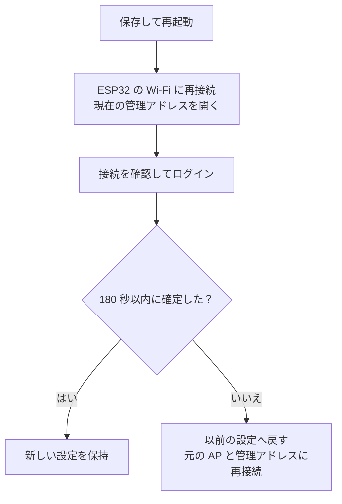

# esp32-socks5-gateway

[English](README.md) · [简体中文](README.zh-CN.md) · [日本語](README.ja.md)

**ESP32-S3** を小さな Wi-Fi ゲートウェイとして使うプロジェクトです。スマートフォンやパソコンを ESP32 が作る Wi-Fi に接続すると、IPv4 の TCP/UDP 通信を、**自分で用意した SOCKS5 サーバー**へ転送します。端末のアプリごとにプロキシを設定する必要はありません。

例えば、自宅のパソコンですでに SOCKS5 サービスを動かしており、2 台のスマートフォンから使いたい場合です。ESP32 は自宅の Wi-Fi に接続しながら、スマートフォン向けの別の Wi-Fi を作り、そのサービスへ通信を中継します。

ESP32 のネットワーク開発を学ぶ場合や、小規模な利用を想定した実験プロジェクトです。既定のハードウェアは **ESP32-S3 N16R8**、接続できる端末は最大 2 台です。既存の Wi-Fi ネットワークと、利用できる SOCKS5 サービスが必要です。

## 読む順番

- [接続の仕組み](#接続の仕組み)
- [性能と適した用途](#性能と適した用途)
- [ハードウェアとソフトウェアの準備](#ハードウェアとソフトウェアの準備)
- [上流の SOCKS5 サービスを準備する](#上流の-socks5-サービスを準備する)
- [ファームウェアと書き込み方法を選ぶ](#ファームウェアと書き込み方法を選ぶ)
- [書き込みと初回の接続](#書き込みと初回の接続)
- [日常の操作と状態 LED](#日常の操作と状態-led)
- [困ったときの確認手順](#困ったときの確認手順)
- [シリアルコンソールと設定の復旧](#シリアルコンソールと設定の復旧)
- [開発を続けるための説明とテスト](#開発を続けるための説明とテスト)
- [対応範囲とセキュリティ](#対応範囲とセキュリティ)

初めて使う場合は、この順に進めてください。テストや内部実装の説明は、接続できるようになってから読んでも構いません。

## 接続の仕組み

ESP32 は、同時に次の 2 つの Wi-Fi の役割を持ちます。

| 用語 | このプロジェクトでの意味 |
| --- | --- |
| AP、アクセスポイント | ESP32 が作る Wi-Fi。スマートフォンやパソコンが接続します |
| STA、ステーション | ESP32 が Wi-Fi のクライアントとして、既存のルーターに接続する側 |
| 上流 | ESP32 が利用する外部ネットワークやサービス。自宅の Wi-Fi や SOCKS5 サーバーなど |
| SOCKS5 | サーバーが端末の代わりに接続を作り、データを中継するプロキシの通信方式 |
| 透過プロキシ | 端末がゲートウェイの Wi-Fi に接続すると、ゲートウェイが転送を処理する仕組み。アプリごとのプロキシ設定は不要です |

**このプロジェクトが提供するのはゲートウェイのファームウェアです。SOCKS5 サービスは別途用意してください。** LAN 内のパソコンや、ESP32 から到達できるほかのホストで動かせます。ルーター上で動作させる必要はありません。

管理ページは ESP32 上で動作します。上流 Wi-Fi をまだ設定していなくても、ESP32 の AP に接続して管理ページを開けます。

## 性能と適した用途

次の数値は **ESP32-S3 N16R8 の実機で行った過去の測定**です。用途に合う速度か判断する目安にしてください。ダウンロードは ESP32 に接続した端末が受け取るデータ、アップロードは端末からテストサービスへ送るデータです。両方向を別々に測定しており、同時に最大負荷をかけた値ではありません。

| 場面 | ダウンロード Mbps | アップロード Mbps |
| --- | ---: | ---: |
| 端末 1 台、単一ストリーム | 16.43 | 16.25 |
| 端末 1 台、4 ストリーム並行の合計 | 24.49 | 21.25 |
| 端末 2 台：A は待機、B は単一ストリームで測定 | 14.21 | 11.97 |
| 端末 2 台：A は 1080P 動画再生、B は単一ストリームで測定 | 14.41 | 11.83 |

Android 端末と LAN 内のテストサービスを使い、各場面で 3 回完了した測定の中央値を記載しています。詳細な開発用診断は無効です。最後の 2 行だけが同じ測定セッション内の比較で、A の動画停止は報告されず、B の結果も A 待機時に近い値でした。最初の 2 行は別の過去の測定で、後のバージョンが速くなった / 遅くなった証拠にはなりません。記録は [性能と検証](docs/performance.md)を参照してください。

**Mbps はメガビット毎秒、MB/s はメガバイト毎秒です。およそ 8 で割ると換算できます。** 単一ストリームで約 16 Mbps は約 2 MB/s に相当します。4 ストリームの約 24 Mbps は合計であり、各ストリームや各端末に 24 Mbps ずつ割り当てられる意味ではありません。

| 容量 | 現在の上限 | 意味 |
| --- | ---: | --- |
| Wi-Fi 端末 | 2 台 | 1 台だけ許可する設定も可能 |
| 同時に中継する TCP 接続 | 64 | 2 台で共有。各端末が 64 接続ではありません |
| UDP flow | 32 | 別々の通信の転送状態。2 台で共有します |
| TCP 対応表 | 512 件 | 終了処理の記録も含み、512 件の同時転送ではありません |

各端末スロットが保持できる TCP 対応表は **256 件**までで、そのスロットの以前の接続の記録も含みます。TCP 待ち受け側の受け付けを待つ初期記録は **16 件**までです。端末が 1 台でも適用し、新規接続の集中で別スロットの記録領域を使い切ることを防ぎます。終了後の記録は最低 **120 秒（2×MSL）**保持するため、短い接続を大量に作ると、同時転送が 64 接続になる前に上限へ達する場合があります。帯域の均等配分は保証しません。

TCP の上流接続と SOCKS 交渉の期限は **15 秒**です。中継が **120 秒**アイドルになると終了し、容量が満杯なら **30 秒**以上アイドルで送受信キューが空の接続を回収できます。UDP のペイロードは 1 データグラム **1462 バイト**までです。長時間待機するアプリ、接続の集中、大きな UDP メッセージでは、これらの制限を考慮してください。

少数の端末での Web 閲覧、軽いファイル転送、ネットワーク開発の実験に向いています。動画の測定は、その条件で別端末と併用できたことを示しますが、動画には先読みがあり、実際のビットレートも不明です。すべての 1080P 動画が滑らかに再生できる保証ではありません。100 Mbps に近い転送、多数の端末、複数台の高ビットレート再生が必要なら、より高い速度と容量の機器を選んでください。

短時間の LAN 測定であり、インターネットへの速度保証ではありません。端末 2 台と AP/STA は 1 つの 2.4 GHz 無線を共有し、端末を増やしても帯域は倍になりません。電波、干渉、上流プロキシ、接続先サービス、接続数によって結果は変わります。クラウドのビルドやホスト回帰は開発環境と実装を確認できますが、実際の無線速度を代わりに測定できません。

## ハードウェアとソフトウェアの準備

### ハードウェア

| 項目 | 推奨 / 検証済み構成 | 注意点 |
| --- | --- | --- |
| 開発ボード | ESP32-S3 N16R8、デュアルコア 240 MHz | N16R8 は Flash 16 MB、PSRAM 8 MB を示します。購入前に仕様を確認してください |
| USB ケーブル | データ通信対応のケーブル | 充電専用のケーブルでは書き込みやシリアル通信ができません |
| 状態 LED | GPIO48 の WS2812 / NeoPixel 1 個 | LED のピンが異なるボードは現在の設定と合いません。管理ページで LED 出力を無効にできます |
| Wi-Fi ルーター | 利用できる 2.4 GHz ネットワーク | ESP32-S3 は 5 GHz のみのネットワークには接続できません |
| テスト用端末 | スマートフォンまたはパソコン 1 台 | まず 1 台で接続を確認してから、2 台目を追加します |

LED ピンが異なる場合は設定を合わせてください。現在の起動時チェックは 2 コア、ちょうど 16 MB の Flash、初期化済みの 8 MB PSRAM を要求します。`menuconfig` の変更だけでは別のメモリー容量に対応できません。初回は上記の構成を選び、既定のファームウェアを任意の ESP32 ボードにそのまま書き込まないでください。

### ソフトウェア

| 用途 | 必要なもの |
| --- | --- |
| ビルド済み BIN を書き込む | 公式 esptool 5.5.0（Python ≥ 3.10）、または Espressif の Windows GUI。必要に応じたシリアルドライバー。**ESP-IDF や独自スクリプトは不要**。[書き込みガイド](docs/flash-prebuilt.ja.md)を参照 |
| 自分でビルドする | Git、Python、指定 ESP-IDF/ツールチェーンと管理部品。[ビルドガイド](docs/build-and-flash.ja.md)の全手順を使用 |
| ゲートウェイを使う | ブラウザー、既存の 2.4 GHz Wi-Fi、後述の SOCKS5 サービス |

管理画面と初回設定画面は既定で英語です。ブラウザーの最優先言語が中国語（`zh` または `zh-*`）なら簡体字中国語、それ以外や判定できない場合は英語です。英語が優先で中国語が第 2 候補の場合も英語です。シリアルコマンドは英語です。

## 上流の SOCKS5 サービスを準備する

**ESP32 が接続するネットワークから**プロキシに到達できるか確認してください。サービスを動かすパソコン自身で使えても、ほかの端末から接続できるとは限りません。

| 必要な条件 | 説明 |
| --- | --- |
| SOCKS5 の待ち受けポート | HTTP プロキシのポートでは代用できません |
| NO AUTH に対応 | 現在のファームウェアは SOCKS5 のユーザー名 / パスワード認証に対応していません |
| UDP ASSOCIATE に対応 | 通常の DNS 問い合わせなどに必要です。TCP が通るだけでは全機能の確認になりません |
| LAN から到達できるアドレスで待ち受け | `127.0.0.1` だけで待ち受けるサービスには、ほかの端末から接続できません。プロキシソフトの説明に従って LAN アクセスを有効にしてください |
| ファイアウォールが通信を許可 | TCP の制御接続に加え、サーバーが返す UDP 中継先のアドレス / ポートも必要です。UDP ポートは SOCKS5 の待ち受けポートと同じとは限りません |

設定の例：

| 用途 | 例 |
| --- | --- |
| 既存の Wi-Fi 名 | `Home-WiFi` |
| ルーターのアドレス | `192.168.1.1` |
| SOCKS5 を動かすパソコンのアドレス | `192.168.1.2` |
| SOCKS5 のポート | `7897` |
| ESP32 AP / 管理ページのアドレス | `192.168.4.1` |
| DHCP で端末に通知する DNS | `1.1.1.1` |

これらは説明用の値です。自分のネットワークに合わせて変更してください。既定の `192.168.1.2:7897` に、実際のプロキシが存在するとは限りません。パソコン側の `127.0.0.1` を ESP32 に設定しないでください。ESP32 から見ると、これは ESP32 自身を指します。

上流の SOCKS5 サービスに [Xray](https://github.com/XTLS/Xray-core) を使う場合は、[VLESS + TCP + REALITY の完全なクライアント設定テンプレート](examples/xray-client-reality.json)と [フィールドの配置・使用ガイド（中国語）](examples/README.md)から始めてください。LAN 内のパソコンで動作します。すべての `<...>` プレースホルダーを自分の LAN アドレスとリモートノードの値に置き換えてから、設定の検証と起動を行ってください。既存の [SOCKS 設定例](examples/xray-socks-settings.json)と DNS 設定例は、既存設定に組み込むための部分設定です。上記の条件を満たすほかのプロキシソフトも使用できます。認証なしのプロキシは、信頼できるネットワークだけに公開してください。

## ファームウェアと書き込み方法を選ぶ

ビルド済み BIN なら **ESP-IDF の導入や独自スクリプトの実行は不要**です。コンパイル時の既定値を変えたい場合や開発する場合はソースからビルドします。

| 目的 | ガイド |
| --- | --- |
| 初回導入 / 初期化 | 完全な `*-factory.bin` を `0x0` に書くと、**保存設定を初期化**します。[Windows 11 / Linux ガイド](docs/flash-prebuilt.ja.md)に公式 CLI と Windows GUI の手順があります |
| 互換性のあるアプリ更新 | `*-sysupgrade.bin` を `0x10000` に書き、通常は設定を保持。既存のブートローダー、配置、設定との互換性が必要 |
| 自分でビルドする | [Windows 11 / Linux / WSL2 ビルドと書き込み](docs/build-and-flash.ja.md)：指定 SDK コミット、lwIP Override、設定、ビルド、パーティション、問題の確認 |

正式な[プロジェクト Release](https://github.com/noaic/esp32-socks5-gateway/releases)は `vYY.MM.DD` を使い、バージョン付き `*-factory.bin` と `*-sysupgrade.bin` だけを提供します。ハッシュは公開ページ、告知はソースアーカイブに含まれます。Actions には開発検証用の完全なパッケージを残します。リリースがなければソースからビルドしてください。既定イメージは後述の AP 情報を使い、上流 Wi-Fi の認証情報を含みません。**ESP32-S3 N16R8** が必要です。

ソースガイドに環境構築の全コマンドを残しています。`ip4.c` パッチと固定依存関係があるため、任意の新しい ESP-IDF へ置き換えることはできません。

## 書き込みと初回の接続

### 1. ボードにファームウェアを書き込む

[ビルド済みファームウェア](docs/flash-prebuilt.ja.md)または[ソースビルド](docs/build-and-flash.ja.md)のガイドに従います。ポート、Linux の権限、WSL2 の USB 接続も説明しています。**`*-factory.bin` は Flash 全体を消去しなくても NVS 設定を上書きします。**互換性のあるアプリ更新や個別イメージの書き込みは通常 NVS を保持します。日常の更新で Flash 全体を消去しないでください。

コンソールは **UART0、115200 baud** です。ログとコマンドにはボードの UART / USB-UART 接続口を優先します。ネイティブ USB で書き込めても、その接続口に UART ログが出るとは限りません。書き込み前にほかのシリアルツールを終了してください。

### 2. ESP32 の Wi-Fi に接続する

スマートフォンまたはパソコンから `ESP32-Transparent-Proxy` に接続し、ファームウェアパッケージの説明または自分のビルド設定にある AP パスワードを使います。変更していない場合の開発用既定値は `esp32proxy` です。通常の利用前に変更してください。

上流をまだ設定していないと、スマートフォンが「インターネットに接続できない Wi-Fi」と表示することがあります。接続を維持して、ローカルの管理ページを開いてください。初回の確認では、モバイルデータや自動ネットワーク切り替えを一時的に無効にすると、ESP32 経由の通信か判断しやすくなります。

### 3. 管理パスワードを設定する

ブラウザーのアドレス欄に **http://192.168.4.1/** を入力します。管理ページは HTTPS を提供しないので、明示的に `http://` を指定してください。

初回は管理パスワードを設定します。ユーザー名は固定で **`admin`**、パスワードは **12～64 バイト**です。長さを判断しやすい ASCII 文字の組み合わせを推奨します。保存後に管理ページを開き、`admin` と設定したパスワードでログインします。

3 種類のパスワードは、それぞれ用途が異なります。

| パスワード | 使用する側 | 設定場所 |
| --- | --- | --- |
| 上流 Wi-Fi パスワード | ESP32 が既存のルーターに接続 | 管理ページまたは `menuconfig` |
| AP Wi-Fi パスワード | 端末が ESP32 に接続 | 管理ページまたは `menuconfig` |
| 管理パスワード | `admin` として ESP32 の管理ページにログイン | 初回設定ページ、その後は管理ページ |

SOCKS5 は NO AUTH を使うため、SOCKS5 用のユーザー名 / パスワード欄はありません。

### 4. ネットワークとプロキシを設定する

「Network settings」（ネットワーク設定）を開いて入力します。以下は英語画面の項目名です。

| 画面の項目 | 入力する内容 |
| --- | --- |
| Upstream Wi-Fi SSID / password | 既存の 2.4 GHz Wi-Fi 名とパスワード |
| SOCKS5 IPv4 | ESP32 から到達できるサーバーの IPv4。例：`192.168.1.2` |
| SOCKS5 port | 実際の SOCKS5 待ち受けポート。例：`7897` |
| AP name / password | ESP32 が作る Wi-Fi 名とパスワード |
| Maximum clients | 最大接続台数。1 または 2 |
| DNS IPv4 advertised by DHCP | 端末が使う DNS。例：`1.1.1.1` |
| AP subnet third octet X | AP アドレスの 3 番目の数値。既定の 4 なら `192.168.4.1` |

**パスワード欄を空にすると、現在のパスワードを保持します。** 削除にはなりません。パスワードなしの上流 Wi-Fi を使う場合は「Upstream Wi-Fi has no password」を選択します。SSID とパスワードの長さは UTF-8 のバイト数で数えるため、日本語などは 1 文字が複数バイトになることがあります。

上流と AP のネットワークは重複できません。一般的な `255.255.255.0` のネットワークなら、上流 `192.168.1.x` と AP `192.168.4.x` は別です。上流も `192.168.4.x` の場合は、例えば X を 10 にすると管理先は `192.168.10.1` になります。画面は実際のネットマスクを使って重複を判断します。

### 5. 保存後に再接続し、設定を確定する

「Save and restart」（保存して再起動）を押すと、現在の接続が切れます。これは通常の動作です。新しい設定は試用状態になり、**再起動後 180 秒以内に「Confirm and keep configuration」（設定を確定）を押さないと、以前の設定に戻ります**。

AP 名 / パスワードを変えた場合は新しい値で接続し、X を変えた場合は新アドレスを開きます。管理パスワードも変えた場合は新しいものを使います。端末が古い IP を保持しているなら、Wi-Fi を切断して再接続し、DHCP でアドレスを取得し直してください。

確定前に STA が IPv4 を取得したか確認し、「Run connection diagnostics」（接続診断）を実行して、普通の Web ページを開いてみてください。確定後は「Check Internet now」（今すぐインターネットを検査）でも確認できます。自動のインターネット検査は、ネットワーク設定が確定するまで待機します。LED の色や「要求を受け付けた」という表示だけで、接続成功とは判断しないでください。

## 日常の操作と状態 LED

管理ページは最初に接続の概要、次の確認手順、接続端末を表示します。必要に応じてネットワーク設定、接続診断とインターネット検査、装置の詳細/資源/イベント、接続の保守を展開します。上流の基本設定をまとめ、ローカル AP、DNS、管理パスワードは設定内の折りたたみ項目に配置しています。上流 Wi-Fi の再接続、現在のプロキシ接続の終了、再起動も可能です。ダウンロードや動画が中断する場合があるため、操作後の結果を確認し、連続して同じ操作を送らないでください。

| 色 | 意味 | 次に確認すること |
| --- | --- | --- |
| 青 | 上流 Wi-Fi が未設定 | SSID とパスワードを入力 |
| 赤 | 上流は設定済みだが、STA が未準備 | 2.4 GHz Wi-Fi、パスワード、電波 |
| 紫 | AP+STA は準備済みだが、インターネット検査が未確認、検査中、または期限切れ | 診断結果と実際の Web ページへの接続 |
| 緑 | 直近の SOCKS5 経由 DNS / HTTP 検査が成功 | 検査先に最近到達できたことを示すだけで、すべてのサイトへの到達を保証しません |
| 黄 | ネットワークの重複、または検査先への連続した失敗 | 画面の重複警告と、失敗した検査段階 |

成功結果の有効期間は 10 分です。通常の自動検査は 5 分間隔で、失敗後は待ち時間を設けて再試行します。検査失敗による自動再起動はありません。自動検査や LED は無効にでき、その設定は保存されます。

**接続診断**は、上流 TCP ポート、SOCKS5 NO AUTH の交渉、UDP DNS の往復を確認します。**インターネット検査**は、さらにプロキシを通して選択した HTTP 検査先に接続します。どちらも、実際のアプリの動作と合わせて判断してください。

## 困ったときの確認手順

近い側から **端末 → ESP32 AP → 上流 Wi-Fi → SOCKS5 → DNS / 接続先サイト** の順に調べると、原因を絞りやすくなります。まず 1 台を動かしてから 2 台目を追加してください。

SDK、パッチ、ダウンロード、コンパイルの問題は[ビルド時の問題](docs/build-and-flash.ja.md#ビルド時の問題)を参照してください。

| 症状 | 最初に確認する点 |
| --- | --- |
| 起動時に PSRAM エラーが出る | ボードが N16R8 / Octal PSRAM 設定と合うか、電源が安定しているか |
| スマートフォンが「インターネットなし」と表示 | 初回設定では接続を維持。その後は STA とプロキシを確認し、テスト中のモバイルデータ切り替えを防ぐ |
| 管理ページが開かない | ESP32 AP に接続しているか、`http://`、X 変更後のアドレス、DHCP の再取得 |
| 管理ログインに失敗 | ユーザー名は `admin`。AP パスワードとは別。変更後は現在の管理パスワードを使う |
| STA が準備済みにならない | SSID、パスワード、2.4 GHz、電波。SSID が空なら接続を試みない |
| 上流 TCP ポート検査が失敗 | SOCKS5 の IP / ポート、LAN アクセス、ファイアウォール。`127.0.0.1` を使わない |
| TCP は通るが NO AUTH が失敗 | HTTP ポートを指定していないか、認証必須のプロキシではないか |
| 一部の Web ページは使えるが DNS / UDP が失敗 | UDP ASSOCIATE、返された中継先アドレス / UDP ポートへの到達、DNS 設定 |
| 保存した設定が元に戻る | 180 秒以内の確定。戻った場合は以前の AP 設定と管理アドレスを使う |
| `menuconfig` の変更がネットワークに反映されない | NVS に保存した値が優先。管理ページで変更するか、後述のコンパイル時の既定値への復旧を使う |
| 3 台目が接続できない | 最大 2 台、設定により 1 台。ほかの端末を切断してから接続 |

管理パスワードを忘れた場合や、設定変更後に管理ページへ戻れない場合は、シリアル復旧を使います。詳しくは [保守と復旧](docs/maintenance.md)を参照してください。

## シリアルコンソールと設定の復旧

コマンドは英語です。ESP-IDF monitor または文字を送信できるシリアルターミナルで入力し、各コマンドの後に Enter を押してください。

ファームウェアは `gateway> ` を表示し、受け付けた ASCII 文字を入力時にエコーします。Backspace/Delete は最後の文字を削除します。Enter（LF、CR、CRLF）は 1 回だけ実行し、再びプロンプトを表示します。`gateway> ` は入力せず、コマンドだけを入力してください。文字が二重に表示される場合はターミナルの **ローカルエコー**を無効にします。1 行は 95 バイト、空でないコマンドは毎秒 1 件までです。矢印キーによる編集や履歴には対応しません。ログが入力行に割り込む場合は `log warn` または `log off` を使ってください。

| コマンド | 用途 |
| --- | --- |
| `help` | ヘルプを表示 |
| `status` | 現在のネットワーク / リソース状態 |
| `events` | 最近のイベント |
| `log info` | 調査用のログを一時的に増やす |
| `log warn` | 日常用の WARN ログへ戻す |
| `log off` | ログを無効にする |
| `reset-admin` | 管理パスワードの解除を要求。現在のネットワークを保持 |
| `reset-network` | コンパイル時のネットワーク既定値への復旧を要求。管理パスワードを保持 |
| `confirm CODE` | 復旧を確認。CODE は装置が今表示したコードに置き換える |
| `cancel` | 確認待ちの復旧を取り消す |

`reset-*` はすぐには実行されません。装置が影響範囲と、**30 秒間有効で 1 回限りの確認コード**を表示します。説明を読んでから、`confirm` に続けてそのコードを入力してください。文字どおりの `CODE` は入力しません。成功すると再起動し、どちらの復旧も設定の試用状態を取り消します。

`reset-admin` 後は管理ページで新しいパスワードを設定します。`reset-network` 後はコンパイル時の AP 名 / パスワードを使い、管理先は `192.168.4.1` になります。`menuconfig` に Wi-Fi パスワードを入れていた場合は既定値にも含まれるため、「復旧」はすべてのパスワードを空にする意味ではありません。

Web の「Restore default configuration」（既定値に復旧）も管理パスワードを保持しますが、再起動後に 180 秒以内の確定が必要です。シリアルの `reset-network` は前述の 30 秒コードで確認します。**RST/EN と電源の入れ直しは再起動のみで、保存されたパスワードやネットワークを消しません。BOOT は復旧メニューには使いません。** 通常の復旧で Flash 全体を消去する必要はありません。

ログ保存と POSIX の行入力は[シリアルツールガイド](tools/README.md)を参照してください。

## 開発を続けるための説明とテスト

アプリは ESP-IDF のドライバー/サービス、FreeRTOS のタスク、lwIP TCP/IP スタックを使います。プロジェクト内の lwIP パッチが端末のパケットを取り込み、元の宛先を記録して応答のアドレスを復元します。TCP は SOCKS5 `CONNECT`、UDP は `UDP ASSOCIATE` で中継し、全体の SDK は変更しません。

[実装と開発ガイド](docs/development.ja.md)にはデータ経路、モジュール/ソース一覧、回帰コマンド、ツールの概要があります。[ビルドと書き込み](docs/build-and-flash.ja.md)には指定依存関係と lwIP の `apply` / `check` / `restore` 手順があります。

- [ドキュメント索引](docs/README.md)：現行ガイドと過去の記録。
- [保守と復旧](docs/maintenance.md)：設定の試用と復旧の範囲。
- [性能と検証](docs/performance.md)：過去の測定とテストの限界。
- [ツールガイド](tools/README.md)：UART 記録、調査、速度測定、パッケージ作成。

生成ファイル、ログ、個人設定、ファームウェアには機密情報が含まれる場合があります。共有前に `git status` と内容を確認してください。

## 対応範囲とセキュリティ

IPv4、SOCKS5 NO AUTH、TCP と UDP の転送に対応します。IPv6、HTTP 上流プロキシ、SOCKS5 アカウント認証、BLE、OTA、VLESS/REALITY、ボード上の GeoIP/GeoSite 振り分け、NTP には対応していません。透過転送では IPv4 ヘッダーのオプションと IPv4 フラグメントを拒否します。1462 バイトを超える UDP ペイロードと、分割された SOCKS UDP パケット（`FRAG != 0`）も破棄します。IPv4 と SOCKS のフラグメント制限は別々のものです。ブロードキャスト、マルチキャスト、特殊な P2P 動作は対象外で、すべての QUIC 利用場面を検証したわけではありません。

2 台の端末は 1 つの 2.4 GHz 無線と転送容量を共有します。接続台数の制限は、帯域の均等配分を保証しません。多数の利用者、高い速度、完全なルーター機能が必要な装置の代替には向きません。PSRAM があっても Wi-Fi/lwIP は限られた内部 RAM に依存します。長期安定性、Flash 書き込み中の電源断、実際の上流障害は追加の検証が必要です。

管理ページは AP 側だけで公開しますが、HTTP を使います。管理パスワードとネットワーク設定は NVS に暗号化せず保存します。シリアル復旧は物理アクセスを前提とし、ログイン認証はありません。セキュアブートと Flash 暗号化も有効にしていません。信頼できる端末とネットワークで初期設定し、自分のパスワードを使い、管理ページや認証なしのプロキシをインターネットに公開しないでください。

## ライセンスと上流の表示

本プロジェクトの独自コードは [MIT ライセンス](LICENSE)です。第三者のコードと改編した例は、それぞれのライセンスと著作権表示を保持します。[第三者の表示](THIRD_PARTY_NOTICES.md)を参照してください。ファームウェアパッケージには適用される許諾文を含めます。MIT は上流のライセンスを置き換えません。
