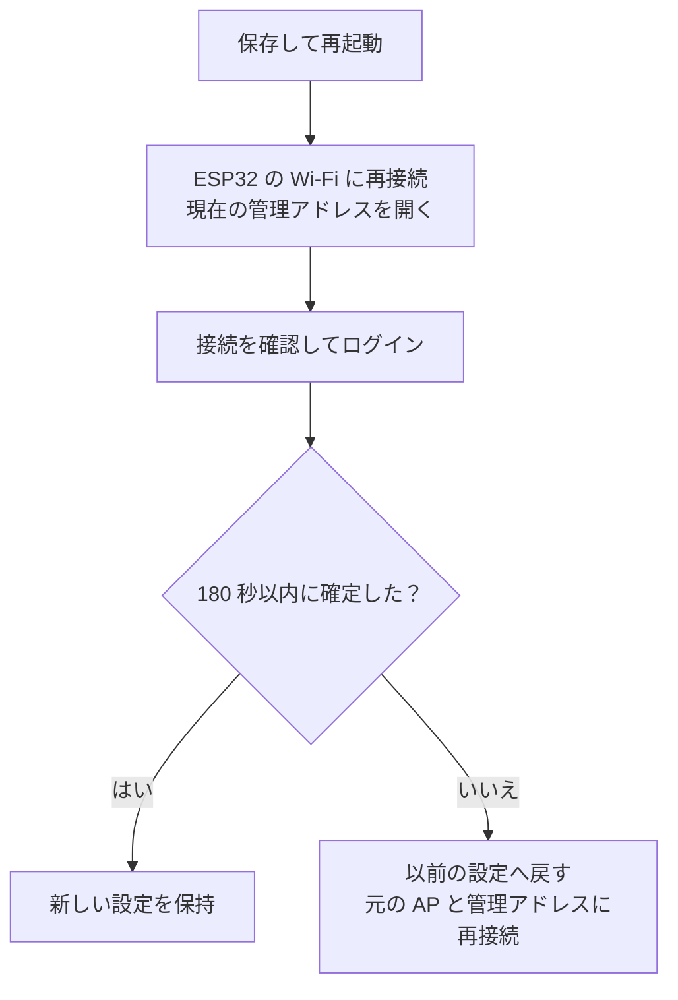

# esp32-socks5-gateway

[English](README.md) · [简体中文](README.zh-CN.md) · [日本語](README.ja.md)

**ESP32-S3** を小さな Wi-Fi ゲートウェイとして使うプロジェクトです。スマートフォンやパソコンを ESP32 が作る Wi-Fi に接続すると、IPv4 の TCP/UDP 通信を、**自分で用意した SOCKS5 サーバー**へ転送します。端末のアプリごとにプロキシを設定する必要はありません。

例えば、自宅のパソコンですでに SOCKS5 サービスを動かしており、2 台のスマートフォンから使いたい場合です。ESP32 は自宅の Wi-Fi に接続しながら、スマートフォン向けの別の Wi-Fi を作り、そのサービスへ通信を中継します。

ESP32 のネットワーク開発を学ぶ場合や、小規模な利用を想定した実験プロジェクトです。既定のハードウェアは **ESP32-S3 N16R8**、接続できる端末は最大 2 台です。既存の Wi-Fi ネットワークと、利用できる SOCKS5 サービスが必要です。

## 読む順番

- [接続の仕組み](#接続の仕組み)
- [性能と適した用途](#性能と適した用途)
- [ハードウェアとソフトウェアの準備](#ハードウェアとソフトウェアの準備)
- [上流の SOCKS5 サービスを準備する](#上流の-socks5-サービスを準備する)
- [開発ツールのインストールとビルド](#開発ツールのインストールとビルド)
- [書き込みと初回の接続](#書き込みと初回の接続)
- [日常の操作と状態 LED](#日常の操作と状態-led)
- [困ったときの確認手順](#困ったときの確認手順)
- [シリアルコンソールと設定の復旧](#シリアルコンソールと設定の復旧)
- [開発を続けるための説明とテスト](#開発を続けるための説明とテスト)
- [対応範囲とセキュリティ](#対応範囲とセキュリティ)

初めて使う場合は、この順に進めてください。テストや内部実装の説明は、接続できるようになってから読んでも構いません。

## 接続の仕組み


ESP32 は、同時に次の 2 つの Wi-Fi の役割を持ちます。

| 用語 | このプロジェクトでの意味 |
| --- | --- |
| AP、アクセスポイント | ESP32 が作る Wi-Fi。スマートフォンやパソコンが接続します |
| STA、ステーション | ESP32 が Wi-Fi のクライアントとして、既存のルーターに接続する側 |
| 上流 | ESP32 が利用する外部ネットワークやサービス。自宅の Wi-Fi や SOCKS5 サーバーなど |
| SOCKS5 | サーバーが端末の代わりに接続を作り、データを中継するプロキシの通信方式 |
| 透過プロキシ | 端末がゲートウェイの Wi-Fi に接続すると、ゲートウェイが転送を処理する仕組み。アプリごとのプロキシ設定は不要です |

**このプロジェクトが提供するのはゲートウェイのファームウェアです。SOCKS5 サービスは別途用意してください。** LAN 内のパソコンや、ESP32 から到達できるほかのホストで動かせます。ルーター上で動作させる必要はありません。

管理ページは ESP32 上で動作します。上流 Wi-Fi をまだ設定していなくても、ESP32 の AP に接続して管理ページを開けます。

## 性能と適した用途

次の数値は **ESP32-S3 N16R8 の実機で行った過去の測定**です。用途に合う速度か判断する目安にしてください。ダウンロードは ESP32 に接続した端末が受け取るデータ、アップロードは端末からテストサービスへ送るデータです。両方向を別々に測定しており、同時に最大負荷をかけた値ではありません。

| 場面 | ダウンロード Mbps | アップロード Mbps |
| --- | ---: | ---: |
| 端末 1 台、単一ストリーム | 16.43 | 16.25 |
| 端末 1 台、4 ストリーム並行の合計 | 24.49 | 21.25 |
| 端末 2 台：A は待機、B は単一ストリームで測定 | 14.21 | 11.97 |
| 端末 2 台：A は 1080P 動画再生、B は単一ストリームで測定 | 14.41 | 11.83 |

Android 端末と LAN 内のテストサービスを使い、各場面で 3 回完了した測定の中央値を記載しています。詳細な開発用診断は無効です。最後の 2 行だけが同じ測定セッション内の比較で、A の動画停止は報告されず、B の結果も A 待機時に近い値でした。最初の 2 行は別の過去の測定で、後のバージョンが速くなった / 遅くなった証拠にはなりません。記録は [性能と検証](docs/performance.md)を参照してください。

**Mbps はメガビット毎秒、MB/s はメガバイト毎秒です。およそ 8 で割ると換算できます。** 単一ストリームで約 16 Mbps は約 2 MB/s に相当します。4 ストリームの約 24 Mbps は合計であり、各ストリームや各端末に 24 Mbps ずつ割り当てられる意味ではありません。

| 容量 | 現在の上限 | 意味 |
| --- | ---: | --- |
| Wi-Fi 端末 | 2 台 | 1 台だけ許可する設定も可能 |
| 同時に中継する TCP 接続 | 64 | 2 台で共有。各端末が 64 接続ではありません |
| UDP flow | 32 | 別々の通信の転送状態。2 台で共有します |
| TCP 対応表 | 512 件 | 終了処理の記録も含み、512 件の同時転送ではありません |

少数の端末での Web 閲覧、軽いファイル転送、ネットワーク開発の実験に向いています。動画の測定は、その条件で別端末と併用できたことを示しますが、動画には先読みがあり、実際のビットレートも不明です。すべての 1080P 動画が滑らかに再生できる保証ではありません。100 Mbps に近い転送、多数の端末、複数台の高ビットレート再生が必要なら、より高い速度と容量の機器を選んでください。

短時間の LAN 測定であり、インターネットへの速度保証ではありません。端末 2 台と AP/STA は 1 つの 2.4 GHz 無線を共有し、端末を増やしても帯域は倍になりません。電波、干渉、上流プロキシ、接続先サービス、接続数によって結果は変わります。クラウドのビルドやホスト回帰は開発環境と実装を確認できますが、実際の無線速度を代わりに測定できません。

## ハードウェアとソフトウェアの準備

### ハードウェア

| 項目 | 推奨 / 検証済み構成 | 注意点 |
| --- | --- | --- |
| 開発ボード | ESP32-S3 N16R8、デュアルコア 240 MHz | N16R8 は Flash 16 MB、PSRAM 8 MB を示します。購入前に仕様を確認してください |
| Flash | 16 MB、DIO、80 MHz | ファームウェアと保存する設定に使用します |
| PSRAM | 8 MB、Octal、80 MHz | 追加の作業用メモリ。既定のビルドでは起動時にテストします |
| USB ケーブル | データ通信対応のケーブル | 充電専用のケーブルでは書き込みやシリアル通信ができません |
| 状態 LED | GPIO48 の WS2812 / NeoPixel 1 個 | LED のピンが異なるボードは現在の設定と合いません。管理ページで LED 出力を無効にできます |
| Wi-Fi ルーター | 利用できる 2.4 GHz ネットワーク | ESP32-S3 は 5 GHz のみのネットワークには接続できません |
| テスト用端末 | スマートフォンまたはパソコン 1 台 | まず 1 台で接続を確認してから、2 台目を追加します |

ESP32 の種類、Flash/PSRAM の容量、LED のピンが違う場合、ハードウェア設定の変更が必要になることがあります。初回は上記の構成を選び、既定のファームウェアを任意の ESP32 ボードにそのまま書き込まないでください。

### ソフトウェア

- **ESP-IDF**：ビルドと書き込みに使う、Espressif の開発ツールです。後述の正確なリビジョンが必要です。
- **Git、Python 3.10 以降**と、ESP-IDF の公式インストールガイドに記載されたシステム依存パッケージ。
- IPv4、認証なし、UDP 転送に対応した **SOCKS5 サービス**。
- 管理ページを開くブラウザー。現在のファームウェアの Web 画面は中国語、シリアルコマンドは英語です。このガイドでは必要な中国語のボタン名も示します。
- ホスト回帰テストには Linux の GCC/binutils、フロントエンドテストには Node.js が必要です。ファームウェアのビルドに Node.js は不要です。

ESP-IDF のインストーラーは、ESP32 用のファームウェアを作る GCC `15.2.0` クロスコンパイラーを取得します。ホストテストでは、パソコンのシステム GCC を使います。ファームウェアの部品である cJSON `1.7.19` と led_strip `3.0.3` は `dependencies.lock` に記録され、初回のビルド時に自動で取得されます。

## 上流の SOCKS5 サービスを準備する

**ESP32 が接続するネットワークから**プロキシに到達できるか確認してください。サービスを動かすパソコン自身で使えても、ほかの端末から接続できるとは限りません。

| 必要な条件 | 説明 |
| --- | --- |
| SOCKS5 の待ち受けポート | HTTP プロキシのポートでは代用できません |
| NO AUTH に対応 | 現在のファームウェアは SOCKS5 のユーザー名 / パスワード認証に対応していません |
| UDP ASSOCIATE に対応 | 通常の DNS 問い合わせなどに必要です。TCP が通るだけでは全機能の確認になりません |
| LAN から到達できるアドレスで待ち受け | `127.0.0.1` だけで待ち受けるサービスには、ほかの端末から接続できません。プロキシソフトの説明に従って LAN アクセスを有効にしてください |
| ファイアウォールが通信を許可 | TCP の制御接続に加え、サーバーが返す UDP 中継先のアドレス / ポートも必要です。UDP ポートは SOCKS5 の待ち受けポートと同じとは限りません |

設定の例：

| 用途 | 例 |
| --- | --- |
| 既存の Wi-Fi 名 | `Home-WiFi` |
| ルーターのアドレス | `192.168.1.1` |
| SOCKS5 を動かすパソコンのアドレス | `192.168.1.2` |
| SOCKS5 のポート | `7897` |
| ESP32 AP / 管理ページのアドレス | `192.168.4.1` |
| DHCP で端末に通知する DNS | `1.1.1.1` |

これらは説明用の値です。自分のネットワークに合わせて変更してください。既定の `192.168.1.2:7897` に、実際のプロキシが存在するとは限りません。パソコン側の `127.0.0.1` を ESP32 に設定しないでください。ESP32 から見ると、これは ESP32 自身を指します。

Xray を使う場合は、[SOCKS 設定例](examples/xray-socks-settings.json)と `examples/` の DNS 設定例を参照してください。これらは設定の一部分で、自分の完全な Xray 設定に組み込む必要があります。上記の条件を満たすほかのプロキシソフトも使用できます。認証なしのプロキシは、信頼できるネットワークだけに公開してください。

## 開発ツールのインストールとビルド

以下のコマンドは **Linux / macOS / WSL の Bash** 向けです。Windows ネイティブ環境では [ESP-IDF 公式入門ガイド](https://docs.espressif.com/projects/esp-idf/en/latest/esp32s3/get-started/index.html)を参照し、インストーラーの開発用ターミナルまたは EIM の有効化スクリプトを使ってください。必要に応じて `python3` を `python` に読み替えます。

WSL でもビルドできますが、USB デバイスが自動で WSL に現れるとは限りません。書き込み前に使用環境の方法で USB を接続 / 転送するか、Windows の ESP-IDF 開発用ターミナルを使ってください。

### 1. 対応する ESP-IDF をインストールする

透過転送には、小さな lwIP パッチを使っています。lwIP は ESP-IDF 内部で TCP/IP 通信を処理するライブラリです。パッチは具体的なソースコードに依存するため、「v6.1」という表示だけでは不十分です。次のコミットを合わせてください。

| 依存関係 | 正確なコミット |
| --- | --- |
| ESP-IDF v6.1 | `fff9895c82d744c7237be8847347bdd1b07c6643` |
| esp-lwIP | `c6f2f878e7b0f86033214b85547d579be43351e3` |

まず公式ガイドに従ってシステム依存パッケージを準備します。その後、**まだ存在しない新しいディレクトリ**にインストールしてください。この例では `esp-idf-gateway` を使い、ほかの ESP-IDF 環境を残せるようにします。

```bash
mkdir -p ~/esp
cd ~/esp

git clone --no-checkout --depth 1 https://github.com/espressif/esp-idf.git esp-idf-gateway
cd esp-idf-gateway
git fetch --depth 1 origin fff9895c82d744c7237be8847347bdd1b07c6643
git checkout --detach fff9895c82d744c7237be8847347bdd1b07c6643
git submodule update --init --recursive --depth 1

./install.sh esp32s3
python3 tools/idf_tools.py install cmake ninja
source ./export.sh
```

`git submodule update` は、対応する lwIP を含む関連ソースを取得します。インストールではコンパイラーと Python の依存パッケージもダウンロードします。各コマンドが正常に終わってから先へ進んでください。

両方の正確なコミットがすでにインストールされているなら、既存の環境を有効にするだけで構いません。**新しいターミナルを開くたびに有効化が必要です。** 上記のディレクトリなら、次のように実行します。

```bash
source ~/esp/esp-idf-gateway/export.sh
idf.py --version
git -C "$IDF_PATH" rev-parse HEAD
```

最後のコマンドが表の ESP-IDF コミットを表示することを確認してください。EIM を使う場合は、インストール時に作成された有効化スクリプトを使い、同じようにコミットを確認します。

### 2. プロジェクトを取得し、lwIP を準備する

```bash
git clone https://github.com/noaic/esp32-socks5-gateway.git ~/esp32-socks5-gateway
cd ~/esp32-socks5-gateway
python3 tools/prepare_lwip.py apply
python3 tools/prepare_lwip.py check
```

すでに取得済みなら、そのディレクトリに移動してください。以降のプロジェクトコマンドは、**`CMakeLists.txt` があるプロジェクトのルート**で実行します。

準備スクリプトはコミットとソースのハッシュを確認し、プロジェクト内に生成する `components/lwip` にパッチを適用します。グローバルの ESP-IDF は変更しません。不一致が出た場合は開発環境を確認し、パッチを無理に適用しないでください。

### 3. 設定してビルドする

```bash
idf.py menuconfig
```

`Transparent gateway Wi-Fi` を開きます。

- 初回は上流の `SSID` を空にして、管理ページから後で設定できます。この場合 AP は起動しますが、上流 Wi-Fi への接続は試みません。
- `SoftAP WPA2 password` を自分の AP パスワードに変更します。ASCII 文字で 8～63 文字にしてください。
- AP 名は `ESP32-Transparent-Proxy` のままで構いません。
- ほかのハードウェア / ネットワーク設定は、まず既定値を使います。通常の利用で `Temporary gateway diagnostics` を有効にする必要はありません。

保存してメニューを閉じ、次を実行します。

```bash
idf.py build
idf.py size
```

`build` はファームウェアを生成し、`size` は容量を表示します。この段階ではボードに書き込みません。初回は関連部品をダウンロードするため、次回以降より時間がかかります。

`sdkconfig.defaults` は ESP32-S3、Flash、PSRAM などの初期設定を提供します。既存の `sdkconfig` を上書きしないため、古い設定を使う場合もボードの仕様を確認してください。

## 書き込みと初回の接続

### 1. ボードにファームウェアを書き込む

データ対応 USB ケーブルで接続し、実際のシリアルポートを確認します。Linux では `/dev/ttyACM0` や `/dev/ttyUSB0`、macOS では `/dev/cu.*`、Windows では `COM5` などが例です。名前は環境により異なります。

ESP-IDF を有効にしたプロジェクトのターミナルから、例えば次を実行します。

```bash
idf.py -p /dev/ttyACM0 flash monitor
```

Windows の開発用ターミナルでは、例えば次の指定になります。

```text
idf.py -p COM5 flash monitor
```

`flash` は書き込み、`monitor` は **115200 baud** のシリアルログ表示です。ESP-IDF monitor は `Ctrl+]` で終了できます。書き込み、monitor、ほかのシリアルツールで同じポートを同時に使わないでください。

### 2. ESP32 の Wi-Fi に接続する

スマートフォンまたはパソコンから `ESP32-Transparent-Proxy` に接続し、`menuconfig` で設定した AP パスワードを使います。変更していない場合の開発用既定値は `esp32proxy` です。通常の利用前に変更してください。

上流をまだ設定していないと、スマートフォンが「インターネットに接続できない Wi-Fi」と表示することがあります。接続を維持して、ローカルの管理ページを開いてください。初回の確認では、モバイルデータや自動ネットワーク切り替えを一時的に無効にすると、ESP32 経由の通信か判断しやすくなります。

### 3. 管理パスワードを設定する

ブラウザーのアドレス欄に **http://192.168.4.1/** を入力します。管理ページは HTTPS を提供しないので、明示的に `http://` を指定してください。

初回は管理パスワードを設定します。ユーザー名は固定で **`admin`**、パスワードは **12～64 バイト**です。長さを判断しやすい ASCII 文字の組み合わせを推奨します。保存後に管理ページを開き、`admin` と設定したパスワードでログインします。

3 種類のパスワードは、それぞれ用途が異なります。

| パスワード | 使用する側 | 設定場所 |
| --- | --- | --- |
| 上流 Wi-Fi パスワード | ESP32 が既存のルーターに接続 | 管理ページまたは `menuconfig` |
| AP Wi-Fi パスワード | 端末が ESP32 に接続 | 管理ページまたは `menuconfig` |
| 管理パスワード | `admin` として ESP32 の管理ページにログイン | 初回設定ページ、その後は管理ページ |

SOCKS5 は NO AUTH を使うため、SOCKS5 用のユーザー名 / パスワード欄はありません。

### 4. ネットワークとプロキシを設定する

「网关配置」（ゲートウェイ設定）に入力します。

| 画面の項目 | 入力する内容 |
| --- | --- |
| 上游 Wi-Fi SSID / 密码 | 既存の 2.4 GHz Wi-Fi 名とパスワード |
| SOCKS5 IPv4 | ESP32 から到達できるサーバーの IPv4。例：`192.168.1.2` |
| SOCKS5 端口 | 実際の SOCKS5 待ち受けポート。例：`7897` |
| AP 名称 / 密码 | ESP32 が作る Wi-Fi 名とパスワード |
| 最大接入数 | 最大接続台数。1 または 2 |
| DHCP 下发的 DNS IPv4 | 端末が使う DNS。例：`1.1.1.1` |
| AP 网段第三段 X | AP アドレスの 3 番目の数値。既定の 4 なら `192.168.4.1` |

**パスワード欄を空にすると、現在のパスワードを保持します。** 削除にはなりません。パスワードなしの上流 Wi-Fi を使う場合は「上游 Wi-Fi 无密码」を選択します。SSID とパスワードの長さは UTF-8 のバイト数で数えるため、日本語などは 1 文字が複数バイトになることがあります。

上流と AP のネットワークは重複できません。一般的な `255.255.255.0` のネットワークなら、上流 `192.168.1.x` と AP `192.168.4.x` は別です。上流も `192.168.4.x` の場合は、例えば X を 10 にすると管理先は `192.168.10.1` になります。画面は実際のネットマスクを使って重複を判断します。

### 5. 保存後に再接続し、設定を確定する

「保存并重启」（保存して再起動）を押すと、現在の接続が切れます。これは通常の動作です。新しい設定は試用状態になり、**再起動後 180 秒以内に「确认保留配置」（設定を確定）を押さないと、以前の設定に戻ります**。



AP 名 / パスワードを変えた場合は新しい値で接続し、X を変えた場合は新アドレスを開きます。管理パスワードも変えた場合は新しいものを使います。端末が古い IP を保持しているなら、Wi-Fi を切断して再接続し、DHCP でアドレスを取得し直してください。

確定前に STA が IPv4 を取得したか確認し、「运行连接诊断」（接続診断）を実行して、普通の Web ページを開いてみてください。確定後は「立即检查互联网」（今すぐインターネットを検査）でも確認できます。自動のインターネット検査は、ネットワーク設定が確定するまで待機します。LED の色や「要求を受け付けた」という表示だけで、接続成功とは判断しないでください。

## 日常の操作と状態 LED

管理ページでは、動作状態、接続端末、端末別のプロキシ通信量、最近のイベントを確認できます。上流 Wi-Fi の再接続、現在のプロキシ接続の終了、再起動も可能です。ダウンロードや動画が中断する場合があるため、操作後の結果を確認し、連続して同じ操作を送らないでください。

| 色 | 意味 | 次に確認すること |
| --- | --- | --- |
| 青 | 上流 Wi-Fi が未設定 | SSID とパスワードを入力 |
| 赤 | 上流は設定済みだが、STA が未準備 | 2.4 GHz Wi-Fi、パスワード、電波 |
| 紫 | AP+STA は準備済みだが、インターネット検査が未確認、検査中、または期限切れ | 診断結果と実際の Web ページへの接続 |
| 緑 | 直近の SOCKS5 経由 DNS / HTTP 検査が成功 | 検査先に最近到達できたことを示すだけで、すべてのサイトへの到達を保証しません |
| 黄 | ネットワークの重複、または検査先への連続した失敗 | 画面の重複警告と、失敗した検査段階 |

成功結果の有効期間は 10 分です。通常の自動検査は 5 分間隔で、失敗後は待ち時間を設けて再試行します。検査失敗による自動再起動はありません。自動検査や LED は無効にでき、その設定は保存されます。

**接続診断**は、上流 TCP ポート、SOCKS5 NO AUTH の交渉、UDP DNS の往復を確認します。**インターネット検査**は、さらにプロキシを通して選択した HTTP 検査先に接続します。どちらも、実際のアプリの動作と合わせて判断してください。

## 困ったときの確認手順

近い側から **端末 → ESP32 AP → 上流 Wi-Fi → SOCKS5 → DNS / 接続先サイト** の順に調べると、原因を絞りやすくなります。まず 1 台を動かしてから 2 台目を追加してください。

| 症状 | 最初に確認する点 |
| --- | --- |
| `idf.py` が見つからない | 今のターミナルで ESP-IDF を有効にしてから、プロジェクトへ移動 |
| lwIP の revision / hash が一致しない | `$IDF_PATH` のコミット、サブモジュールの取得。パッチを強制しない |
| ビルド中に部品をダウンロードできない | 最初のダウンロードエラーと、GitHub・Espressif のダウンロード先・部品レジストリへの接続。TLS / ハッシュ検証は無効にしない |
| シリアルポートがない / 書き込めない | データ対応ケーブル、ボードの USB 接続先、ドライバー、ポート権限、WSL の USB 接続、ほかのツールによる使用 |
| 起動時に PSRAM エラーが出る | ボードが N16R8 / Octal PSRAM 設定と合うか、電源が安定しているか |
| スマートフォンが「インターネットなし」と表示 | 初回設定では接続を維持。その後は STA とプロキシを確認し、テスト中のモバイルデータ切り替えを防ぐ |
| 管理ページが開かない | ESP32 AP に接続しているか、`http://`、X 変更後のアドレス、DHCP の再取得 |
| 管理ログインに失敗 | ユーザー名は `admin`。AP パスワードとは別。変更後は現在の管理パスワードを使う |
| STA が準備済みにならない | SSID、パスワード、2.4 GHz、電波。SSID が空なら接続を試みない |
| 上流 TCP ポート検査が失敗 | SOCKS5 の IP / ポート、LAN アクセス、ファイアウォール。`127.0.0.1` を使わない |
| TCP は通るが NO AUTH が失敗 | HTTP ポートを指定していないか、認証必須のプロキシではないか |
| 一部の Web ページは使えるが DNS / UDP が失敗 | UDP ASSOCIATE、返された中継先アドレス / UDP ポートへの到達、DNS 設定 |
| 保存した設定が元に戻る | 180 秒以内の確定。戻った場合は以前の AP 設定と管理アドレスを使う |
| `menuconfig` の変更がネットワークに反映されない | NVS に保存した値が優先。管理ページで変更するか、後述のコンパイル時の既定値への復旧を使う |
| 3 台目が接続できない | 最大 2 台、設定により 1 台。ほかの端末を切断してから接続 |

管理パスワードを忘れた場合や、設定変更後に管理ページへ戻れない場合は、シリアル復旧を使います。詳しくは [保守と復旧](docs/maintenance.md)を参照してください。

## シリアルコンソールと設定の復旧

コマンドは英語です。ESP-IDF monitor または文字を送信できるシリアルターミナルで入力し、各コマンドの後に Enter を押してください。

| コマンド | 用途 |
| --- | --- |
| `help` | ヘルプを表示 |
| `status` | 現在のネットワーク / リソース状態 |
| `events` | 最近のイベント |
| `log info` | 調査用のログを一時的に増やす |
| `log warn` | 日常用の WARN ログへ戻す |
| `log off` | ログを無効にする |
| `reset-admin` | 管理パスワードの解除を要求。現在のネットワークを保持 |
| `reset-network` | コンパイル時のネットワーク既定値への復旧を要求。管理パスワードを保持 |
| `confirm CODE` | 復旧を確認。CODE は装置が今表示したコードに置き換える |
| `cancel` | 確認待ちの復旧を取り消す |

`reset-*` はすぐには実行されません。装置が影響範囲と、**30 秒間有効で 1 回限りの確認コード**を表示します。説明を読んでから、`confirm` に続けてそのコードを入力してください。文字どおりの `CODE` は入力しません。成功すると再起動し、どちらの復旧も設定の試用状態を取り消します。

`reset-admin` 後は管理ページで新しいパスワードを設定します。`reset-network` 後はコンパイル時の AP 名 / パスワードを使い、管理先は `192.168.4.1` になります。`menuconfig` に Wi-Fi パスワードを入れていた場合は既定値にも含まれるため、「復旧」はすべてのパスワードを空にする意味ではありません。

Web の「恢复默认配置」（既定値に復旧）も管理パスワードを保持しますが、再起動後に 180 秒以内の確定が必要です。シリアルの `reset-network` は前述の 30 秒コードで確認します。**RST/EN と電源の入れ直しは再起動のみで、保存されたパスワードやネットワークを消しません。BOOT は復旧メニューには使いません。** 通常の復旧で Flash 全体を消去する必要はありません。

ログ取得とコマンド送信を 1 つの接続で行う場合は、プロジェクトのルートで次を実行します。

```bash
python tools/uart_capture.py --port /dev/ttyACM0 --no-reset --interactive --timestamps --seconds 0
```

先にほかのシリアルツールを終了してください。`--seconds 0` は中断まで読み続けます。`--no-reset` はツールによる能動的なリセットを避けますが、アダプターやドライバーによってリセット信号が影響を受ける場合はあります。

## 開発を続けるための説明とテスト

### 実装を簡単に理解する

ESP32 を、データを受け取り、相手に渡す中継役として考えると分かりやすくなります。

- **TCP** は、多くの Web 接続などで使う、確実な転送を行う仕組みです。ゲートウェイは端末が接続したい相手を記録し、SOCKS5 `CONNECT` で代理接続を依頼して、応答を端末へ返します。
- **UDP** は、通常の DNS 問い合わせや一部のリアルタイム通信で使います。`UDP ASSOCIATE` で中継先を取得し、宛先情報を付けて転送します。別々の通信はそれぞれの状態を保持します。
- **DNS** は、名前を IP アドレスに変換します。既定の DHCP は端末に `1.1.1.1` を通知します。ESP32 にローカル DNS サービスはなく、通常の DNS UDP 通信も SOCKS5 経由です。
- **NVS** は、Flash に設定を保存する領域です。そのため通常の再起動で設定が残り、アプリの再書き込みでも既存のネットワーク設定が自動では置き換わりません。

全体の容量は、同時に中継する TCP 接続が 64、UDP flow が 32 です。TCP の宛先や終了処理を記録する 512 件の対応表もありますが、**TCP を 512 接続同時に転送できる意味ではありません**。再送など TCP の基本動作は lwIP が担当し、アプリの固定ループで複数の接続を処理します。

### Web ページへの TCP 接続を追う

スマートフォンが Web サイトの `203.0.113.10:443` に接続するとします。このアドレスは説明用の例です。

1. スマートフォンは、デフォルトゲートウェイである ESP32 にパケットを送ります。
2. プロジェクト内の lwIP パッチが IPv4 の処理経路からゲートウェイのコードを呼びます。パケットを検証し、端末と元の宛先を記録して、ESP32 のローカル待ち受けポートへ向け直します。受信側が検証できるようチェックサムも更新します。
3. lwIP がローカル TCP 接続を処理し、アプリは socket からデータを読みます。socket はプログラムがネットワークデータを送受信するためのインターフェースで、アプリ自身が TCP の接続交渉や再送を実装する必要はありません。
4. TCP の転送ループが上流と SOCKS5 NO AUTH を交渉し、`CONNECT` で元の宛先への接続を依頼します。その後、2 つの接続間でデータを中継します。
5. スマートフォンへ返す TCP パケットは、対応表から元の接続先アドレスへ戻し、チェックサムを修正します。端末からは Web サイトとの接続に見えます。


「透過」は端末からの使い方を示します。元の TCP パケットをそのまま SOCKS5 に入れるのではなく、lwIP が接続を処理してから、その中のデータを中継します。HTTPS の暗号化はブラウザーと Web サイトが担当し、ゲートウェイはページ内容を復号しません。

### UDP、並行処理、設定保存の仕組み

UDP 自体には TCP のような接続手順がありませんが、SOCKS5 の UDP 転送には TCP の制御接続が必要です。各 UDP flow は端末と宛先を記録し、`UDP ASSOCIATE` を交渉して、SOCKS5 の宛先ヘッダー付き UDP データを中継先へ送ります。返信は flow と端末の所属を確認してから配信します。DNS 用に一部の容量と交渉機会を確保し、ほかの UDP 通信が資源を使い切って名前解決ができなくなる状況を減らしています。

TCP と UDP はそれぞれ固定の転送ループを使います。今送受信できる接続を確認し、一部のデータを処理して次の接続に移ります。接続ごとにタスクは作りません。キュー容量と待ち時間には上限があり、大きな TCP データバッファーは PSRAM、頻繁に参照する TCP 状態は内部 RAM に置きます。メモリ使用量を制御する仕組みで、無線帯域や接続総数の上限がなくなるわけではありません。

設定管理は現在の値と以前の値を保存します。新しいネットワークは試用後に確定し、時間切れなら元へ戻します。管理 / 保守タスクは転送ループと分かれており、状態ページを開くたびにプロキシを再起動しません。各端末の接続識別情報と通信量カウンターを使い、返信の所属や、切断した端末の接続を判別します。

ソースを読む場合は、調べたい部分に対応するファイルから始められます。

| 知りたい部分 | 主なソース |
| --- | --- |
| 起動、AP/STA、ネットワークイベント | [app_main.c](main/app_main.c) |
| TCP 入力、アドレス変更、宛先記録 | [tcp_poc.c](main/tcp_poc.c)、[packet_rewrite.c](main/packet_rewrite.c)、[flow_table.c](main/flow_table.c) |
| TCP の SOCKS5 交渉と双方向転送 | [socks_relay.c](main/socks_relay.c) |
| UDP の受け取り、関連付け、データ形式 | [udp_gateway.c](main/udp_gateway.c)、[udp_relay.c](main/udp_relay.c)、[socks_udp.c](main/socks_udp.c) |
| 端末の所属と通信量 | [ap_clients.c](main/ap_clients.c) |
| 設定保存、確定、復旧 | [gateway_settings.c](main/gateway_settings.c)、[web_management.c](main/web_management.c) |
| 保守タスク、接続検査 | [gateway_control.c](main/gateway_control.c)、[gateway_probe.c](main/gateway_probe.c) |

全体の経路と担当は [アーキテクチャ](docs/architecture.md)を参照してください。初回は設定手順を理解し、必要になった部分から実装を読めば十分です。

### 既存の回帰テストを実行する

「ホストテスト」は開発用パソコンで C コードの一部をコンパイルし、実行するテストです。ESP32 ボードは不要です。先にファームウェアを 1 回正常にビルドし、指定した cJSON が `managed_components/` に取得されていることを確認してください。

Linux で ESP-IDF を有効にしたプロジェクトのターミナルを使い、システム GCC/binutils と Node.js を用意して実行します。

```bash
# PATH を変える前に、使用中の Python の場所を保存します。
HOST_PYTHON="$(command -v python)"
PATH=/usr/bin:/bin:$PATH "$HOST_PYTHON" -m unittest discover -s tests -v
node tests/management_feedback_harness.js
node tests/management_transport_harness.js
```

ESP-IDF の Python 環境には、UART テストで使う pyserial/esptool が含まれます。現在は **75 項目のホスト回帰**と、2 組のフロントエンドの操作結果 / 互換性テストがあります。実行数、失敗、スキップを確認してください。成功しても、実際の Wi-Fi、電源断、長時間のボード動作を検証したことにはなりません。

### ディレクトリと参考資料

| パス | 内容 |
| --- | --- |
| `main/` | ファームウェアと組み込み管理ページ |
| `patches/` | lwIP パッチとリビジョン / ハッシュ情報 |
| `tools/` | パッチ準備、UART 記録、ネットワーク調査、速度測定 |
| `tests/` | C/Python ホストテストと JavaScript フロントエンドテスト |
| `examples/` | Xray 設定の一部分 |
| `sdkconfig.defaults` | ハードウェア / 機能の初期設定 |
| `dependencies.lock` | ファームウェア部品のバージョン記録 |
| `docs/` | 設計、保守、性能、開発記録 |

- [ドキュメント索引](docs/README.md)
- [保守と復旧](docs/maintenance.md)
- [性能と検証](docs/performance.md)：測定記録、メモリのサンプル値、検証の範囲。
- [開発履歴](docs/history/README.md)：後で取り消した実験も含まれます。日常の動作は、この README と `docs/` 直下の説明を優先してください。

`sdkconfig`、`build/`、`managed_components/`、プロジェクト内の lwIP コピー、テスト出力はツールが生成します。コミット前に `git status` を確認し、Wi-Fi パスワード、個人設定、ログ、ローカルのファームウェア成果物を公開しないでください。

## 対応範囲とセキュリティ

IPv4、SOCKS5 NO AUTH、TCP と UDP の転送に対応します。IPv6、HTTP 上流プロキシ、SOCKS5 アカウント認証、BLE、OTA、VLESS/REALITY、ボード上の GeoIP/GeoSite 振り分け、NTP には対応していません。分割された SOCKS UDP パケット（`FRAG != 0`）は破棄します。ブロードキャスト、マルチキャスト、特殊な P2P 動作は対象外で、すべての QUIC 利用場面を検証したわけではありません。

2 台の端末は 1 つの 2.4 GHz 無線と転送容量を共有します。接続台数の制限は、帯域の均等配分を保証しません。多数の利用者、高い速度、完全なルーター機能が必要な装置の代替には向きません。PSRAM があっても Wi-Fi/lwIP は限られた内部 RAM に依存します。長期安定性、Flash 書き込み中の電源断、実際の上流障害は追加の検証が必要です。

管理ページは AP 側だけで公開しますが、HTTP を使います。管理パスワードとネットワーク設定は NVS に暗号化せず保存します。シリアル復旧は物理アクセスを前提とし、ログイン認証はありません。セキュアブートと Flash 暗号化も有効にしていません。信頼できる端末とネットワークで初期設定し、自分のパスワードを使い、管理ページや認証なしのプロキシをインターネットに公開しないでください。
