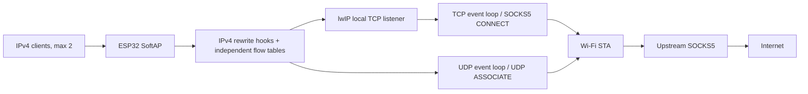

# esp32-socks5-gateway

[English](README.md) · [简体中文](README.zh-CN.md) · [日本語](README.ja.md)

An **ESP32-S3 IPv4 transparent SOCKS5 gateway**. Connect a device to the ESP32 Wi-Fi AP and send its TCP/UDP traffic through an upstream SOCKS5 server without configuring a proxy on the device.

A personal experimental project, based on the tested **web51** firmware. Two Android clients, forwarding, Web management, configuration rollback and serial recovery have been tested. Addresses in this repository are examples; personal Wi-Fi credentials, NVS contents and local build artifacts are excluded.

## Features and scope

- IPv4 Wi-Fi AP+STA; up to **two AP clients**, using DHCP.
- Transparent TCP via SOCKS5 CONNECT and UDP via UDP ASSOCIATE; SOCKS5 v5 **NO AUTH**.
- Fixed event loops rather than one task per connection. lwIP owns TCP handshakes, ACKs, sequence numbers, retransmission, windows and connection shutdown.
- Independent flow metadata: **64 active TCP relays**, **512 TCP mappings** including closing protection, and **32 UDP flows**.
- AP-local Web management: first-use password setup, status, per-client counters, configuration, events, diagnostics and maintenance actions.
- Configuration changes restart the device and require confirmation within **180 seconds**; otherwise the previous configuration is restored.
- A persistent on/off setting for the GPIO48 WS2812 status LED.
- English UART commands and one-use confirmation for password/network recovery.

IPv6, HTTP upstream proxying, username/password SOCKS authentication, BLE, OTA, VLESS/REALITY, local GeoIP/GeoSite routing and NTP are outside the current scope. SOCKS UDP packets with `FRAG != 0` are dropped. Broadcast, multicast and special P2P behavior are not supported. Client admission limits do not guarantee equal bandwidth.

## Hardware and dependencies

| Item | Tested configuration |
| --- | --- |
| Module | ESP32-S3 N16R8, dual core at 240 MHz |
| Flash | 16 MB, DIO, 80 MHz |
| PSRAM | 8 MB, Octal, 80 MHz, boot memory test enabled |
| LED | One WS2812/NeoPixel on GPIO48 |
| Console | UART, 115200 baud; choose your actual serial device |
| ESP-IDF | v6.1, pinned revision below |
| Toolchain | xtensa-esp32s3-elf-gcc 15.2.0 tested |
| Components | cJSON 1.7.19 and led_strip 3.0.3; `dependencies.lock` |

The lwIP patch requires these exact revisions:

- ESP-IDF: `fff9895c82d744c7237be8847347bdd1b07c6643`
- esp-lwIP: `c6f2f878e7b0f86033214b85547d579be43351e3`

The preparation script checks revisions and hashes. An installation reporting “v6.1” may still use a different commit; review and rebase the patch before changing IDF versions.

## Architecture



For TCP, the input path records the original destination and rewrites packets to a local listener. The output path restores the original remote endpoint and repairs checksums. lwIP continues to implement TCP. UDP uses bounded flows with independent SOCKS associations; unrelated client source ports are not forced to share one association.

This is a transparent proxy, not a NAT router or Linux TPROXY implementation. The patch is applied to a generated **project-local `components/lwip` override**. It never edits the global ESP-IDF installation. The repository contains the patch and preparation script, not a vendored full lwIP copy.

## Build and first use

Install the pinned ESP-IDF revision and its submodules using the [official installation guide](https://docs.espressif.com/projects/esp-idf/en/latest/esp32s3/get-started/index.html). Activate the environment with `source "$IDF_PATH/export.sh"`, or your installation's EIM activation script.

From the repository root:

```bash
python3 tools/prepare_lwip.py apply
idf.py menuconfig
idf.py build
idf.py size
```

Under **Transparent gateway Wi-Fi**, set the upstream Wi-Fi SSID/password and change the development AP password. With an empty STA SSID, the AP starts but the STA does not attempt to connect. `sdkconfig.defaults` fixes the hardware and baseline tuning; it does not override an existing `sdkconfig`.

Flash only when ready, using your actual port:

```bash
idf.py -p /dev/ttyACM0 flash monitor
```

1. Connect to `ESP32-Transparent-Proxy`. Its development AP password is `esp32proxy`; change it before normal use.
2. Open **http://192.168.4.1/** and set your own management password on first use.
3. Enter the real upstream SOCKS5 IPv4 address and port. The default `192.168.1.2:7897` is an example. The server must permit LAN access, NO AUTH and UDP ASSOCIATE.
4. Save, reconnect to the AP, and confirm within 180 seconds. Check DNS, ordinary browsing and connection diagnostics.

Upstream Wi-Fi can also be configured in the Web page. The Web password and AP Wi-Fi password are separate. Stored NVS configuration takes precedence over compiled defaults; ordinary application flashing does not replace it.

The AP subnet is configurable as `192.168.X.1/24`. Change it when it overlaps the upstream subnet. Saving restarts the device; use the new management address and confirm before the trial expires. DHCP defaults to DNS `1.1.1.1`. The ESP32 does not run a local DNS server; client DNS UDP travels through SOCKS5 like other UDP traffic.

## Status and recovery

LED colors: red = STA not ready; blue = AP only; purple = AP+STA ready with unknown/stale Internet result; green = recent SOCKS-routed DNS/HTTP check passed; yellow = subnet conflict or repeated check failure. Green describes the check target, not universal Internet availability. Automatic checks normally run every five minutes and can be disabled. Check failures do not trigger automatic device restarts.

```text
help
status
events
log info
log warn
log off
reset-admin
reset-network
confirm CODE
cancel
```

- `reset-admin` clears the management password, keeps the current network, cancels a configuration trial and restarts into first-use password setup.
- `reset-network` keeps the current management password, restores compiled network defaults, cancels the trial and restarts at `192.168.4.1`.
- Each recovery request displays its effects and a one-use code valid for 30 seconds. Use that device-generated code, not the literal `CODE` above.
- RST/EN restarts the board; it does not clear credentials or network settings. BOOT is not a recovery-menu button.

Do not let flashing, monitoring and capture tools own the same UART concurrently. `tools/uart_capture.py --no-reset --interactive --timestamps` can read logs and send commands through one connection. See [maintenance and recovery](docs/maintenance.md).

## Tests and measured performance

There are **75 host regression tests** for forwarding, flow/client isolation, configuration, NVS transactions and serial recovery guards, plus frontend feedback/compatibility tests. Run an IDF build first to obtain the pinned cJSON component. On Linux, use host GCC/binutils and a Python environment containing pyserial/esptool:

```bash
# Keep host assembler/linker ahead of cross-toolchain utilities.
PATH=/usr/bin:/bin:$PATH python -m unittest discover -s tests
node tests/management_feedback_harness.js
node tests/management_transport_harness.js
```

If that PATH selects a different Python, invoke your Python environment's absolute interpreter path. Node is only needed for frontend tests, not firmware. Host tests do not substitute for Wi-Fi, power-loss or long-running hardware tests.

Historical local measurements were approximately **16/16 Mbps single-stream** and **24/21 Mbps aggregate with four streams**. A same-session mixed-load test kept client A playing 1080P without stalls while client B measured **14.41/11.83 Mbps**, compared with **14.21/11.97 Mbps** while A was idle. These are short-term results for specific devices and radio conditions, not guaranteed public-Internet throughput or fairness. See [performance and validation](docs/performance.md).

The browser benchmark server in `tools/` defaults to port `18080`. Optional development diagnostics use the example peer `192.168.1.10:18080`; adapt it to your test network. These diagnostics are disabled in the normal build.

## Repository layout

| Path | Contents |
| --- | --- |
| `main/` | AP+STA, transparent forwarding, SOCKS5, Web/state/serial management |
| `patches/` | Minimal revision-pinned lwIP patch and metadata |
| `tools/` | Patch preparation, UART capture, benchmarks, probes, snapshot verification |
| `tests/` | Host C/Python harnesses and JavaScript frontend tests |
| `examples/` | Xray SOCKS/DNS snippets, not a complete server configuration |
| `docs/` | Architecture, maintenance, performance and sanitized development history |

Generated `sdkconfig`, Wi-Fi credentials, NVS, logs, builds, managed components and local binary snapshots are excluded. Historical addresses/MACs/paths are anonymized, and referenced local experiment artifacts are not included. This README and top-level `docs/` describe current behavior; history includes rejected experiments. The firmware Web UI currently uses Chinese; UART commands use English.

## Known boundaries

Management binds to the AP interface but uses HTTP. Passwords/network settings are stored unencrypted in NVS. UART recovery assumes physical access and has no authentication. Secure boot and Flash encryption are not enabled. Perform first-use setup from a trusted device and keep the management interface off the public Internet.

PSRAM does not eliminate internal-RAM requirements. Two clients share one AP+STA radio and the same flow limits. Weak signals, upstream failures, long RTTs and connection bursts can affect throughput. Flash-write power interruption, mid-session shared-Xray shutdown and long-term stability still need dedicated coverage.
