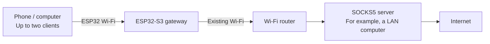
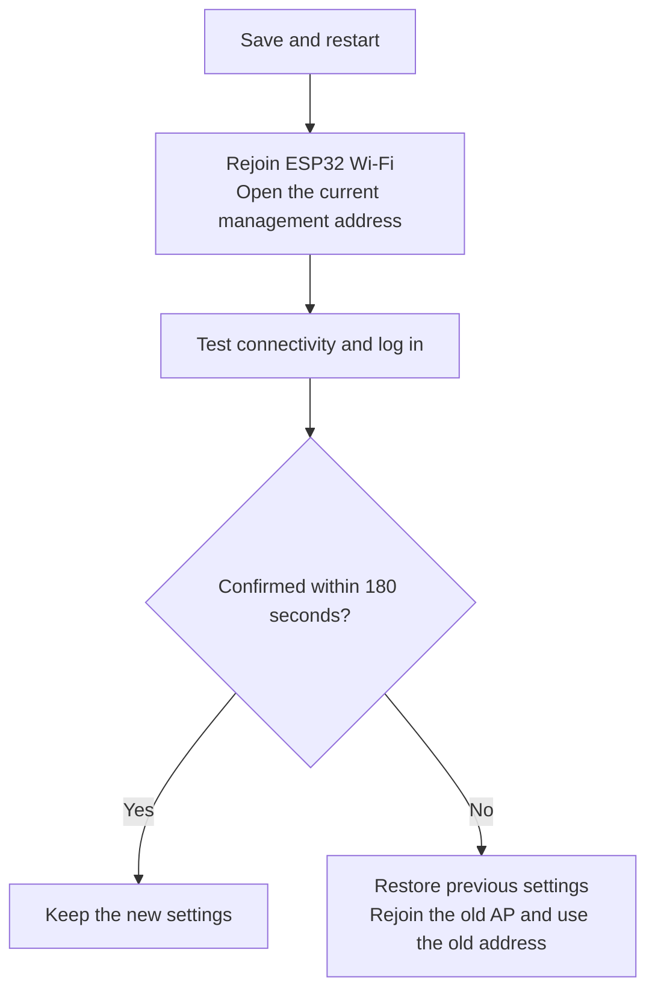
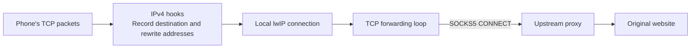

# esp32-socks5-gateway

[English](README.md) · [简体中文](README.zh-CN.md) · [日本語](README.ja.md)

Turn an **ESP32-S3** into a small Wi-Fi gateway. A phone or computer connects to the Wi-Fi network created by the ESP32, and the gateway forwards its IPv4 TCP/UDP traffic through **a SOCKS5 server you provide**. Applications on the client do not need individual proxy settings.

For example, you already run a SOCKS5 service on a computer at home and want two phones to use it. The ESP32 connects to your existing Wi-Fi, creates another Wi-Fi network for the phones, and forwards their traffic to that service.

This is an experimental project for learning ESP32 networking and small-scale use. The default hardware configuration targets **ESP32-S3 N16R8**, with up to two clients. You still need an existing Wi-Fi network and a working SOCKS5 service.

## Reading guide

- [Understand the connection](#understand-the-connection)
- [Performance and suitable uses](#performance-and-suitable-uses)
- [Prepare hardware and software](#prepare-hardware-and-software)
- [Prepare the upstream SOCKS5 service](#prepare-the-upstream-socks5-service)
- [Install the toolchain and build](#install-the-toolchain-and-build)
- [Flash and connect for the first time](#flash-and-connect-for-the-first-time)
- [Daily use and status LED](#daily-use-and-status-led)
- [Troubleshooting](#troubleshooting)
- [Serial console and recovery](#serial-console-and-recovery)
- [Development and tests](#development-and-tests)
- [Scope and security](#scope-and-security)

For a first setup, follow this order. You can read about tests and implementation after the gateway is working.

## Understand the connection



The ESP32 performs two Wi-Fi roles at the same time:

| Term | Meaning in this project |
| --- | --- |
| AP, access point | The Wi-Fi network created by the ESP32, which your phone or computer joins |
| STA, station | The ESP32 acting as a Wi-Fi client of your existing router |
| Upstream | The external network or service used by the ESP32, such as your home Wi-Fi and SOCKS5 server |
| SOCKS5 | A proxy protocol: the server opens connections and forwards data on a client's behalf |
| Transparent proxy | The gateway handles forwarding when a client joins its Wi-Fi; each application does not need a proxy address |

**This project provides the gateway firmware; you must provide the SOCKS5 service separately.** It can run on a LAN computer or another host reachable by the ESP32. It does not have to run on your router.

The management page runs on the ESP32. You can connect to its AP and configure it even before upstream Wi-Fi is set up.

## Performance and suitable uses

These **historical measurements on an ESP32-S3 N16R8 board** show the throughput range to expect when assessing this project. Download means data reaching the client connected to the ESP32; upload means data sent by that client to the test service. The directions were measured separately, not saturated simultaneously.

| Scenario | Download Mbps | Upload Mbps |
| --- | ---: | ---: |
| One client, one stream | 16.43 | 16.25 |
| One client, four concurrent streams, aggregate | 24.49 | 21.25 |
| Two clients: A idle, B running a one-stream test | 14.21 | 11.97 |
| Two clients: A playing 1080P video, B running a one-stream test | 14.41 | 11.83 |

Tests used Android clients and a LAN test service, reporting the median of three completed rounds per scenario with detailed development diagnostics disabled. Only the last two rows are a same-session comparison: no video stalls were reported on A, and B's results were close to those with A idle. The first two rows come from a different historical test and do not establish a later version's improvement or regression. See [performance and validation](docs/performance.md) for the records.

**Mbps means megabits per second; MB/s means megabytes per second. Divide by about 8 to convert.** Around 16 Mbps for one stream is about 2 MB/s. Around 24 Mbps for four streams is their combined throughput, not 24 Mbps per stream or per client.

| Capacity | Current limit | Meaning |
| --- | ---: | --- |
| Wi-Fi clients | 2 | Can be configured to allow only 1 |
| Active TCP relays | 64 | Shared by both clients, not 64 each |
| UDP flows | 32 | Forwarding state for separate traffic flows, shared by both clients |
| TCP mapping records | 512 | Also retain closing-state information; not 512 active connections |

Suitable uses include browsing, light transfers, and networking experiments with a small number of devices. The video test supports sharing under those particular conditions, but video buffering and unknown bitrate mean it cannot guarantee smooth playback for all 1080P video. For transfers approaching 100 Mbps, many clients, or several simultaneous high-bitrate streams, choose hardware with greater throughput and capacity.

These are short LAN tests, not public-Internet speed guarantees. Both clients and AP/STA share a single 2.4 GHz radio; adding clients does not double bandwidth. Signal, interference, upstream proxy, destination service, and connection count affect results. Cloud builds and host regressions validate tools and implementation, but cannot replace real radio throughput tests.

## Prepare hardware and software

### Hardware

| Item | Recommended / tested configuration | Notes |
| --- | --- | --- |
| Board | ESP32-S3 N16R8, dual core at 240 MHz | N16R8 means 16 MB Flash and 8 MB PSRAM; check the board specification |
| Flash | 16 MB, DIO, 80 MHz | Stores firmware and persistent settings |
| PSRAM | 8 MB, Octal, 80 MHz | Additional working memory; the default build tests it at startup |
| USB cable | A cable that carries data | A charging-only cable cannot flash firmware or provide a serial console |
| Status LED | One WS2812 / NeoPixel on GPIO48 | A board with a different LED pin does not match this configuration; LED output can be disabled on the management page |
| Wi-Fi router | An available 2.4 GHz network | ESP32-S3 cannot join a network that only provides 5 GHz |
| Test client | One phone or computer | Get one client working before adding the second |

A different ESP32 chip, Flash/PSRAM size, or LED pin may require hardware configuration changes. For a first setup, use the configuration above rather than flashing the default firmware onto an arbitrary ESP32 board.

### Software

- **ESP-IDF**, Espressif's tools for building and flashing firmware. This project requires the exact revision listed below.
- **Git and Python 3.10 or newer**, plus the system dependencies in the ESP-IDF installation guide.
- A **SOCKS5 service** supporting IPv4, no authentication, and UDP forwarding.
- A browser for management. The current firmware's Web interface is in Chinese; serial commands are in English. This guide includes Chinese button labels where needed.
- Linux GCC/binutils for host regression tests, and Node.js for frontend tests. Node.js is not required to build the firmware.

The ESP-IDF installer downloads the matching GCC `15.2.0` cross-compiler to generate ESP32 firmware; host tests use your computer's system GCC instead. The firmware components cJSON `1.7.19` and led_strip `3.0.3` are recorded in `dependencies.lock` and downloaded automatically on the first build.

## Prepare the upstream SOCKS5 service

Check that the proxy is reachable **from the ESP32's network**. A proxy working on its own computer does not necessarily accept connections from other devices.

| Requirement | Explanation |
| --- | --- |
| A SOCKS5 listening port | An HTTP proxy port cannot replace a SOCKS5 port |
| NO AUTH support | The firmware does not support SOCKS5 username/password authentication |
| UDP ASSOCIATE support | Ordinary DNS queries and other UDP traffic depend on it; working TCP alone does not verify the whole gateway |
| An address reachable from the LAN | A service bound only to `127.0.0.1` cannot be reached by other devices; enable LAN access using your proxy software's instructions |
| Appropriate firewall access | Allow the TCP control connection and the UDP relay address/port returned by the server; the UDP port may differ from the SOCKS5 listening port |

Example network settings:

| Purpose | Example value |
| --- | --- |
| Existing Wi-Fi name | `Home-WiFi` |
| Router address | `192.168.1.1` |
| Computer running SOCKS5 | `192.168.1.2` |
| SOCKS5 port | `7897` |
| ESP32 AP / management address | `192.168.4.1` |
| DNS address advertised by DHCP | `1.1.1.1` |

Replace these examples with your network's actual settings. The firmware default `192.168.1.2:7897` does not establish that a proxy exists there. Do not enter your computer's `127.0.0.1` as the server address: to the ESP32, that address refers to the ESP32 itself.

For Xray, see the [SOCKS settings example](examples/xray-socks-settings.json) and the DNS examples in `examples/`. They are fragments to integrate into your own complete Xray configuration. Other proxy software can work if it meets the requirements above. Keep an unauthenticated proxy accessible only to trusted networks.

## Install the toolchain and build

The commands below use **Bash on Linux, macOS, or WSL**. For native Windows, follow the [official ESP-IDF getting-started guide](https://docs.espressif.com/projects/esp-idf/en/latest/esp32s3/get-started/index.html) and use the installer's development terminal or EIM activation script. In that terminal, use `python` in place of `python3` if needed.

WSL can build the firmware, but USB devices do not necessarily appear in WSL automatically. Before flashing, attach/forward USB using your system's supported method, or use a Windows ESP-IDF development terminal.

### 1. Install the matching ESP-IDF revision

Transparent forwarding uses a small lwIP patch. lwIP is the TCP/IP networking library inside ESP-IDF. The patch depends on its source code, so a version string of “v6.1” alone is insufficient; these commits must match:

| Dependency | Exact commit |
| --- | --- |
| ESP-IDF v6.1 | `fff9895c82d744c7237be8847347bdd1b07c6643` |
| esp-lwIP | `c6f2f878e7b0f86033214b85547d579be43351e3` |

Install the system prerequisites from the official guide first. Then use a **new directory that does not already exist**. This example uses a separate `esp-idf-gateway` directory so you can keep another ESP-IDF installation.

```bash
mkdir -p ~/esp
cd ~/esp

git clone --no-checkout --depth 1 https://github.com/espressif/esp-idf.git esp-idf-gateway
cd esp-idf-gateway
git fetch --depth 1 origin fff9895c82d744c7237be8847347bdd1b07c6643
git checkout --detach fff9895c82d744c7237be8847347bdd1b07c6643
git submodule update --init --recursive --depth 1

./install.sh esp32s3
python3 tools/idf_tools.py install cmake ninja
source ./export.sh
```

The submodule command downloads supporting source code, including the matching lwIP revision. Installation also downloads compilers and Python dependencies. Wait for each command to finish successfully before continuing.

If both exact commits are already installed, activate that installation instead. **Activate the environment again in each new terminal.** For the example directory:

```bash
source ~/esp/esp-idf-gateway/export.sh
idf.py --version
git -C "$IDF_PATH" rev-parse HEAD
```

The final command should print the ESP-IDF commit in the table. EIM users should use their installation's generated activation script and check the commit too.

### 2. Get the project and prepare lwIP

```bash
git clone https://github.com/noaic/esp32-socks5-gateway.git ~/esp32-socks5-gateway
cd ~/esp32-socks5-gateway
python3 tools/prepare_lwip.py apply
python3 tools/prepare_lwip.py check
```

If you already have the project, enter that checkout rather than cloning again. All subsequent project commands run from the **project root, containing `CMakeLists.txt`**.

The preparation script checks commits and source hashes, then applies the patch to a generated, project-local `components/lwip` directory. It does not edit the global ESP-IDF installation. If a revision or hash does not match, check the toolchain instead of forcing the patch.

### 3. Configure and build

```bash
idf.py menuconfig
```

Open `Transparent gateway Wi-Fi`:

- For a first setup, you can leave the upstream `SSID` empty and configure it later on the management page. The AP starts, but the ESP32 does not attempt to join upstream Wi-Fi yet.
- Change `SoftAP WPA2 password` to your own AP password, using 8–63 ASCII characters.
- You can keep the AP name `ESP32-Transparent-Proxy`.
- Keep other hardware/network defaults initially. Normal use does not require `Temporary gateway diagnostics`.

Save, exit the menu, and run:

```bash
idf.py build
idf.py size
```

`build` generates firmware; `size` reports its memory footprint and does not flash the board. The first build downloads components and takes longer than subsequent builds.

`sdkconfig.defaults` supplies initial ESP32-S3, Flash, PSRAM, and feature settings. It does not overwrite an existing `sdkconfig`, so check the board settings when reusing an older project configuration.

## Flash and connect for the first time

### 1. Write the firmware to the board

Connect the board with a data cable and identify its actual serial port. Common examples are `/dev/ttyACM0` or `/dev/ttyUSB0` on Linux, `/dev/cu.*` on macOS, and `COM5` on Windows. These names are not fixed.

From the project terminal with ESP-IDF activated, run, for example:

```bash
idf.py -p /dev/ttyACM0 flash monitor
```

A Windows development terminal uses a port such as:

```text
idf.py -p COM5 flash monitor
```

`flash` writes the firmware, and `monitor` opens logs at **115200 baud**. Press `Ctrl+]` to exit ESP-IDF monitor. Flashing, monitoring, and other serial tools must not use the same device simultaneously.

### 2. Join the ESP32 Wi-Fi network

Connect your phone or computer to `ESP32-Transparent-Proxy`, using the AP password you chose in `menuconfig`. The unchanged development default is `esp32proxy`; replace it before normal use.

Without upstream settings, a phone may say this Wi-Fi has no Internet access. Choose to stay connected so you can open the local management page. During the first test, temporarily disabling mobile data or automatic network switching helps confirm that traffic is actually going through the ESP32.

### 3. Set the management password

Enter **http://192.168.4.1/** in the browser address bar. Use `http://` explicitly; the management page does not provide HTTPS.

On first access, set a management password. The username is always **`admin`**. The password must be **12–64 bytes**; ASCII characters make the length easier to judge. After saving, open the management page and log in with `admin` and your new password.

Three different passwords serve three different purposes:

| Password | Used by | Set through |
| --- | --- | --- |
| Upstream Wi-Fi password | ESP32 joining your existing router | Management page or `menuconfig` |
| AP Wi-Fi password | Phone/computer joining the ESP32 | Management page or `menuconfig` |
| Management password | Logging in to the ESP32 page as `admin` | First-use page, then management settings |

The SOCKS5 server uses NO AUTH, so there are no SOCKS5 username/password fields.

### 4. Enter network and proxy settings

In “网关配置” (gateway configuration), enter:

| Page field | What to enter |
| --- | --- |
| 上游 Wi-Fi SSID / 密码 | Your existing 2.4 GHz Wi-Fi name and password |
| SOCKS5 IPv4 | The server's IPv4 address reachable by the ESP32, such as `192.168.1.2` |
| SOCKS5 端口 | Its actual SOCKS5 listening port, such as `7897` |
| AP 名称 / 密码 | Name/password of the Wi-Fi created by the ESP32 |
| 最大接入数 | Maximum clients: 1 or 2 |
| DHCP 下发的 DNS IPv4 | DNS server for clients, such as `1.1.1.1` |
| AP 网段第三段 X | Third part of the AP address: default 4 gives `192.168.4.1` |

**An empty password field preserves the existing password.** It does not clear it. For an upstream Wi-Fi network without a password, select “上游 Wi-Fi 无密码”. SSID/password lengths use UTF-8 bytes; non-ASCII characters can take multiple bytes.

Upstream and AP networks must not overlap. For a typical `255.255.255.0` network, upstream `192.168.1.x` and AP `192.168.4.x` are separate. If upstream also uses `192.168.4.x`, you could change X to 10 and use `192.168.10.1` for management. The page detects conflicts using the actual network masks.

### 5. Save, reconnect, and confirm

Click “保存并重启” (save and restart). Losing the current connection is expected. The new configuration is tried first: **after restart, click “确认保留配置” (confirm configuration) within 180 seconds**, or the device restores the previous settings.



Use the new AP name/password if changed, the new management address if X changed, and the new management password if changed. If a client retains its old IP address, disconnect and reconnect Wi-Fi to obtain a new DHCP lease.

Before confirming, check that STA has an IPv4 address, run “运行连接诊断” (connection diagnostics), and try an ordinary webpage. After confirmation, use “立即检查互联网” (check Internet now) for an additional check. Automatic Internet checks wait until network settings are confirmed. A single LED color or an “accepted” operation message is insufficient to establish successful connectivity.

## Daily use and status LED

The management page shows runtime status, connected clients, per-client proxy traffic, and recent events. You can reconnect upstream Wi-Fi, close existing proxy connections, or restart the board. These actions can interrupt downloads/video; check the result and avoid repeatedly submitting an action.

| Color | Meaning | Next step |
| --- | --- | --- |
| Blue | Upstream Wi-Fi has not been configured | Enter its SSID/password |
| Red | Upstream is configured, but STA is not ready | Check 2.4 GHz Wi-Fi, password, and signal |
| Purple | AP+STA ready, but an Internet result is unconfirmed, being checked, or expired | Inspect diagnostics and test a real webpage |
| Green | A recent DNS/HTTP check through SOCKS5 passed | The check target was recently reachable; other sites may still fail |
| Yellow | Subnet conflict or repeated failures for the check target | Inspect the conflict warning and failing diagnostic step |

A successful result remains valid for 10 minutes. Normal automatic checks run every 5 minutes, with retry backoff after failures. Check failures do not automatically restart the board. Automatic checks and LED output can be disabled; those preferences are saved.

**Connection diagnostics** checks the upstream TCP port, SOCKS5 NO AUTH handshake, and UDP DNS round trip. **Internet check** additionally connects to a selected HTTP target through the proxy. Interpret both alongside actual application behavior.

## Troubleshooting

Check from the nearest component outward: **client → ESP32 AP → upstream Wi-Fi → SOCKS5 → DNS / destination site**. Get one client working before adding a second.

| Symptom | Check first |
| --- | --- |
| `idf.py` not found | Activate ESP-IDF in this terminal, then enter the project directory |
| lwIP revision/hash mismatch | Correct `$IDF_PATH` commit and complete submodules; do not force the patch |
| Component download fails during build | Read the first download error; check access to GitHub, Espressif downloads, and the component registry; keep TLS/hash verification enabled |
| Serial port missing or flashing fails | Data cable, board USB connector, driver, port permissions, WSL USB attachment, and other programs using the port |
| Startup reports a PSRAM error | Board really matches N16R8/Octal PSRAM settings and has stable power |
| Phone reports no Internet | Stay connected during initial setup; afterward check STA and proxy. Prevent mobile-data switching while testing |
| Management page does not open | Joined the ESP32 AP, explicit `http://`, current address after an X change, and a fresh DHCP lease |
| Management login fails | Username is `admin`; management password is separate from the AP password; use the current password after changes |
| STA never becomes ready | SSID/password, 2.4 GHz availability, signal; empty SSID disables connection attempts |
| Upstream TCP port check fails | SOCKS5 IP/port, LAN access, firewall; do not use `127.0.0.1` |
| TCP port works but NO AUTH fails | An HTTP port was entered, or the proxy requires credentials |
| Some pages work but DNS/UDP fails | UDP ASSOCIATE support, reachable relay address/UDP port returned by the server, and DNS configuration |
| Settings revert after saving | Confirmation within 180 seconds; after rollback, use the previous AP settings/address |
| `menuconfig` changes do not affect the board's network | Stored NVS settings take precedence; change them on the page or restore compiled defaults as described below |
| A third client cannot join | Maximum is two, configurable to one; disconnect another device first |

Use serial recovery if you forget the management password or lose access after changing network settings. See [maintenance and recovery](docs/maintenance.md) for more detail.

## Serial console and recovery

Commands are in English. Enter them in ESP-IDF monitor or a serial terminal that can send text; press Enter after each command.

| Command | Purpose |
| --- | --- |
| `help` | Show help |
| `status` | Current network/resource state |
| `events` | Recent events |
| `log info` | Temporarily increase diagnostic logging |
| `log warn` | Return to everyday WARN logging |
| `log off` | Disable logging |
| `reset-admin` | Request management password removal, keeping current network settings |
| `reset-network` | Request compiled network defaults, keeping the management password |
| `confirm CODE` | Confirm recovery; replace CODE with the code just shown by this device |
| `cancel` | Cancel pending recovery |

Neither `reset-*` command acts immediately. The board displays the effects and a **one-use code valid for 30 seconds**. Read the message, then enter `confirm` followed by that code. Do not type the literal `CODE`. Successful recovery restarts the board; both recovery operations cancel an active configuration trial.

After `reset-admin`, open the page and set a new password. After `reset-network`, use the compiled AP name/password and management address `192.168.4.1`. If you entered Wi-Fi credentials in `menuconfig`, the compiled defaults contain them; “defaults” does not mean all passwords become empty.

The Web “恢复默认配置” action also keeps the management password, but requires the 180-second confirmation after restarting. Serial `reset-network` uses the 30-second code above. **RST/EN and power cycling only restart the board; they do not clear saved passwords/network settings. BOOT is not a recovery-menu button.** Routine recovery does not require erasing all Flash.

To capture logs and send commands through one connection, run from the project root:

```bash
python tools/uart_capture.py --port /dev/ttyACM0 --no-reset --interactive --timestamps --seconds 0
```

Exit other serial tools first. `--seconds 0` reads until interrupted. `--no-reset` avoids the tool's active reset, but adapter/driver behavior can still affect reset signals.

## Development and tests

### A simple view of the implementation

Think of the ESP32 as an intermediary that receives and passes on data:

- **TCP**, used by many webpage connections, provides reliable transport. The gateway remembers the client's intended destination, asks the proxy to connect using SOCKS5 `CONNECT`, and returns the response to the client.
- **UDP**, used by ordinary DNS queries and some real-time traffic, uses `UDP ASSOCIATE` to obtain relay information. Forwarded packets carry their destination, and separate flows keep their own state.
- **DNS** converts names into IP addresses. Default DHCP tells clients to use `1.1.1.1`. The ESP32 does not run a local DNS service; ordinary DNS UDP traffic is forwarded through SOCKS5 too.
- **NVS** is the area of Flash used for persistent settings. That is why settings survive normal restarts and application flashing does not automatically replace existing network settings.

Total capacity is 64 active TCP relays and 32 UDP flows. There are also 512 TCP mapping records for destinations and closing-state information; **this does not mean 512 simultaneous forwarded TCP connections**. lwIP handles underlying TCP behavior, such as retransmission, while fixed application loops service multiple connections.

### Follow one webpage's TCP connection

Suppose a phone connects to a website at `203.0.113.10:443`; this address is just an example:

1. The phone sends packets to its default gateway, the ESP32.
2. The project-local lwIP patch calls gateway code from the IPv4 processing path. It validates the packet, records the client and original destination, redirects the TCP packet to a local ESP32 listener, and updates checksums so the receiver can validate the packet.
3. lwIP handles this local TCP connection. The application reads data through a socket, a programming interface for sending/receiving network data, rather than implementing TCP handshakes and retransmission itself.
4. The TCP forwarding loop negotiates SOCKS5 NO AUTH and sends `CONNECT`, asking the proxy to connect to the original destination. It then passes data between the two connections.
5. TCP packets returning to the phone use the mapping to restore the original remote address and correct their checksums. The phone still sees a connection to the website.



“Transparent” describes the client's experience. Raw TCP packets are not simply inserted into SOCKS5; lwIP handles the connection, and the gateway forwards its data. HTTPS encryption remains between browser and website; the gateway does not decrypt webpage content.

### UDP, concurrency, and saved settings

UDP has no TCP-style connection setup, but SOCKS5 UDP forwarding still needs a TCP control connection. Each UDP flow records its client/destination, negotiates `UDP ASSOCIATE`, and sends UDP data with a SOCKS5 destination header to the relay. Replies are checked against the flow and client identity before delivery. The code reserves some capacity and negotiation opportunities for DNS, reducing cases where other UDP traffic prevents name resolution by exhausting resources.

TCP and UDP each use a fixed forwarding loop: check which connections can send/receive, handle a portion of data, then service others. There is no task per connection. Queues and wait times are bounded; larger TCP data buffers use PSRAM, while frequently accessed TCP state stays in internal RAM. This controls memory use without removing radio or total connection limits.

Configuration management stores current and previous settings. New network settings are tried first, kept after confirmation, or rolled back on timeout. Management/maintenance tasks are separate from forwarding loops, so viewing status does not restart the proxy for each page request. Each client has a connection identity and counters to identify reply ownership and clean up connections when it leaves.

To explore the source, start with the matching modules:

| Topic | Main source files |
| --- | --- |
| Startup, AP/STA, and network events | [app_main.c](main/app_main.c) |
| TCP input, address rewriting, and destination records | [tcp_poc.c](main/tcp_poc.c), [packet_rewrite.c](main/packet_rewrite.c), [flow_table.c](main/flow_table.c) |
| TCP SOCKS5 negotiation and bidirectional forwarding | [socks_relay.c](main/socks_relay.c) |
| UDP interception, association, and packet format | [udp_gateway.c](main/udp_gateway.c), [udp_relay.c](main/udp_relay.c), [socks_udp.c](main/socks_udp.c) |
| Client ownership and counters | [ap_clients.c](main/ap_clients.c) |
| Settings, confirmation, and rollback | [gateway_settings.c](main/gateway_settings.c), [web_management.c](main/web_management.c) |
| Maintenance jobs and connectivity checks | [gateway_control.c](main/gateway_control.c), [gateway_probe.c](main/gateway_probe.c) |

See [architecture](docs/architecture.md) for the complete packet path and module responsibilities. For a first setup, learn the configuration steps first and explore the implementation when useful.

### Run the existing regression tests

“Host tests” compile and execute parts of the C implementation on your development computer; no ESP32 board is needed. Build the firmware successfully once first so the pinned cJSON source exists in `managed_components/`.

On Linux, in an activated ESP-IDF project terminal, make system GCC/binutils and Node.js available, then run:

```bash
# Remember the current interpreter before PATH changes select another Python.
HOST_PYTHON="$(command -v python)"
PATH=/usr/bin:/bin:$PATH "$HOST_PYTHON" -m unittest discover -s tests -v
node tests/management_feedback_harness.js
node tests/management_transport_harness.js
```

The ESP-IDF Python environment includes pyserial/esptool, which the UART tests need. The current suite has **75 host regressions**, plus two frontend feedback/compatibility harnesses. Check actual counts, failures, and skips. Passing these checks does not replace Wi-Fi, power-loss, or long-running hardware tests.

### Repository layout and further reading

| Path | Contents |
| --- | --- |
| `main/` | Firmware source and embedded management pages |
| `patches/` | lwIP patch and revision/hash metadata |
| `tools/` | Patch preparation, UART capture, network probes, and benchmarks |
| `tests/` | C/Python host tests and JavaScript frontend tests |
| `examples/` | Xray configuration fragments |
| `sdkconfig.defaults` | Initial hardware and feature defaults |
| `dependencies.lock` | Firmware component version record |
| `docs/` | Architecture, maintenance, performance, and development notes |

- [Documentation index](docs/README.md)
- [Maintenance and recovery](docs/maintenance.md)
- [Performance and validation](docs/performance.md): full measurement records, memory samples, and validation limits.
- [Development history](docs/history/README.md): includes experiments that were later reverted. For everyday behavior, prefer this README and the top-level guides in `docs/`.

`sdkconfig`, `build/`, `managed_components/`, the local lwIP copy, and test outputs are generated. Check `git status` before committing; keep Wi-Fi passwords, personal configuration, logs, and local firmware artifacts out of the repository.

## Scope and security

The gateway supports IPv4, SOCKS5 NO AUTH, TCP, and UDP forwarding. It does not support IPv6, HTTP upstream proxies, SOCKS5 account authentication, BLE, OTA, VLESS/REALITY, on-device GeoIP/GeoSite routing, or NTP. Fragmented SOCKS UDP packets (`FRAG != 0`) are dropped. Broadcast, multicast, and special P2P behavior are outside scope, and complete QUIC compatibility has not been verified.

Two clients share one 2.4 GHz radio and total forwarding capacity. Client limits do not guarantee equal bandwidth. This project is unsuitable as a replacement for equipment requiring many users, high throughput, or full routing features. PSRAM adds memory, but Wi-Fi/lwIP still depend on limited internal RAM. Long-term stability, interrupted Flash writes, and real upstream outages need further validation.

Management is available only on the AP, but uses HTTP. Management passwords/network settings are stored unencrypted in NVS. Serial recovery assumes physical access and has no login authentication; secure boot and Flash encryption are not enabled. Set up the device from a trusted client/network, choose your own passwords, and keep the management page and unauthenticated proxy off the public Internet.
