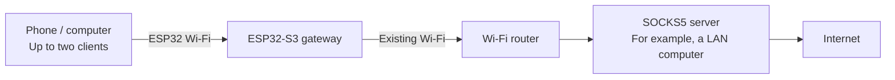
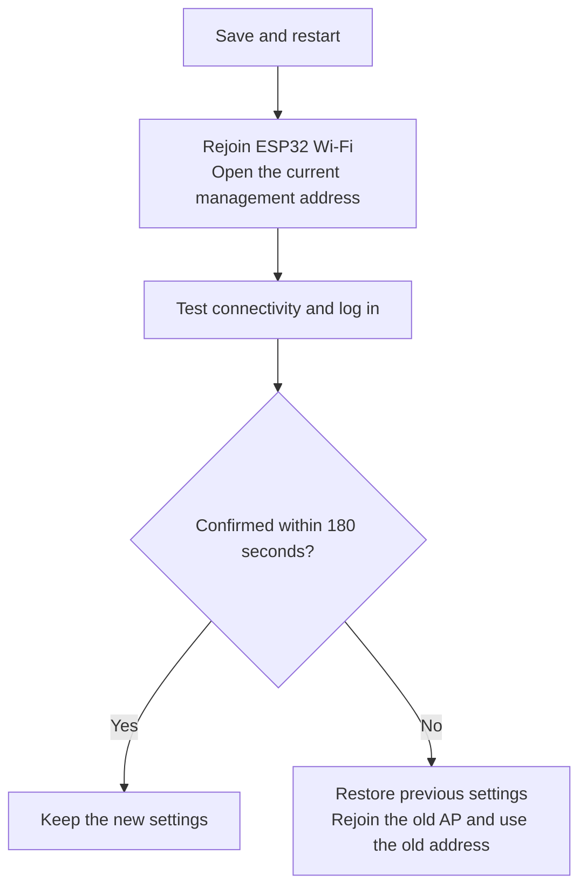
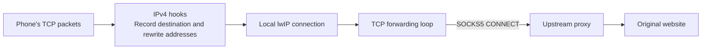

# esp32-socks5-gateway

[English](README.md) · [简体中文](README.zh-CN.md) · [日本語](README.ja.md)

Turn an **ESP32-S3** into a small Wi-Fi gateway. A phone or computer connects to the Wi-Fi network created by the ESP32, and the gateway forwards its IPv4 TCP/UDP traffic through **a SOCKS5 server you provide**. Applications on the client do not need individual proxy settings.

For example, you already run a SOCKS5 service on a computer at home and want two phones to use it. The ESP32 connects to your existing Wi-Fi, creates another Wi-Fi network for the phones, and forwards their traffic to that service.

This is an experimental project for learning ESP32 networking and small-scale use. The default hardware configuration targets **ESP32-S3 N16R8**, with up to two clients. You still need an existing Wi-Fi network and a working SOCKS5 service.

## Reading guide

- [Understand the connection](#understand-the-connection)
- [Performance and suitable uses](#performance-and-suitable-uses)
- [Prepare hardware and software](#prepare-hardware-and-software)
- [Prepare the upstream SOCKS5 service](#prepare-the-upstream-socks5-service)
- [Install the toolchain and build](#install-the-toolchain-and-build)
- [Flash and connect for the first time](#flash-and-connect-for-the-first-time)
- [Daily use and status LED](#daily-use-and-status-led)
- [Troubleshooting](#troubleshooting)
- [Serial console and recovery](#serial-console-and-recovery)
- [Development and tests](#development-and-tests)
- [Scope and security](#scope-and-security)

For a first setup, follow this order. You can read about tests and implementation after the gateway is working.

## Understand the connection



The ESP32 performs two Wi-Fi roles at the same time:

| Term | Meaning in this project |
| --- | --- |
| AP, access point | The Wi-Fi network created by the ESP32, which your phone or computer joins |
| STA, station | The ESP32 acting as a Wi-Fi client of your existing router |
| Upstream | The external network or service used by the ESP32, such as your home Wi-Fi and SOCKS5 server |
| SOCKS5 | A proxy protocol: the server opens connections and forwards data on a client's behalf |
| Transparent proxy | The gateway handles forwarding when a client joins its Wi-Fi; each application does not need a proxy address |

**This project provides the gateway firmware; you must provide the SOCKS5 service separately.** It can run on a LAN computer or another host reachable by the ESP32. It does not have to run on your router.

The management page runs on the ESP32. You can connect to its AP and configure it even before upstream Wi-Fi is set up.

## Performance and suitable uses

These **historical measurements on an ESP32-S3 N16R8 board** show the throughput range to expect when assessing this project. Download means data reaching the client connected to the ESP32; upload means data sent by that client to the test service. The directions were measured separately, not saturated simultaneously.

| Scenario | Download Mbps | Upload Mbps |
| --- | ---: | ---: |
| One client, one stream | 16.43 | 16.25 |
| One client, four concurrent streams, aggregate | 24.49 | 21.25 |
| Two clients: A idle, B running a one-stream test | 14.21 | 11.97 |
| Two clients: A playing 1080P video, B running a one-stream test | 14.41 | 11.83 |

Tests used Android clients and a LAN test service, reporting the median of three completed rounds per scenario with detailed development diagnostics disabled. Only the last two rows are a same-session comparison: no video stalls were reported on A, and B's results were close to those with A idle. The first two rows come from a different historical test and do not establish a later version's improvement or regression. See [performance and validation](docs/performance.md) for the records.

**Mbps means megabits per second; MB/s means megabytes per second. Divide by about 8 to convert.** Around 16 Mbps for one stream is about 2 MB/s. Around 24 Mbps for four streams is their combined throughput, not 24 Mbps per stream or per client.

| Capacity | Current limit | Meaning |
| --- | ---: | --- |
| Wi-Fi clients | 2 | Can be configured to allow only 1 |
| Active TCP relays | 64 | Shared by both clients, not 64 each |
| UDP flows | 32 | Forwarding state for separate traffic flows, shared by both clients |
| TCP mapping records | 512 | Also retain closing-state information; not 512 active connections |

Each client slot can retain at most **256 TCP mappings**, including records from earlier connections of that slot, and **16 initial mappings awaiting acceptance by the TCP listener**. These limits apply even with one client, protecting the other slot from a burst of new connections. Closing mappings remain reserved for at least **120 seconds (2×MSL)**; a rapid series of short connections can reach these limits before reaching 64 active relays. They do not guarantee equal bandwidth.

TCP upstream connection/negotiation has a **15-second** deadline. Idle relays expire after **120 seconds**; when capacity is full, a relay idle for at least **30 seconds** with empty queues can be reclaimed. UDP payloads are limited to **1462 bytes per datagram**. Consider these limits when evaluating long-idle applications, connection bursts, or large UDP messages.

Suitable uses include browsing, light transfers, and networking experiments with a small number of devices. The video test supports sharing under those particular conditions, but video buffering and unknown bitrate mean it cannot guarantee smooth playback for all 1080P video. For transfers approaching 100 Mbps, many clients, or several simultaneous high-bitrate streams, choose hardware with greater throughput and capacity.

These are short LAN tests, not public-Internet speed guarantees. Both clients and AP/STA share a single 2.4 GHz radio; adding clients does not double bandwidth. Signal, interference, upstream proxy, destination service, and connection count affect results. Cloud builds and host regressions validate tools and implementation, but cannot replace real radio throughput tests.

## Prepare hardware and software

### Hardware

| Item | Recommended / tested configuration | Notes |
| --- | --- | --- |
| Board | ESP32-S3 N16R8, dual core at 240 MHz | N16R8 means 16 MB Flash and 8 MB PSRAM; check the board specification |
| USB cable | A cable that carries data | A charging-only cable cannot flash firmware or provide a serial console |
| Status LED | One WS2812 / NeoPixel on GPIO48 | A board with a different LED pin does not match this configuration; LED output can be disabled on the management page |
| Wi-Fi router | An available 2.4 GHz network | ESP32-S3 cannot join a network that only provides 5 GHz |
| Test client | One phone or computer | Get one client working before adding the second |

A different LED pin requires matching configuration. The current startup check requires two CPU cores, exactly 16 MB Flash, and initialized 8 MB PSRAM; changing `menuconfig` alone does not support other memory sizes. For a first setup, use the configuration above rather than flashing the default firmware onto an arbitrary ESP32 board.

### Software

| Category | Dependency and purpose | Preparation |
| --- | --- | --- |
| Required: development tools | Git, Python ≥ 3.10 (3.12 recommended), CMake ≥ 3.22, Ninja | Official EIM checks/installs prerequisites on Windows; Linux packages are listed below. This IDF tool manifest recommends CMake 4.0.3 and Ninja 1.12.1 |
| Required: SDK | Exact ESP-IDF v6.1 and esp-lwIP commits | See the commit table below; FreeRTOS and lwIP are included in ESP-IDF, not separate installations |
| Automatically managed: toolchain | Xtensa GCC 15.2.0 for ESP32-S3 firmware; esptool, Python build tools, Component Manager | EIM or IDF scripts use this commit's tool/requirement manifests |
| Automatically managed: components | cJSON 1.7.19, led_strip 3.0.3 | Declared in `main/idf_component.yml`, version/hash-pinned in `dependencies.lock`, downloaded into `managed_components/` at first build |
| Required: use of the gateway | Browser, existing 2.4 GHz Wi-Fi, IPv4 / NO AUTH / UDP ASSOCIATE SOCKS5 service | User-provided; building and host tests do not require a live proxy |
| Optional: development/testing | Linux system GCC/binutils, Node.js; ccache speeds repeated builds | GCC runs host C tests, Node.js runs frontend tests; neither is a firmware runtime dependency |

The management and first-use pages default to English. A Chinese first browser language (`zh` or `zh-*`) selects Simplified Chinese; other or unavailable preferences use English. A secondary Chinese preference does not override an English first preference. Serial commands are in English. System GCC and the ESP32 cross-compiler serve different purposes. Do not substitute the former for the firmware toolchain or update the dependency lock merely to make a build pass.

## Prepare the upstream SOCKS5 service

Check that the proxy is reachable **from the ESP32's network**. A proxy working on its own computer does not necessarily accept connections from other devices.

| Requirement | Explanation |
| --- | --- |
| A SOCKS5 listening port | An HTTP proxy port cannot replace a SOCKS5 port |
| NO AUTH support | The firmware does not support SOCKS5 username/password authentication |
| UDP ASSOCIATE support | Ordinary DNS queries and other UDP traffic depend on it; working TCP alone does not verify the whole gateway |
| An address reachable from the LAN | A service bound only to `127.0.0.1` cannot be reached by other devices; enable LAN access using your proxy software's instructions |
| Appropriate firewall access | Allow the TCP control connection and the UDP relay address/port returned by the server; the UDP port may differ from the SOCKS5 listening port |

Example network settings:

| Purpose | Example value |
| --- | --- |
| Existing Wi-Fi name | `Home-WiFi` |
| Router address | `192.168.1.1` |
| Computer running SOCKS5 | `192.168.1.2` |
| SOCKS5 port | `7897` |
| ESP32 AP / management address | `192.168.4.1` |
| DNS address advertised by DHCP | `1.1.1.1` |

Replace these examples with your network's actual settings. The firmware default `192.168.1.2:7897` does not establish that a proxy exists there. Do not enter your computer's `127.0.0.1` as the server address: to the ESP32, that address refers to the ESP32 itself.

If your upstream SOCKS5 service uses [Xray](https://github.com/XTLS/Xray-core), start with the [complete VLESS + TCP + REALITY client template](examples/xray-client-reality.json) and its [field placement and setup guide (Chinese)](examples/README.md). It runs on the LAN computer; replace all `<...>` placeholders with your LAN address and remote node parameters before checking or running it. The existing [SOCKS settings example](examples/xray-socks-settings.json) and DNS examples remain fragments for integration into an existing configuration. Other proxy software can work if it meets the requirements above. Keep an unauthenticated proxy accessible only to trusted networks.

## Install the toolchain and build

Use **PowerShell on Windows**, and **Bash on Linux/WSL2**; run only the commands for your platform. Avoid spaces and non-ASCII characters in SDK/project paths, for example by using `C:\esp` on Windows. These steps prepare a separate SDK directory without overwriting an installation used by other projects.

### 1. Install the matching ESP-IDF revision

Transparent forwarding uses a small lwIP patch. lwIP is the TCP/IP networking library inside ESP-IDF. The patch depends on its source code, so a version string of “v6.1” alone is insufficient; these commits must match:

| Dependency | Exact commit |
| --- | --- |
| ESP-IDF v6.1 | `fff9895c82d744c7237be8847347bdd1b07c6643` |
| esp-lwIP | `c6f2f878e7b0f86033214b85547d579be43351e3` |

#### Windows 11: official EIM and PowerShell

1. Download the EIM GUI installer from [Espressif](https://dl.espressif.com/dl/eim/). Follow the prerequisite checks in the [official Windows guide](https://docs.espressif.com/projects/esp-idf/en/latest/esp32s3/get-started/windows-setup.html). If Git is unavailable, install [Git for Windows](https://git-scm.com/install/windows) and open a new PowerShell. `winget` is not required.
2. In ordinary PowerShell, put the exact commit in a **new** `C:\esp\esp-idf-gateway` directory. The preparation script accepts both LF and CRLF checkouts; no Git line-ending settings need to be changed:

```powershell
git --version
New-Item -ItemType Directory -Force C:\esp | Out-Null
git clone --no-checkout --depth 1 https://github.com/espressif/esp-idf.git C:\esp\esp-idf-gateway
Set-Location C:\esp\esp-idf-gateway
git fetch --depth 1 origin fff9895c82d744c7237be8847347bdd1b07c6643
git checkout --detach fff9895c82d744c7237be8847347bdd1b07c6643
git submodule update --init --recursive --depth 1
```

3. In EIM, choose **Custom Installation** and point its path to this existing Git directory. Official [Expert Installation](https://docs.espressif.com/projects/idf-im-ui/en/latest/expert_installation.html) supports using an existing repository without rewriting its contents. Install the tools for that checkout, including the compiler, CMake, Ninja, and Python environment. Use this directory rather than installing an arbitrary latest SDK for the build.
4. Open the installation's PowerShell through EIM's **Manage Installations → Open IDF Terminal**, or its generated PowerShell shortcut. **Run subsequent Windows commands in that activated terminal.** A new ordinary PowerShell does not inherit the environment:

```powershell
python --version
idf.py --version
git -C "$env:IDF_PATH" rev-parse HEAD
git -C "$env:IDF_PATH\components\lwip\lwip" rev-parse HEAD
git -C "$env:IDF_PATH\components\lwip\lwip" ls-files --eol src/core/ipv4/ip4.c
cmake --version
ninja --version
```

Both commits must match the table. The EOL command is diagnostic: `i/lf w/lf` and `i/lf w/crlf` are both supported; the latter means Git checked out Windows line endings, not that the source was edited. An existing SDK need not be reinstalled for this difference. Use EIM's generated activation entry point. For legacy script installs, PowerShell runs `.\install.ps1 esp32s3` and `.\export.ps1` from the SDK directory; CMD uses `install.bat esp32s3` / `export.bat`. Windows does not use Bash's `source`.

#### Linux: Ubuntu/Debian or Fedora, Bash

For Ubuntu/Debian, use the [official prerequisite list](https://docs.espressif.com/projects/esp-idf/en/latest/esp32s3/get-started/linux-macos-setup-legacy.html). Choose a release providing Python ≥ 3.10, such as Ubuntu 22.04 or newer:

```bash
sudo apt-get update
sudo apt-get install git wget flex bison gperf python3 python3-pip python3-venv cmake ninja-build ccache libffi-dev libssl-dev dfu-util libusb-1.0-0
```

Fedora uses different package names and `dnf`; its Python package provides `venv`:

```bash
sudo dnf install git wget flex bison gperf python3 python3-pip cmake ninja-build ccache libffi-devel openssl-devel dfu-util libusb1
```

Prepare a separate SDK directory; `esp-idf-gateway` must not already exist:

```bash
mkdir -p ~/esp
cd ~/esp

git clone --no-checkout --depth 1 https://github.com/espressif/esp-idf.git esp-idf-gateway
cd esp-idf-gateway
git fetch --depth 1 origin fff9895c82d744c7237be8847347bdd1b07c6643
git checkout --detach fff9895c82d744c7237be8847347bdd1b07c6643
git submodule update --init --recursive --depth 1

./install.sh esp32s3
python3 tools/idf_tools.py install cmake ninja
source ./export.sh
```

Installation downloads the matching compiler and Python dependencies. Explicitly requesting CMake/Ninja avoids outdated system versions. **Activate again in every new Bash**, then inspect the actual versions:

```bash
source ~/esp/esp-idf-gateway/export.sh
idf.py --version
git -C "$IDF_PATH" rev-parse HEAD
git -C "$IDF_PATH/components/lwip/lwip" rev-parse HEAD
cmake --version
ninja --version
```

#### Can an existing installation be reused?

Reuse an SDK only when both commits match, submodules are complete, and global lwIP source is unchanged. Activate it through its own entry point and run the checks above; “v6.1” alone is insufficient. Otherwise prepare a separate SDK, rather than running `git pull` or changing versions in a shared installation. Use EIM terminals for EIM installations and the matching `export` script for script installations.

A shallow clone may make `idf.py --version` report `Git version unavailable` before reading the source version. Validate both exact commits and the patch checks rather than relying on a tag description.

For WSL2, install inside the Linux distribution using the Linux steps; Windows compiler binaries cannot be reused directly. USB attachment is covered below. macOS users can consult the official guide; Bash project commands are the same.

### 2. Get the project and prepare lwIP

Windows, in activated PowerShell:

```powershell
git clone https://github.com/noaic/esp32-socks5-gateway.git C:\esp\esp32-socks5-gateway
Set-Location C:\esp\esp32-socks5-gateway
python tools/prepare_lwip.py apply
python tools/prepare_lwip.py check
```

Linux/WSL2, in activated Bash:

```bash
git clone https://github.com/noaic/esp32-socks5-gateway.git ~/esp32-socks5-gateway
cd ~/esp32-socks5-gateway
python3 tools/prepare_lwip.py apply
python3 tools/prepare_lwip.py check
```

If you already have the project, enter that checkout rather than cloning again. All subsequent project commands run from the **project root, containing `CMakeLists.txt`**.

`patches/lwip-v6.1-transparent-tcp.patch` contains the `ip4.c` changes; `patches/lwip-v6.1.json` records the commits and original/patched SHA-256 hashes. The script copies the entire `$IDF_PATH/components/lwip` component, including its lwIP submodule, into project `components/lwip` and modifies only that copy. ESP-IDF's [same-name component precedence](https://docs.espressif.com/projects/esp-idf/en/latest/esp32s3/api-guides/build-system.html#multiple-components-with-the-same-name) selects the project override, leaving the global SDK and other projects unaffected. The generated directory is Git-ignored.

For `ip4.c` hash checks, CRLF is treated as LF in memory; the pinned hashes are unchanged. `apply` and `restore` write LF only to the verified project copy, and CRLF patch input is also supported without rewriting the patch file. `check` is read-only. Before copying or checking, `apply`/`check` also compare the **whole global lwIP component and submodule against their committed Git contents**, rejecting edited, missing, or extra source files even when HEAD matches. Text files allow LF/CRLF checkout differences; binary files must match byte for byte. Code/whitespace edits, a BOM, or lone CR differences are rejected. The local override must then match that verified SDK copy apart from patched `ip4.c`.

These commands work in either activated terminal (Linux can also use `python3`):

| Command | Purpose |
| --- | --- |
| `python tools/prepare_lwip.py apply` | Check revisions/content, create or reuse the local copy, normalize its `ip4.c` to LF, and patch it; safe to repeat |
| `python tools/prepare_lwip.py check` | Read-only verification of revisions, LF-normalized original/patched hashes, and the complete component file list/content |
| `python tools/prepare_lwip.py restore` | Reverse the verified local `ip4.c` patch and leave it as LF; no activated SDK needed. Keep the local component and do not disable transparent mode |

`restore` verifies only the local `ip4.c` patch state; it is an offline reversal, not a full SDK/component integrity check. Run `apply` and `check` for the full verification.

Default transparent mode requires another `apply` and `check` after `restore`; `check` rejects an unpatched copy. If an existing build used global lwIP, run `idf.py reconfigure` after preparing the override, then build. Revision errors identify the expected and actual commits; a hash error means changes beyond LF/CRLF. Back up and inspect unexpected SDK/local edits, or prepare a separate clean SDK; do not force overwrites. `apply`/`check` also reject other component changes, and writes through local symlinks are refused. An ESP-IDF/esp-lwIP upgrade may change the `ip4.c` path, hook placement, or interfaces, requiring a separate patch review/adaptation. Do not just change commits/hashes to bypass validation.

### 3. Configure and build

These configuration/build commands are the same in either activated terminal:

```text
idf.py menuconfig
```

Open `Transparent gateway Wi-Fi`:

- For a first setup, you can leave the upstream `SSID` empty and configure it later on the management page. The AP starts, but the ESP32 does not attempt to join upstream Wi-Fi yet.
- Change `SoftAP WPA2 password` to your own AP password, using 8–63 ASCII characters.
- You can keep the AP name `ESP32-Transparent-Proxy`.
- Keep other hardware/network defaults initially. Normal use does not require `Temporary gateway diagnostics`.

Save, exit the menu, and run:

```text
idf.py build
idf.py size
```

`build` generates firmware; `size` reports its memory footprint and does not flash the board. The first build downloads components and takes longer than subsequent builds.

`sdkconfig.defaults` supplies initial ESP32-S3, Flash, PSRAM, and feature settings. It does not overwrite an existing `sdkconfig`, so check the board settings when reusing an older project configuration.

Patch preparation, build, and size checks have been verified on Linux x86_64. Windows 11/EIM, distribution package installation, and WSL2 USB steps were checked against official instructions and still require validation on those systems and a physical board.

## Flash and connect for the first time

### 1. Write the firmware to the board

On Windows 11, compare **Device Manager → Ports (COM & LPT)** before/after connecting the board to find its COM port; install the vendor driver for its USB bridge when needed. On Linux, compare the serial device list and inspect permissions:

```bash
ls /dev/ttyACM* /dev/ttyUSB* 2>/dev/null
ls -l /dev/ttyACM0
```

`/dev/ttyACM0` and `COM5` are examples; substitute the actual port. macOS commonly uses `/dev/cu.*`. If the Linux device belongs to `dialout`, use `sudo usermod -aG dialout "$USER"`, then log out/in; handle other groups according to actual ownership, rather than routinely flashing as root.

Linux, from the activated project terminal:

```bash
idf.py -p /dev/ttyACM0 flash monitor
```

A Windows activated PowerShell project terminal:

```powershell
idf.py -p COM5 flash monitor
```

`flash` writes the firmware, and `monitor` opens logs at **115200 baud**. Press `Ctrl+]` to exit ESP-IDF monitor. Flashing, monitoring, and other serial tools must not use the same device simultaneously.

The current configuration uses a **UART0 console**. Prefer the board's UART / USB-UART connector; being able to flash over native USB does not mean that connector displays this firmware's UART logs. If automatic download-mode entry fails, use BOOT/EN according to the board's instructions.

**WSL2 USB:** install [usbipd-win following Microsoft's instructions](https://learn.microsoft.com/en-us/windows/wsl/connect-usb) and start the WSL2 distribution. These are Windows PowerShell commands. Replace example BUSID `4-4` with the device from `usbipd list`; `bind` requires administrator privileges:

```powershell
usbipd list
usbipd bind --busid 4-4
usbipd attach --wsl --busid 4-4
```

Then find `/dev/ttyACM*` / `/dev/ttyUSB*` in WSL Bash and flash using the Linux command. A reset may re-enumerate the device, requiring attachment to be checked again. Windows and WSL serial tools cannot use the same USB device simultaneously.

#### Partitions, images, and reflashing

`partitions.csv` defines this layout. Remaining space on the 16 MB Flash is unallocated; there is no OTA or filesystem partition:

| Partition | Offset | Size | Purpose |
| --- | --- | --- | --- |
| `nvs` | `0x9000` | `0x6000` (24 KiB) | Persistent configuration and other NVS data |
| `phy_init` | `0xf000` | `0x1000` (4 KiB) | Reserved PHY initialization data; current configuration has no separate PHY image |
| `factory` | `0x10000` | 4 MiB | Application |

A normal build generates `build/bootloader/bootloader.bin` (starts the application), `build/partition_table/partition-table.bin` (describes the layout), and `build/esp32-socks5-gateway.bin` (application). Current `build/flash_args` places them at `0x0`, `0x8000`, and `0x10000`; `idf.py flash` uses those build arguments, so offsets need not be guessed.

Normal flashing erases/writes the required image ranges; it is not `erase-flash`. With the same layout, existing NVS settings normally remain. A full erase clears network/management credentials, and padding in a merged full image can overwrite NVS too. Do not erase routinely for upgrades; save settings before changing partition layouts or incompatible configuration formats. Existing NVS settings take precedence over new compiled defaults.

An exception is startup recovery from `ESP_ERR_NVS_NO_FREE_PAGES` or `ESP_ERR_NVS_NEW_VERSION_FOUND`: the current code erases NVS and retries, so settings can be lost. If startup fails before the hardware/NVS checks complete, serial recovery commands are not yet available; inspect boot logs first. See [recovery limits](docs/maintenance.md#tested-boundary).

### 2. Join the ESP32 Wi-Fi network

Connect your phone or computer to `ESP32-Transparent-Proxy`, using the AP password you chose in `menuconfig`. The unchanged development default is `esp32proxy`; replace it before normal use.

Without upstream settings, a phone may say this Wi-Fi has no Internet access. Choose to stay connected so you can open the local management page. During the first test, temporarily disabling mobile data or automatic network switching helps confirm that traffic is actually going through the ESP32.

### 3. Set the management password

Enter **http://192.168.4.1/** in the browser address bar. Use `http://` explicitly; the management page does not provide HTTPS.

On first access, set a management password. The username is always **`admin`**. The password must be **12–64 bytes**; ASCII characters make the length easier to judge. After saving, open the management page and log in with `admin` and your new password.

Three different passwords serve three different purposes:

| Password | Used by | Set through |
| --- | --- | --- |
| Upstream Wi-Fi password | ESP32 joining your existing router | Management page or `menuconfig` |
| AP Wi-Fi password | Phone/computer joining the ESP32 | Management page or `menuconfig` |
| Management password | Logging in to the ESP32 page as `admin` | First-use page, then management settings |

The SOCKS5 server uses NO AUTH, so there are no SOCKS5 username/password fields.

### 4. Enter network and proxy settings

In “Gateway configuration”, enter (English interface labels are used below):

| Page field | What to enter |
| --- | --- |
| Upstream Wi-Fi SSID / password | Your existing 2.4 GHz Wi-Fi name and password |
| SOCKS5 IPv4 | The server's IPv4 address reachable by the ESP32, such as `192.168.1.2` |
| SOCKS5 port | Its actual SOCKS5 listening port, such as `7897` |
| AP name / password | Name/password of the Wi-Fi created by the ESP32 |
| Maximum clients | Maximum clients: 1 or 2 |
| DNS IPv4 advertised by DHCP | DNS server for clients, such as `1.1.1.1` |
| AP subnet third octet X | Third part of the AP address: default 4 gives `192.168.4.1` |

**An empty password field preserves the existing password.** It does not clear it. For an upstream Wi-Fi network without a password, select “Upstream Wi-Fi has no password”. SSID/password lengths use UTF-8 bytes; non-ASCII characters can take multiple bytes.

Upstream and AP networks must not overlap. For a typical `255.255.255.0` network, upstream `192.168.1.x` and AP `192.168.4.x` are separate. If upstream also uses `192.168.4.x`, you could change X to 10 and use `192.168.10.1` for management. The page detects conflicts using the actual network masks.

### 5. Save, reconnect, and confirm

Click “Save and restart”. Losing the current connection is expected. The new configuration is tried first: **after restart, click “Confirm and keep configuration” within 180 seconds**, or the device restores the previous settings.



Use the new AP name/password if changed, the new management address if X changed, and the new management password if changed. If a client retains its old IP address, disconnect and reconnect Wi-Fi to obtain a new DHCP lease.

Before confirming, check that STA has an IPv4 address, run “Run connection diagnostics”, and try an ordinary webpage. After confirmation, use “Check Internet now” for an additional check. Automatic Internet checks wait until network settings are confirmed. A single LED color or an “accepted” operation message is insufficient to establish successful connectivity.

## Daily use and status LED

The management page shows runtime status, connected clients, per-client proxy traffic, and recent events. You can reconnect upstream Wi-Fi, close existing proxy connections, or restart the board. These actions can interrupt downloads/video; check the result and avoid repeatedly submitting an action.

| Color | Meaning | Next step |
| --- | --- | --- |
| Blue | Upstream Wi-Fi has not been configured | Enter its SSID/password |
| Red | Upstream is configured, but STA is not ready | Check 2.4 GHz Wi-Fi, password, and signal |
| Purple | AP+STA ready, but an Internet result is unconfirmed, being checked, or expired | Inspect diagnostics and test a real webpage |
| Green | A recent DNS/HTTP check through SOCKS5 passed | The check target was recently reachable; other sites may still fail |
| Yellow | Subnet conflict or repeated failures for the check target | Inspect the conflict warning and failing diagnostic step |

A successful result remains valid for 10 minutes. Normal automatic checks run every 5 minutes, with retry backoff after failures. Check failures do not automatically restart the board. Automatic checks and LED output can be disabled; those preferences are saved.

**Connection diagnostics** checks the upstream TCP port, SOCKS5 NO AUTH handshake, and UDP DNS round trip. **Internet check** additionally connects to a selected HTTP target through the proxy. Interpret both alongside actual application behavior.

## Troubleshooting

Check from the nearest component outward: **client → ESP32 AP → upstream Wi-Fi → SOCKS5 → DNS / destination site**. Get one client working before adding a second.

| Symptom | Check first |
| --- | --- |
| `idf.py` not found | Activate ESP-IDF in this terminal, then enter the project directory |
| Wrong Python / CMake / Ninja version or path | Python ≥ 3.10, CMake ≥ 3.22, and the selected SDK's terminal; do not mix Windows and WSL toolchains |
| lwIP revision/hash mismatch | Check both pinned commits and complete submodules. LF/CRLF alone is accepted; inspect actual edits with `git diff` in the SDK's lwIP repository, or back up the project override before recreating it. Do not force the patch |
| Build still refers to another SDK or global lwIP | Select the correct environment and run `idf.py reconfigure`; if stale cache remains, run `idf.py fullclean` inside the project and rebuild |
| Component download fails during build | Read the first download error; check access to GitHub, Espressif downloads, and the component registry; keep TLS/hash verification enabled |
| Serial port missing or flashing fails | Data cable, board USB connector, driver, port permissions, WSL USB attachment, and other programs using the port |
| Startup reports a PSRAM error | Board really matches N16R8/Octal PSRAM settings and has stable power |
| Phone reports no Internet | Stay connected during initial setup; afterward check STA and proxy. Prevent mobile-data switching while testing |
| Management page does not open | Joined the ESP32 AP, explicit `http://`, current address after an X change, and a fresh DHCP lease |
| Management login fails | Username is `admin`; management password is separate from the AP password; use the current password after changes |
| STA never becomes ready | SSID/password, 2.4 GHz availability, signal; empty SSID disables connection attempts |
| Upstream TCP port check fails | SOCKS5 IP/port, LAN access, firewall; do not use `127.0.0.1` |
| TCP port works but NO AUTH fails | An HTTP port was entered, or the proxy requires credentials |
| Some pages work but DNS/UDP fails | UDP ASSOCIATE support, reachable relay address/UDP port returned by the server, and DNS configuration |
| Settings revert after saving | Confirmation within 180 seconds; after rollback, use the previous AP settings/address |
| `menuconfig` changes do not affect the board's network | Stored NVS settings take precedence; change them on the page or restore compiled defaults as described below |
| A third client cannot join | Maximum is two, configurable to one; disconnect another device first |

Use serial recovery if you forget the management password or lose access after changing network settings. See [maintenance and recovery](docs/maintenance.md) for more detail.

## Serial console and recovery

Commands are in English. Enter them in ESP-IDF monitor or a serial terminal that can send text; press Enter after each command.

The firmware displays `gateway> ` and echoes accepted ASCII characters as you type. Backspace/Delete removes the last character; Enter (LF, CR, or CRLF) submits once and displays the prompt again. Type only the command, without `gateway> `. Disable your terminal's **local echo** if characters appear twice. Input is limited to 95 bytes and one nonempty command per second; arrow-key editing/history is not supported. Live logs can interrupt the input line, so use `log warn` or `log off` when needed.

| Command | Purpose |
| --- | --- |
| `help` | Show help |
| `status` | Current network/resource state |
| `events` | Recent events |
| `log info` | Temporarily increase diagnostic logging |
| `log warn` | Return to everyday WARN logging |
| `log off` | Disable logging |
| `reset-admin` | Request management password removal, keeping current network settings |
| `reset-network` | Request compiled network defaults, keeping the management password |
| `confirm CODE` | Confirm recovery; replace CODE with the code just shown by this device |
| `cancel` | Cancel pending recovery |

Neither `reset-*` command acts immediately. The board displays the effects and a **one-use code valid for 30 seconds**. Read the message, then enter `confirm` followed by that code. Do not type the literal `CODE`. Successful recovery restarts the board; both recovery operations cancel an active configuration trial.

After `reset-admin`, open the page and set a new password. After `reset-network`, use the compiled AP name/password and management address `192.168.4.1`. If you entered Wi-Fi credentials in `menuconfig`, the compiled defaults contain them; “defaults” does not mean all passwords become empty.

The Web “Restore default configuration” action also keeps the management password, but requires the 180-second confirmation after restarting. Serial `reset-network` uses the 30-second code above. **RST/EN and power cycling only restart the board; they do not clear saved passwords/network settings. BOOT is not a recovery-menu button.** Routine recovery does not require erasing all Flash.

On Linux/WSL2, capture logs and send line-based commands through one connection from the project root:

```bash
python tools/uart_capture.py --port /dev/ttyACM0 --no-reset --interactive --timestamps --seconds 0
```

The tool's `--interactive` stdin handling is POSIX-only and sends a line after Enter. On Windows, use `idf.py -p COM5 monitor` or a serial terminal for commands; log-only capture works with `--port COM5` and without `--interactive`. Timestamped capture displays prompts/echo immediately, even before a newline. Exit other serial tools first. `--seconds 0` reads until interrupted. `--no-reset` avoids the tool's active reset, but adapter/driver behavior can still affect reset signals.

## Development and tests

### A simple view of the implementation

`main/` defines gateway behavior using ESP-IDF's Wi-Fi, `esp_netif`, socket, HTTP, and NVS APIs. **FreeRTOS is the scheduler included in ESP-IDF**, running TCP/UDP and maintenance tasks with queues/locks. **lwIP is its TCP/IP stack**, handling IPv4, TCP handshakes, retransmission, and related protocols. The application chooses forwarding behavior, the SDK provides drivers/services, FreeRTOS schedules execution, and lwIP handles networking. No separate operating-system installation is needed on the board.

Think of the ESP32 as an intermediary that receives and passes on data:

- **TCP**, used by many webpage connections, provides reliable transport. The gateway remembers the client's intended destination, asks the proxy to connect using SOCKS5 `CONNECT`, and returns the response to the client.
- **UDP**, used by ordinary DNS queries and some real-time traffic, uses `UDP ASSOCIATE` to obtain relay information. Forwarded packets carry their destination, and separate flows keep their own state.
- **DNS** converts names into IP addresses. Default DHCP tells clients to use `1.1.1.1`. The ESP32 does not run a local DNS service; ordinary DNS UDP traffic is forwarded through SOCKS5 too.
- **NVS** is the area of Flash used for persistent settings. That is why settings survive normal restarts and application flashing does not automatically replace existing network settings.

Total capacity is 64 active TCP relays and 32 UDP flows. The 512 destination/closing-state mappings have the per-client limits described above; **this does not mean 512 simultaneous forwarded TCP connections**. lwIP handles underlying TCP behavior, such as retransmission, while fixed application loops service multiple connections.

### Follow one webpage's TCP connection

**Why change `ip4.c`?** A client's website request is addressed to a remote host, so an ordinary local application socket does not receive that TCP connection. The patch adds an input hook after IPv4 validation and before local-address acceptance, allowing the gateway to record/rewrite the destination, plus an output hook after header preparation and before network-interface output to restore the remote address. Rewriting uses private packet copies so lwIP's retransmission buffers stay intact. Opening a SOCKS5 socket alone cannot provide the interception/address restoration used here, while the application need not reimplement TCP. See [ESP-IDF's lwIP documentation](https://docs.espressif.com/projects/esp-idf/en/latest/esp32s3/api-guides/lwip.html).

Suppose a phone connects to a website at `203.0.113.10:443`; this address is just an example:

1. The phone sends packets to its default gateway, the ESP32.
2. The project-local lwIP patch calls gateway code from the IPv4 processing path. It validates the packet, records the client and original destination, redirects the TCP packet to a local ESP32 listener, and updates checksums so the receiver can validate the packet.
3. lwIP handles this local TCP connection. The application reads data through a socket, a programming interface for sending/receiving network data, rather than implementing TCP handshakes and retransmission itself.
4. The TCP forwarding loop negotiates SOCKS5 NO AUTH and sends `CONNECT`, asking the proxy to connect to the original destination. It then passes data between the two connections.
5. TCP packets returning to the phone use the mapping to restore the original remote address and correct their checksums. The phone still sees a connection to the website.



“Transparent” describes the client's experience. Raw TCP packets are not simply inserted into SOCKS5; lwIP handles the connection, and the gateway forwards its data. HTTPS encryption remains between browser and website; the gateway does not decrypt webpage content.

### UDP, concurrency, and saved settings

UDP has no TCP-style connection setup, but SOCKS5 UDP forwarding still needs a TCP control connection. Each UDP flow records its client/destination, negotiates `UDP ASSOCIATE`, and sends UDP data with a SOCKS5 destination header to the relay. Replies are checked against the flow and client identity before delivery. The code reserves some capacity and negotiation opportunities for DNS, reducing cases where other UDP traffic prevents name resolution by exhausting resources.

TCP and UDP each use a fixed forwarding loop: check which connections can send/receive, handle a portion of data, then service others. There is no task per connection. Queues and wait times are bounded; larger TCP data buffers use PSRAM, while frequently accessed TCP state stays in internal RAM. This controls memory use without removing radio or total connection limits.

Configuration management stores current and previous settings. New network settings are tried first, kept after confirmation, or rolled back on timeout. Management/maintenance tasks are separate from forwarding loops, so viewing status does not restart the proxy for each page request. Each client has a connection identity and counters to identify reply ownership and clean up connections when it leaves.

Clients must obtain their IPv4 address through the ESP32's DHCP server: manually assigned static IPs are not registered for forwarding. Client identities protect against stale replies after reconnecting, but are not authentication against IP spoofing. Traffic counters measure relayed TCP/UDP **payload bytes**, excluding protocol headers; they are not radio byte counters or proof of delivery to an application.

The management server bounds network receive/send time to **5 seconds per request**, with a 1024-byte request-body limit. Rejected or partially read bodies close the connection instead of draining an arbitrary amount of data. This bounds network stalls in the HTTP task that also handles configuration rollback. Unsaved Internet-check preferences remain in the form during status polling; event names follow the page language.

To explore the source, start with the matching modules:

| Topic | Main source files |
| --- | --- |
| Startup, AP/STA, and network events | [app_main.c](main/app_main.c) |
| TCP input, address rewriting, and destination records | [tcp_poc.c](main/tcp_poc.c), [packet_rewrite.c](main/packet_rewrite.c), [flow_table.c](main/flow_table.c) |
| TCP SOCKS5 negotiation and bidirectional forwarding | [socks_relay.c](main/socks_relay.c) |
| UDP interception, association, and packet format | [udp_gateway.c](main/udp_gateway.c), [udp_relay.c](main/udp_relay.c), [socks_udp.c](main/socks_udp.c) |
| Client ownership and counters | [ap_clients.c](main/ap_clients.c) |
| Settings, confirmation, and rollback | [gateway_settings.c](main/gateway_settings.c), [web_management.c](main/web_management.c) |
| HTTP transport deadlines and connection cleanup | [management_http.c](main/management_http.c) |
| Maintenance jobs and connectivity checks | [gateway_control.c](main/gateway_control.c), [gateway_probe.c](main/gateway_probe.c) |

See [architecture](docs/architecture.md) for the complete packet path and module responsibilities. For a first setup, learn the configuration steps first and explore the implementation when useful.

### Run the existing regression tests

“Host tests” compile and execute parts of the C implementation on your development computer; no ESP32 board is needed. Build the firmware successfully once first so the pinned cJSON source exists in `managed_components/`.

On Linux, in an activated ESP-IDF project terminal, make system GCC/binutils and Node.js available, then run:

```bash
# Remember the current interpreter before PATH changes select another Python.
HOST_PYTHON="$(command -v python)"
PATH=/usr/bin:/bin:$PATH "$HOST_PYTHON" -m unittest discover -s tests -v
node tests/management_feedback_harness.js
node tests/management_transport_harness.js
```

The ESP-IDF Python environment includes pyserial/esptool, which the UART tests need. The current suite has **87 firmware/tool host regressions and 19 lwIP preparation regressions**, plus two frontend feedback/compatibility harnesses. The preparation tests use isolated temporary Git repositories to cover LF/CRLF, repeat operations, read-only checks, and rejection of unexpected edits. HTTP deadline tests use real host sockets; serial echo/prompt tests use a pseudo-terminal with a mocked UART driver. Check actual counts, failures, and skips. Passing these checks does not replace Wi-Fi, power-loss, or long-running hardware tests.

### Tools at a glance

Run these from the project root. Only lwIP preparation is required for a firmware build; the others are optional troubleshooting/development tools. See the [tool usage guide](tools/README.md) for complete commands, platform limits, and test setup.

| Tool | Use |
| --- | --- |
| `prepare_lwip.py` | `apply` prepares the override, `check` verifies it, `restore` reverses the local patch |
| `uart_capture.py` | Save serial logs; Linux/WSL2 can also send commands with `--interactive` |
| `probe_upstream_udp.py`, `probe_upstream_quic.py` | Test SOCKS UDP/DNS or QUIC from the computer directly; these bypass the ESP32 |
| `test_stream_server.py`, `throughput_bench.html` | Host a LAN test service/page to measure throughput from an AP client |
| `test_transparent_echo.py`, `test-transparent-echo.ps1` | Check transparent TCP using a dedicated echo target; a normal HTTPS website is not an echo service |
| `collect_link_bench.py`, `snapshot_manifest.py` | Extract supported diagnostic UART reports; create/check a local file inventory |

### Repository layout and further reading

| Path | Contents |
| --- | --- |
| `main/` | Firmware source and embedded management pages |
| `patches/` | lwIP patch and revision/hash metadata |
| `tools/` | Patch preparation, UART capture, network probes, and benchmarks |
| `tests/` | C/Python host tests and JavaScript frontend tests |
| `examples/` | Complete Xray client example, field placement guide, and configuration fragments |
| `sdkconfig.defaults` | Initial hardware and feature defaults |
| `dependencies.lock` | Firmware component version record |
| `docs/` | Architecture, maintenance, performance, and development notes |

- [Documentation index](docs/README.md)
- [Maintenance and recovery](docs/maintenance.md)
- [Performance and validation](docs/performance.md): full measurement records, memory samples, and validation limits.
- [Development history](docs/history/README.md): includes experiments that were later reverted. For everyday behavior, prefer this README and the top-level guides in `docs/`.

`sdkconfig`, `build/`, `managed_components/`, the local lwIP copy, and test outputs are generated. Check `git status` before committing; keep Wi-Fi passwords, personal configuration, logs, and local firmware artifacts out of the repository.

## Scope and security

The gateway supports IPv4, SOCKS5 NO AUTH, TCP, and UDP forwarding. It does not support IPv6, HTTP upstream proxies, SOCKS5 account authentication, BLE, OTA, VLESS/REALITY, on-device GeoIP/GeoSite routing, or NTP. Transparent forwarding rejects IPv4 header options and IPv4 fragments; UDP payloads above 1462 bytes and fragmented SOCKS UDP packets (`FRAG != 0`) are dropped. IPv4 fragmentation and SOCKS fragmentation are separate restrictions. Broadcast, multicast, and special P2P behavior are outside scope, and complete QUIC compatibility has not been verified.

Two clients share one 2.4 GHz radio and total forwarding capacity. Client limits do not guarantee equal bandwidth. This project is unsuitable as a replacement for equipment requiring many users, high throughput, or full routing features. PSRAM adds memory, but Wi-Fi/lwIP still depend on limited internal RAM. Long-term stability, interrupted Flash writes, and real upstream outages need further validation.

Management is available only on the AP, but uses HTTP. Management passwords/network settings are stored unencrypted in NVS. Serial recovery assumes physical access and has no login authentication; secure boot and Flash encryption are not enabled. Set up the device from a trusted client/network, choose your own passwords, and keep the management page and unauthenticated proxy off the public Internet.
