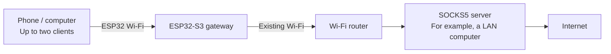
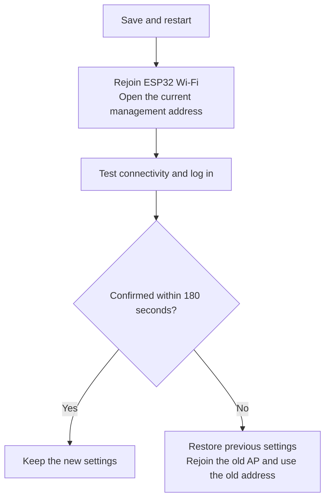

# esp32-socks5-gateway

[English](README.md) · [简体中文](README.zh-CN.md) · [日本語](README.ja.md)

Turn an **ESP32-S3** into a small Wi-Fi gateway. A phone or computer connects to the Wi-Fi network created by the ESP32, and the gateway forwards its IPv4 TCP/UDP traffic through **a SOCKS5 server you provide**. Applications on the client do not need individual proxy settings.

For example, you already run a SOCKS5 service on a computer at home and want two phones to use it. The ESP32 connects to your existing Wi-Fi, creates another Wi-Fi network for the phones, and forwards their traffic to that service.

This is an experimental project for learning ESP32 networking and small-scale use. The default hardware configuration targets **ESP32-S3 N16R8**, with up to two clients. You still need an existing Wi-Fi network and a working SOCKS5 service.

## Reading guide

- [Understand the connection](#understand-the-connection)
- [Performance and suitable uses](#performance-and-suitable-uses)
- [Prepare hardware and software](#prepare-hardware-and-software)
- [Prepare the upstream SOCKS5 service](#prepare-the-upstream-socks5-service)
- [Choose firmware and flashing method](#choose-firmware-and-flashing-method)
- [Flash and connect for the first time](#flash-and-connect-for-the-first-time)
- [Daily use and status LED](#daily-use-and-status-led)
- [Troubleshooting](#troubleshooting)
- [Serial console and recovery](#serial-console-and-recovery)
- [Development and tests](#development-and-tests)
- [Scope and security](#scope-and-security)

For a first setup, follow this order. You can read about tests and implementation after the gateway is working.

## Understand the connection

The ESP32 performs two Wi-Fi roles at the same time:

| Term | Meaning in this project |
| --- | --- |
| AP, access point | The Wi-Fi network created by the ESP32, which your phone or computer joins |
| STA, station | The ESP32 acting as a Wi-Fi client of your existing router |
| Upstream | The external network or service used by the ESP32, such as your home Wi-Fi and SOCKS5 server |
| SOCKS5 | A proxy protocol: the server opens connections and forwards data on a client's behalf |
| Transparent proxy | The gateway handles forwarding when a client joins its Wi-Fi; each application does not need a proxy address |

**This project provides the gateway firmware; you must provide the SOCKS5 service separately.** It can run on a LAN computer or another host reachable by the ESP32. It does not have to run on your router.

The management page runs on the ESP32. You can connect to its AP and configure it even before upstream Wi-Fi is set up.

## Performance and suitable uses

These **historical measurements on an ESP32-S3 N16R8 board** show the throughput range to expect when assessing this project. Download means data reaching the client connected to the ESP32; upload means data sent by that client to the test service. The directions were measured separately, not saturated simultaneously.

| Scenario | Download Mbps | Upload Mbps |
| --- | ---: | ---: |
| One client, one stream | 16.43 | 16.25 |
| One client, four concurrent streams, aggregate | 24.49 | 21.25 |
| Two clients: A idle, B running a one-stream test | 14.21 | 11.97 |
| Two clients: A playing 1080P video, B running a one-stream test | 14.41 | 11.83 |

Tests used Android clients and a LAN test service, reporting the median of three completed rounds per scenario with detailed development diagnostics disabled. Only the last two rows are a same-session comparison: no video stalls were reported on A, and B's results were close to those with A idle. The first two rows come from a different historical test and do not establish a later version's improvement or regression. See [performance and validation](docs/performance.md) for the records.

**Mbps means megabits per second; MB/s means megabytes per second. Divide by about 8 to convert.** Around 16 Mbps for one stream is about 2 MB/s. Around 24 Mbps for four streams is their combined throughput, not 24 Mbps per stream or per client.

| Capacity | Current limit | Meaning |
| --- | ---: | --- |
| Wi-Fi clients | 2 | Can be configured to allow only 1 |
| Active TCP relays | 64 | Shared by both clients, not 64 each |
| UDP flows | 32 | Forwarding state for separate traffic flows, shared by both clients |
| TCP mapping records | 512 | Also retain closing-state information; not 512 active connections |

A burst of short connections can exhaust mapping space before all 64 relays are active. Idle TCP connections also expire; see [connection limits](docs/performance.md#connection-limits) when evaluating applications that keep connections open. Client limits do not guarantee equal bandwidth.

TCP upstream connection/negotiation has a **15-second** deadline. Idle relays expire after **120 seconds**; when capacity is full, a relay idle for at least **30 seconds** with empty queues can be reclaimed. UDP payloads are limited to **1462 bytes per datagram**. Consider these limits when evaluating long-idle applications, connection bursts, or large UDP messages.

Suitable uses include browsing, light transfers, and networking experiments with a small number of devices. The video test supports sharing under those particular conditions, but video buffering and unknown bitrate mean it cannot guarantee smooth playback for all 1080P video. For transfers approaching 100 Mbps, many clients, or several simultaneous high-bitrate streams, choose hardware with greater throughput and capacity.

These are short LAN tests, not public-Internet speed guarantees. Both clients and AP/STA share a single 2.4 GHz radio; adding clients does not double bandwidth. Signal, interference, upstream proxy, destination service, and connection count affect results. Cloud builds and host regressions validate tools and implementation, but cannot replace real radio throughput tests.

## Prepare hardware and software

### Hardware

| Item | Recommended / tested configuration | Notes |
| --- | --- | --- |
| Board | ESP32-S3 N16R8, dual core at 240 MHz | N16R8 means 16 MB Flash and 8 MB PSRAM; check the board specification |
| USB cable | A cable that carries data | A charging-only cable cannot flash firmware or provide a serial console |
| Status LED | One WS2812 / NeoPixel on GPIO48 | A board with a different LED pin does not match this configuration; LED output can be disabled on the management page |
| Wi-Fi router | An available 2.4 GHz network | ESP32-S3 cannot join a network that only provides 5 GHz |
| Test client | One phone or computer | Get one client working before adding the second |

A different LED pin requires matching configuration. The current startup check requires two CPU cores, exactly 16 MB Flash, and initialized 8 MB PSRAM; changing `menuconfig` alone does not support other memory sizes. For a first setup, use the configuration above rather than flashing the default firmware onto an arbitrary ESP32 board.

### Software

| Purpose | What you need |
| --- | --- |
| Flash a precompiled BIN | Official esptool 5.x (5.5.0 recommended; Python ≥ 3.10), or Espressif's Windows graphical tool; a serial driver when needed. **No ESP-IDF or project script required**. See [firmware flashing](docs/flash-prebuilt.md) |
| Build firmware yourself | Git, Python, pinned ESP-IDF/toolchain and managed components; follow the complete [build guide](docs/build-and-flash.md) |
| Use the gateway | Browser, an existing 2.4 GHz Wi-Fi network, and the SOCKS5 service described below |

The management and first-use pages default to English. A Chinese first browser language (`zh` or `zh-*`) selects Simplified Chinese; other or unavailable preferences use English. A secondary Chinese preference does not override an English first preference. Serial commands are in English.

## Prepare the upstream SOCKS5 service

Check that the proxy is reachable **from the ESP32's network**. A proxy working on its own computer does not necessarily accept connections from other devices.

| Requirement | Explanation |
| --- | --- |
| A SOCKS5 listening port | An HTTP proxy port cannot replace a SOCKS5 port |
| NO AUTH support | The firmware does not support SOCKS5 username/password authentication |
| UDP ASSOCIATE support | Ordinary DNS queries and other UDP traffic depend on it; working TCP alone does not verify the whole gateway |
| An address reachable from the LAN | A service bound only to `127.0.0.1` cannot be reached by other devices; enable LAN access using your proxy software's instructions |
| Appropriate firewall access | Allow the TCP control connection and the UDP relay address/port returned by the server; the UDP port may differ from the SOCKS5 listening port |

The UDP relay reply must contain a reachable **IPv4** address; `0.0.0.0` uses the configured proxy address. Domain-name and IPv6 UDP relay replies are unsupported.

Example network settings:

| Purpose | Example value |
| --- | --- |
| Existing Wi-Fi name | `Home-WiFi` |
| Router address | `192.168.1.1` |
| Computer running SOCKS5 | `192.168.1.2` |
| SOCKS5 port | `7897` |
| ESP32 AP / management address | `192.168.4.1` |
| DNS address advertised by DHCP | `1.1.1.1` |

Replace these examples with your network's actual settings. The firmware default `192.168.1.2:7897` does not establish that a proxy exists there. Do not enter your computer's `127.0.0.1` as the server address: to the ESP32, that address refers to the ESP32 itself.

If your upstream SOCKS5 service uses [Xray](https://github.com/XTLS/Xray-core), start with the [complete VLESS + TCP + REALITY client template](examples/xray-client-reality.json) and its [field placement and setup guide (Chinese)](examples/README.md). It runs on the LAN computer; replace all `<...>` placeholders with your LAN address and remote node parameters before checking or running it. The existing [SOCKS settings example](examples/xray-socks-settings.json) and DNS examples remain fragments for integration into an existing configuration. Other proxy software can work if it meets the requirements above. Keep an unauthenticated proxy accessible only to trusted networks.

## Choose firmware and flashing method

You can flash a precompiled BIN **without installing ESP-IDF or running a project script**, or build from source when changing compiled defaults or developing the project.

| Goal | Guide |
| --- | --- |
| First installation / reset | Write the complete `*-factory.bin` at `0x0`; **resets saved settings**. [Windows 11 / Linux guide](docs/flash-prebuilt.md) includes official CLI and Windows GUI steps |
| Compatible application update | Write `*-sysupgrade.bin` at `0x10000`; normally retains settings. Existing bootloader, partitions and settings must be compatible |
| Build your own firmware | [Windows 11 / Linux / WSL2 build and flash](docs/build-and-flash.md): exact SDK commits, lwIP override, configuration, build, partitions, and troubleshooting |

Formal [project releases](https://github.com/noaic/esp32-socks5-gateway/releases) use `vYY.MM.DD` and provide only versioned `*-factory.bin` and `*-sysupgrade.bin` files. Checksums appear on the release page; notices are included in its source archives. Actions retain a fuller developer verification package. If no release is available, build from source. Default images use the AP credentials below and contain no upstream Wi-Fi credentials. **ESP32-S3 N16R8 is required**.

The source-build guide preserves the complete setup commands. An arbitrary newer ESP-IDF is not interchangeable: the `ip4.c` patch and dependency pins must match.

## Flash and connect for the first time

### 1. Write the firmware to the board

Use the [precompiled-firmware guide](docs/flash-prebuilt.md) or the [source-build guide](docs/build-and-flash.md). Both explain ports, Linux permissions and WSL2 USB mapping. **`*-factory.bin` overwrites NVS settings, even without a full-Flash erase.** Compatible app-only or separate-image updates normally preserve NVS. Do not erase all Flash routinely.

The console runs at **115200 baud on UART0**. Use the board's UART / USB-UART connector for logs and commands; a native USB connector that can flash may not carry UART logs. Close other serial tools before flashing.

### 2. Join the ESP32 Wi-Fi network

Connect your phone or computer to `ESP32-Transparent-Proxy`, using the AP password from your firmware package or your source-build configuration. The unchanged development default is `esp32proxy`; replace it before normal use.

Use **automatic IPv4/DHCP** on the client. Manually assigned static IPs are not registered for forwarding, even if the local management page opens.

Without upstream settings, a phone may say this Wi-Fi has no Internet access. Choose to stay connected so you can open the local management page. During the first test, temporarily disabling mobile data or automatic network switching helps confirm that traffic is actually going through the ESP32.

### 3. Set the management password

Enter **http://192.168.4.1/** in the browser address bar. Use `http://` explicitly; the management page does not provide HTTPS.

On first access, set a management password. The username is always **`admin`**. The password must be **12–64 bytes**; ASCII characters make the length easier to judge. After saving, open the management page and log in with `admin` and your new password.

Three different passwords serve three different purposes:

| Password | Used by | Set through |
| --- | --- | --- |
| Upstream Wi-Fi password | ESP32 joining your existing router | Management page or `menuconfig` |
| AP Wi-Fi password | Phone/computer joining the ESP32 | Management page or `menuconfig` |
| Management password | Logging in to the ESP32 page as `admin` | First-use page, then management settings |

The SOCKS5 server uses NO AUTH, so there are no SOCKS5 username/password fields.

### 4. Enter network and proxy settings

Open “Network settings” and enter (English interface labels are used below):

| Page field | What to enter |
| --- | --- |
| Upstream Wi-Fi SSID / password | Your existing 2.4 GHz Wi-Fi name and password |
| SOCKS5 IPv4 | The server's IPv4 address reachable by the ESP32, such as `192.168.1.2` |
| SOCKS5 port | Its actual SOCKS5 listening port, such as `7897` |
| AP name / password | Name/password of the Wi-Fi created by the ESP32 |
| Maximum clients | Maximum clients: 1 or 2 |
| DNS IPv4 advertised by DHCP | DNS server for clients, such as `1.1.1.1` |
| AP subnet third octet X | Third part of the AP address: default 4 gives `192.168.4.1` |

**An empty password field preserves the existing password.** It does not clear it. For an upstream Wi-Fi network without a password, select “Upstream Wi-Fi has no password”.

SSID and password limits use UTF-8 **bytes**, not character counts: SSID up to 32, AP password 8–63, and management password 12–64. A nonempty upstream password normally needs 8–63 bytes; a 64-byte value must be a hexadecimal PSK. ASCII passwords are easier to count.

Upstream and AP networks must not overlap. For a typical `255.255.255.0` network, upstream `192.168.1.x` and AP `192.168.4.x` are separate. If upstream also uses `192.168.4.x`, you could change X to 10 and use `192.168.10.1` for management. The page detects conflicts using the actual network masks.

### 5. Save, reconnect, and confirm

Click “Save and restart”. Losing the current connection is expected. The new configuration is tried first: **after restart, click “Confirm and keep configuration” within 180 seconds**, or the device restores the previous settings.

Use the new AP name/password if changed, the new management address if X changed, and the new management password if changed. If a client retains its old IP address, disconnect and reconnect Wi-Fi to obtain a new DHCP lease.

Before confirming, check that STA has an IPv4 address, run “Run connection diagnostics”, and try an ordinary webpage. After confirmation, use “Check Internet now” for an additional check. Automatic Internet checks wait until network settings are confirmed. A single LED color or an “accepted” operation message is insufficient to establish successful connectivity.

## Daily use and status LED

The management page first shows the connection overview, next-step advice, and connected devices. Expand Network settings, Connection diagnostics and Internet check, Device details/resources/events, or Connection maintenance when needed. Basic upstream settings remain together; local AP, DNS, and management-password fields are grouped inside the settings section. You can reconnect upstream Wi-Fi, close existing proxy connections, or restart the board. These actions can interrupt downloads/video; check the result and avoid repeatedly submitting an action.

If an immediate setting/action response is lost, the page keeps checking current status and does not automatically repeat the request. It lets you retry or confirm the network configuration; reaching the requested state does not prove which request caused it. Network saves, queued maintenance and restart operations still wait for their matching result.

| Color | Meaning | Next step |
| --- | --- | --- |
| Blue | Upstream Wi-Fi has not been configured | Enter its SSID/password |
| Red | Upstream is configured, but STA is not ready | Check 2.4 GHz Wi-Fi, password, and signal |
| Purple | AP+STA ready, but an Internet result is unconfirmed, being checked, or expired | Inspect diagnostics and test a real webpage |
| Green | A recent DNS/HTTP check through SOCKS5 passed | The check target was recently reachable; other sites may still fail |
| Yellow | Subnet conflict or repeated failures for the check target | Inspect the conflict warning and failing diagnostic step |

A successful result remains valid for 10 minutes. Normal automatic checks run every 5 minutes, with retry backoff after failures. Check failures do not automatically restart the board. Automatic checks and LED output can be disabled; those preferences are saved.

**Connection diagnostics** checks the upstream TCP port, SOCKS5 NO AUTH handshake, and UDP DNS round trip. **Internet check** additionally connects to a selected HTTP target through the proxy. Interpret both alongside actual application behavior.

## Troubleshooting

Check from the nearest component outward: **client → ESP32 AP → upstream Wi-Fi → SOCKS5 → DNS / destination site**. Get one client working before adding a second.

Build, SDK, patch, and tool-download problems are covered in [build troubleshooting](docs/build-and-flash.md#build-troubleshooting).

| Symptom | Check first |
| --- | --- |
| Startup reports a PSRAM error | Board really matches N16R8/Octal PSRAM settings and has stable power |
| Phone reports no Internet | Stay connected during initial setup; afterward check STA and proxy. Prevent mobile-data switching while testing |
| Management page does not open | Joined the ESP32 AP, explicit `http://`, current address after an X change, and a fresh DHCP lease |
| Management login fails | Username is `admin`; management password is separate from the AP password; use the current password after changes |
| Management works but all client Internet traffic fails | Set the client to automatic IPv4/DHCP, reconnect, then check STA and the proxy |
| STA never becomes ready | SSID/password, 2.4 GHz availability, signal; empty SSID disables connection attempts |
| Upstream TCP port check fails | SOCKS5 IP/port, LAN access, firewall; do not use `127.0.0.1` |
| TCP port works but NO AUTH fails | An HTTP port was entered, or the proxy requires credentials |
| Some pages work but DNS/UDP fails | UDP ASSOCIATE support, reachable relay address/UDP port returned by the server, and DNS configuration |
| Settings revert after saving | Confirmation within 180 seconds; after rollback, use the previous AP settings/address |
| `menuconfig` changes do not affect the board's network | Stored NVS settings take precedence; change them on the page or restore compiled defaults as described below |
| A third client cannot join | Maximum is two, configurable to one; disconnect another device first |

Use serial recovery if you forget the management password or lose access after changing network settings. See [maintenance and recovery](docs/maintenance.md) for more detail.

## Serial console and recovery

Commands are in English. Enter them in ESP-IDF monitor or a serial terminal that can send text; press Enter after each command.

The firmware displays `gateway> ` and echoes accepted ASCII characters as you type. Backspace/Delete removes the last character; Enter (LF, CR, or CRLF) submits once and displays the prompt again. Type only the command, without `gateway> `. Disable your terminal's **local echo** if characters appear twice. Input is limited to 95 bytes per line. State-changing and recovery commands are limited to one per second; `help`, `status`, `events`, and `log` without an argument can be read immediately, and `cancel` can cancel immediately. Arrow-key editing/history is not supported. Live logs can interrupt the input line, so use `log warn` or `log off` when needed.

| Command | Purpose |
| --- | --- |
| `help` | Show help |
| `status` | Current network/resource state |
| `events` | Recent events |
| `log` | Show the current logging level |
| `log info` | Temporarily increase diagnostic logging |
| `log warn` | Return to everyday WARN logging |
| `log off` | Disable logging |
| `reset-admin` | Request management password removal, keeping current network settings |
| `reset-network` | Request compiled network defaults, keeping the management password |
| `confirm CODE` | Confirm recovery; replace CODE with the code just shown by this device |
| `cancel` | Cancel pending recovery |

Neither `reset-*` command acts immediately. The board displays the effects and a **one-use code valid for 30 seconds**. Read the message, then enter `confirm` followed by that code. Do not type the literal `CODE`. Successful recovery restarts the board; both recovery operations cancel an active configuration trial.

After `reset-admin`, open the page and set a new password. After `reset-network`, use the compiled AP name/password and management address `192.168.4.1`. If you entered Wi-Fi credentials in `menuconfig`, the compiled defaults contain them; “defaults” does not mean all passwords become empty.

The Web “Restore default configuration” action also keeps the management password, but requires the 180-second confirmation after restarting. Serial `reset-network` uses the 30-second code above. **RST/EN and power cycling only restart the board; they do not clear saved passwords/network settings. BOOT is not a recovery-menu button.** Routine recovery does not require erasing all Flash.

For log capture and POSIX line-based input, see the [serial tools guide](tools/README.md).

## Development and tests

The application uses ESP-IDF drivers/services, FreeRTOS tasks, and the lwIP TCP/IP stack. A project-local lwIP patch intercepts client packets, records their original destination, and restores reply addresses; TCP uses SOCKS5 `CONNECT`, while UDP uses `UDP ASSOCIATE`. The global SDK remains unchanged.

Read [implementation and development](docs/development.md) for the packet path, module/source map, regression commands, and tools overview. [Build and flash](docs/build-and-flash.md) explains exact dependencies and the lwIP `apply` / `check` / `restore` workflow.

- [Document index](docs/README.md): all current guides and historical records.
- [Maintenance and recovery](docs/maintenance.md): configuration trials and recovery boundaries.
- [Performance and validation](docs/performance.md): historical measurements and test limits.
- [Tool usage](tools/README.md): serial capture, probes, benchmarks, and packaging.

Generated build files, logs, personal configurations, and firmware packages can contain sensitive information. Check `git status` before sharing them.

## Scope and security

The gateway supports IPv4, SOCKS5 NO AUTH, TCP, and UDP forwarding. It does not provide IPv6, HTTP upstream proxies, SOCKS5 account authentication, BLE, OTA, native VLESS/REALITY upstreams, or on-device GeoIP/GeoSite routing. It does not run its own SNTP client or NTP server; client NTP packets use the general UDP path, without dedicated NTP validation. Transparent forwarding rejects IPv4 header options and IPv4 fragments; UDP payloads above 1462 bytes and fragmented SOCKS UDP packets (`FRAG != 0`) are dropped. IPv4 fragmentation and SOCKS fragmentation are separate restrictions. Broadcast, multicast, and special P2P behavior are outside scope, and complete QUIC compatibility has not been verified.

Two clients share one 2.4 GHz radio and total forwarding capacity. Client limits do not guarantee equal bandwidth. This project is unsuitable as a replacement for equipment requiring many users, high throughput, or full routing features. PSRAM adds memory, but Wi-Fi/lwIP still depend on limited internal RAM. Long-term stability, interrupted Flash writes, and real upstream outages need further validation.

Management is available only on the AP, but uses HTTP. Management passwords/network settings are stored unencrypted in NVS. Serial recovery assumes physical access and has no login authentication; secure boot and Flash encryption are not enabled. Set up the device from a trusted client/network, choose your own passwords, and keep the management page and unauthenticated proxy off the public Internet.

## License and upstream notices

Original project code is provided under the [MIT License](LICENSE). Third-party code and adapted examples retain their own licenses and copyright notices; see [third-party notices](THIRD_PARTY_NOTICES.md). Firmware packages include the applicable license texts. MIT does not replace upstream licenses.
