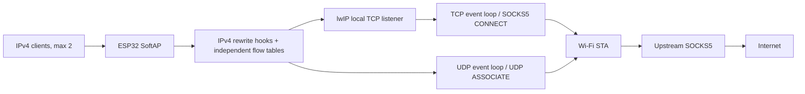

# esp32-socks5-gateway

[English](README.md) · [简体中文](README.zh-CN.md) · [日本語](README.ja.md)

ESP32-S3 IPv4 Transparent SOCKS5 Gateway：终端连接 ESP32 的 Wi-Fi AP 后，无需手动设置代理，即可通过上游 SOCKS5 访问网络。

这是一个个人实验项目。当前可用基线为 **web51**，已验证两台 Android 同时接入、TCP/UDP 转发、Web 管理、配置回滚和串口恢复。发布目录中的网络地址是示例，不包含作者的 Wi-Fi 凭据或设备配置。

## 功能与范围

- IPv4 Wi-Fi AP+STA，最多两个 AP 客户端；客户端使用 DHCP。
- 透明 TCP → SOCKS5 CONNECT，透明 UDP → SOCKS5 UDP ASSOCIATE，SOCKS5 v5 NO AUTH。
- 一个固定 TCP 事件循环及一个 UDP 事件循环；lwIP 负责握手、ACK、重传、窗口和关闭。
- 独立流表：64 个活动 TCP relay、512 条 TCP 映射、32 个 UDP flow；不在 PCB 中保存业务元数据。
- AP 本地 Web 管理：首次设置口令、运行状态、逐客户端统计、配置、事件、连接诊断、维护与重启。
- 网络配置保存后重启，180 秒内确认；未确认自动回滚。
- GPIO48 WS2812 状态灯，可在管理页关闭并持久保存。
- 英文串口命令及带单次确认的口令/网络恢复。

不实现 IPv6、HTTP 上游代理、BLE、OTA、VLESS/REALITY、本地 GeoIP/GeoSite 分流或 NTP。UDP `FRAG != 0` 丢弃；不承诺广播、组播和 P2P 特殊语义。客户端数量限制不是带宽公平保证。

## 硬件与软件

| 项目 | 已验证配置 |
| --- | --- |
| 芯片/模组 | ESP32-S3 N16R8，双核 240 MHz |
| Flash | 16 MB，DIO，80 MHz |
| PSRAM | 8 MB，Octal，80 MHz，启动内存测试 |
| RGB | 单颗 WS2812/NeoPixel，GPIO48 |
| UART | 115200 baud；本机曾使用 `/dev/ttyACM0` |
| ESP-IDF | v6.1，精确 revision 见下方 |
| 工具链 | 已验证 xtensa-esp32s3-elf-gcc 15.2.0 |
| 组件 | cJSON 1.7.19，led_strip 3.0.3，锁定于 `dependencies.lock` |

lwIP 补丁固定对应：

- ESP-IDF：`fff9895c82d744c7237be8847347bdd1b07c6643`
- esp-lwIP：`c6f2f878e7b0f86033214b85547d579be43351e3`

脚本会检查 revision 和源码哈希，不会把旧补丁强行应用到其他版本。仅版本号同为 v6.1，也不意味着 revision 一致。

## 架构



TCP 入站保存原始目的地址，再改写为本地 listener；输出回客户端时反向改写并修复校验和。lwIP 继续处理 TCP。UDP 使用有界流表及每 flow 的独立 association，不把不同源端口强行共用一个上游 association。本项目不是 NAT 软路由，也不是 Linux TPROXY。

补丁只放入项目生成的 `components/lwip` 覆盖组件，**不修改全局 ESP-IDF 安装**。源码包只带补丁与脚本，不带复制的完整 lwIP。

## 构建与首次使用

先安装并激活上述 ESP-IDF revision，初始化其子模块。官方安装说明：[ESP-IDF 入门](https://docs.espressif.com/projects/esp-idf/en/latest/esp32s3/get-started/index.html)。普通安装使用 `source "$IDF_PATH/export.sh"`；EIM 安装请使用自己的 EIM 激活脚本。

在项目根目录执行：

```bash
python3 tools/prepare_lwip.py apply
idf.py menuconfig
idf.py build
idf.py size
```

在 `Transparent gateway Wi-Fi` 填上游 Wi-Fi SSID/密码并修改默认 AP 密码。默认 STA SSID 为空，AP 能启动，STA 不尝试连接。目标和硬件参数由 `sdkconfig.defaults` 固化；已有 `sdkconfig` 时 defaults 不会覆盖它。

准备烧录时自行选择正确串口：

```bash
idf.py -p /dev/ttyACM0 flash monitor
```

随后：

1. 连接 `ESP32-Transparent-Proxy`。默认开发 AP 密码为 `esp32proxy`，使用前应修改。
2. 打开 **http://192.168.4.1/**，首次访问自行设置管理口令。
3. 在上游配置中填写实际 SOCKS5 IPv4/端口；源码默认值 `192.168.1.2:7897` 只是示例。上游必须允许局域网访问、NO AUTH 和 UDP ASSOCIATE。
4. 保存配置，重连 AP，在 180 秒内确认；检查 DNS、普通网页和连接诊断。

上游 Wi-Fi 也可在 Web 页面填写。首次设置管理口令与 AP Wi-Fi 密码是两件事。已保存的 NVS 配置优先于编译默认值，普通重新烧录应用不会替换已有配置。

本地 AP 为 `192.168.X.1/24`，可以修改第三段。若上游与 AP 网段重叠，应修改 AP 网段；保存后重启，页面提示新地址，未确认时会回滚。DHCP 默认下发 `1.1.1.1`；本地不是 DNS 服务器，DNS UDP 请求与其他 UDP 一样经 SOCKS5。

## 状态灯与恢复

红：STA 未就绪；蓝：仅 AP 就绪；紫：AP+STA 就绪但互联网结果未知/过期；绿：最近经 SOCKS5 的 DNS/HTTP 检查通过；黄：冲突或连续检查失败。绿灯代表检测目标最近可达，不保证所有网站均正常。自动正常检查间隔 5 分钟，可关闭；不因检测失败自动重启。

串口命令：

```text
help
status
events
log info
log warn
log off
reset-admin
reset-network
confirm CODE
cancel
```

- `reset-admin`：清管理口令、保留当前网络，取消试运行，重启后重新设置口令。
- `reset-network`：恢复编译默认网络、保留当前管理口令，取消试运行，重启；入口回到 `192.168.4.1`。
- 两条恢复命令先显示影响及随机确认码，30 秒内输入该次代码；代码只用一次。不要照抄 `CODE`。
- RST/EN 只重启，不清除口令或网络；BOOT 未用于恢复菜单。

烧录、monitor 与串口采集工具不要同时占用设备。`tools/uart_capture.py --no-reset --interactive --timestamps` 支持同一连接读取日志并发送命令。详细说明见 [维护与恢复](docs/maintenance.md)。

## 验证与性能

本项目的 75 项宿主回归覆盖 TCP/UDP、流表、客户端隔离、配置、NVS 事务及串口保护；另有前端反馈/兼容测试。先执行一次 IDF 构建以获取锁定的 cJSON 组件，再在 Linux 的 Python 环境运行（需 pyserial/esptool）；确保系统 GCC/binutils 优先于交叉工具链，如有需要使用 Python 解释器绝对路径：

```bash
PATH=/usr/bin:/bin:$PATH python -m unittest discover -s tests
node tests/management_feedback_harness.js
node tests/management_transport_harness.js
```

Node 仅用于前端测试，不是固件依赖。宿主测试不能替代真实 Wi-Fi、掉电或长时间稳定性实验。

历史本地基线：单客户端单路约 **16/16 Mbps**，四路总吞吐约 **24/21 Mbps**。最新混合负载：A 播放 1080P 无卡顿，B 单路 **14.41/11.83 Mbps**，与 A 空闲时 **14.21/11.97 Mbps** 接近。这些是特定手机/上游/空口的短期成绩，不保证公网速度或严格公平。详见 [性能与验证](docs/performance.md)。

测速页面和自动回传服务在 `tools/`，服务默认端口 `18080`；开发诊断硬编码的示例 peer 为 `192.168.1.10:18080`，应按测试环境修改，日常构建关闭该诊断。

## 目录

| 路径 | 内容 |
| --- | --- |
| `main/` | AP+STA、透明流处理、SOCKS5、Web、状态与串口管理 |
| `patches/` | 固定 revision 的最小 lwIP 补丁及元数据 |
| `tools/` | 补丁应用、采集、测速、探测和归档校验 |
| `tests/` | 宿主 C/Python harness 和前端 JS 测试 |
| `examples/` | 示例 Xray SOCKS/DNS 配置片段，不是完整服务器配置 |
| `docs/` | 架构、维护、性能与脱敏后的历史记录 |

Wi-Fi 密码、生成的 `sdkconfig`、板上 NVS、原始日志、build、managed_components 和本机二进制快照不入库。历史文档中的地址/MAC/路径已泛化，引用的本机实验产物没有上传。当前行为以本 README 和 `docs/` 顶层说明为准。

## 已知边界

管理接口只绑定 AP，但仍是 HTTP；管理口令和网络配置未加密存储于 NVS。串口是物理恢复入口，不做身份认证。该项目未启用安全启动/Flash 加密。首次设置应由可信终端完成；不要将管理接口暴露到公网。

8 MB PSRAM 不能替代 Wi-Fi/lwIP 对内部 RAM 的要求；两个客户端共享单射频 AP+STA 空口和总流容量。弱信号、上游故障、长 RTT 或连接突发都可能限制吞吐。尚未完成真实写 Flash 时断电、共享 Xray 中途停止和长期稳定性覆盖。
