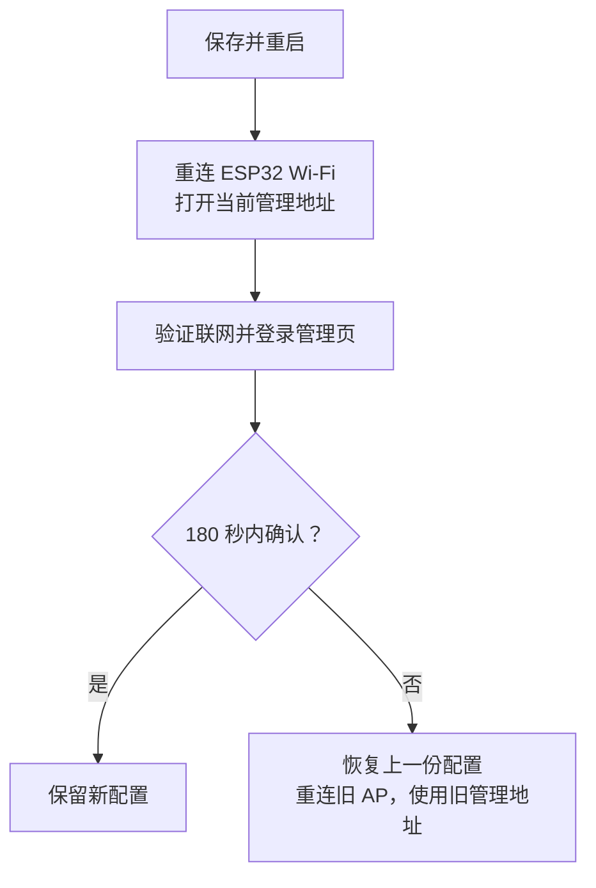

# esp32-socks5-gateway

[English](README.md) · [简体中文](README.zh-CN.md) · [日本語](README.ja.md)

把 **ESP32-S3** 变成一个小型 Wi-Fi 网关：手机或电脑连接它创建的 Wi-Fi 后，IPv4 的 TCP/UDP 通信会通过你提供的 **SOCKS5 代理服务器**转发，终端无需逐个应用设置代理。

例如，你已经在家里的电脑上运行了 SOCKS5 服务，希望两台手机都能使用它。ESP32 一边连接家里的 Wi-Fi，一边为手机提供另一个 Wi-Fi，并在两者之间转发通信。

这是一个实验项目，适合学习 ESP32 网络开发和小规模使用。默认配置针对 **ESP32-S3 N16R8**，最多接入两台终端；它仍需要已有的 Wi-Fi 网络和可用的 SOCKS5 服务。

## 阅读导航

- [先理解它怎么工作](#先理解它怎么工作)
- [性能与适用场景](#性能与适用场景)
- [准备硬件和软件](#准备硬件和软件)
- [准备上游 SOCKS5 服务](#准备上游-socks5-服务)
- [选择固件与刷写方式](#选择固件与刷写方式)
- [烧录并完成首次联网](#烧录并完成首次联网)
- [日常使用与状态灯](#日常使用与状态灯)
- [常见问题与排查](#常见问题与排查)
- [串口与恢复设置](#串口与恢复设置)
- [继续开发与运行测试](#继续开发与运行测试)
- [功能边界与安全说明](#功能边界与安全说明)

第一次使用，建议按上面的顺序阅读；已经能联网后，再查看测试和实现原理。

## 先理解它怎么工作

这里有两个 Wi-Fi 角色，它们由同一块 ESP32 同时承担：

| 名词 | 在本项目中的意思 |
| --- | --- |
| AP，接入点 | ESP32 创建的 Wi-Fi，手机或电脑连接它 |
| STA，客户端 | ESP32 作为 Wi-Fi 客户端，连接你已有的无线路由器 |
| 上游 | ESP32 连接的外部网络或服务，例如家里的 Wi-Fi 和 SOCKS5 服务器 |
| SOCKS5 | 一种代理协议；代理服务器代替客户端建立连接并转发数据 |
| 透明代理 | 终端连接网关 Wi-Fi 后，网关处理转发，终端应用无需单独填写代理地址 |

**本项目提供网关固件，SOCKS5 服务需要你另外准备。** SOCKS5 可以运行在局域网电脑或其他 ESP32 能访问的主机上；它不一定运行在无线路由器里。

管理页面运行在 ESP32 上。即使还没有填写上游 Wi-Fi，也可以先连接 ESP32 的 AP，打开管理页面完成配置。

## 性能与适用场景

下面是 ESP32-S3 N16R8 的**历史板上实测**，可以用来估计项目的吞吐量级。下载指数据送到连接 ESP32 的终端，上传指终端向测试服务发送数据；两个方向分别测量，并非同时满速。

| 场景 | 下载 Mbps | 上传 Mbps |
| --- | ---: | ---: |
| 一台终端，单路传输 | 16.43 | 16.25 |
| 一台终端，四路并行的合计吞吐 | 24.49 | 21.25 |
| 两台终端：A 空闲，B 单路测速 | 14.21 | 11.97 |
| 两台终端：A 播放 1080P 视频，B 单路测速 | 14.41 | 11.83 |

测试使用 Android 终端和局域网测试服务，每种场景完成三轮后取中位数，日常详细诊断关闭。最后两行是同一测试会话中的比较：A 播放视频时未报告卡顿，B 的测速结果与 A 空闲时接近。前两行来自另一组历史测试，不能直接据此推断后来版本变慢或变快。具体记录见 [性能与验证](docs/performance.md)。

**Mbps 是兆比特每秒，MB/s 是兆字节每秒，换算时约除以 8。** 单路约 16 Mbps 相当于约 2 MB/s；四路约 24 Mbps 是所有并行传输的合计，既不是每路 24 Mbps，也不是每台终端各有 24 Mbps。

| 容量项目 | 当前上限 | 含义 |
| --- | ---: | --- |
| Wi-Fi 终端 | 2 台 | 可配置为只允许 1 台 |
| 活动 TCP 转发连接 | 64 条 | 两台终端共享，不是每台各 64 条 |
| UDP flow | 32 条 | 不同通信的转发状态；两台终端共享 |
| TCP 映射记录 | 512 条 | 还保留结束阶段信息，不等于 512 条活动连接 |

每个终端槽位最多保留 **256 条 TCP 映射**，包含该槽位之前连接留下的记录；其中最多 **16 条初始映射等待 TCP 监听端接纳**。只有一台终端时也适用，避免新连接突发占满另一槽位的映射空间。结束后的记录至少保留 **120 秒（2×MSL）**；大量短连接可能在活动转发数达到 64 前就触及映射上限。这些限制不保证带宽均分。

TCP 上游连接及协商期限为 **15 秒**，转发连接空闲 **120 秒**后关闭；容量已满时，可回收空闲至少 **30 秒**且收发队列为空的连接。UDP 每个数据报的有效载荷最多 **1462 字节**。评估长时间空闲的应用、连接突发或较大 UDP 消息时，请考虑这些限制。

它适合少量终端的网页访问、轻量传输和网络开发实验。历史视频测试支持“特定条件下可与另一台终端并用”，但视频可能提前缓存，实际码率也未知，不能保证所有 1080P 视频都流畅。如果你的目标是接近 100 Mbps 的传输、大量终端或多台同时进行高码率播放，应选用吞吐和容量更高的设备。

这些数值来自短期局域网测试，不是公网速度承诺。两台终端和 AP/STA 共用一个 2.4 GHz 无线电，更多终端不会让带宽翻倍；信号、干扰、上游代理、目标服务及连接数量都会影响结果。云端构建和宿主回归能验证实现与工具链，无法替代真实无线吞吐测试。

## 准备硬件和软件

### 硬件

| 项目 | 推荐 / 已验证配置 | 注意事项 |
| --- | --- | --- |
| 开发板 | ESP32-S3 N16R8，双核 240 MHz | N16R8 表示 16 MB Flash 和 8 MB PSRAM；购买前确认板型 |
| USB 线 | 能传输数据的 USB 线 | 只能充电的线无法烧录或读取串口 |
| 状态灯 | GPIO48 上的单颗 WS2812 / NeoPixel | 若板上灯的引脚不同，当前灯控配置不匹配；可在管理页关闭灯 |
| 无线路由器 | 可用的 2.4 GHz Wi-Fi | ESP32-S3 使用 2.4 GHz，不能连接只提供 5 GHz 的网络 |
| 测试终端 | 一台手机或电脑 | 第一次先验证一台，再接入第二台 |

LED 引脚不同需要匹配配置。当前启动检查要求双核、恰好 16 MB Flash 和已初始化的 8 MB PSRAM；仅修改 `menuconfig` 不能支持其他内存规格。第一次使用建议选择上述配置，不要直接把默认固件用于任意 ESP32 板。

### 软件

| 用途 | 需要准备 |
| --- | --- |
| 刷入预编译 BIN | 官方 esptool 5.5.0（Python ≥ 3.10），或乐鑫 Windows 图形工具；必要时安装串口驱动。**无需 ESP-IDF 或项目脚本**。见[固件刷写](docs/flash-prebuilt.zh-CN.md) |
| 自行编译固件 | Git、Python、精确版本的 ESP-IDF/工具链与托管组件，完整步骤见[编译指南](docs/build-and-flash.zh-CN.md) |
| 使用网关 | 浏览器、已有 2.4 GHz Wi-Fi，以及下文要求的 SOCKS5 服务 |

管理页和首次设置页默认英文；浏览器首选语言为中文（`zh` 或 `zh-*`）时显示简体中文，其他语言或无法识别时使用英文。首选英文、备用中文时仍显示英文。串口命令为英文。

## 准备上游 SOCKS5 服务

先确认代理服务器能从 **ESP32 所在的网络**访问。电脑上“自己的代理能用”，不一定代表其他设备也能连上。

| 必须满足的条件 | 说明 |
| --- | --- |
| 提供 SOCKS5 端口 | HTTP 代理端口不能直接代替 SOCKS5 端口 |
| 支持 NO AUTH | 当前固件不支持 SOCKS5 用户名 / 密码认证 |
| 支持 UDP ASSOCIATE | 普通 DNS 查询等 UDP 通信依赖它；仅 TCP 可用不足以验证完整功能 |
| 监听局域网可访问的地址 | 只监听 `127.0.0.1` 时，其他设备不能访问；应按代理软件说明启用局域网访问 |
| 防火墙允许相应通信 | 除 TCP 控制连接外，还需允许服务返回的 UDP 中继地址 / 端口；它不一定与 SOCKS5 监听端口相同 |

一个配置示例：

| 用途 | 示例值 |
| --- | --- |
| 已有 Wi-Fi 名称 | `Home-WiFi` |
| 无线路由器地址 | `192.168.1.1` |
| 运行 SOCKS5 的电脑地址 | `192.168.1.2` |
| SOCKS5 端口 | `7897` |
| ESP32 AP / 管理页面地址 | `192.168.4.1` |
| DHCP 下发的 DNS 地址 | `1.1.1.1` |

这些地址仅用于说明。请换成你自己的网络参数；固件默认的 `192.168.1.2:7897` 并不表示该地址一定存在代理服务。也不要把电脑上的 `127.0.0.1` 填给 ESP32：对 ESP32 来说，它代表 ESP32 自己。

上游 SOCKS5 服务使用 [Xray](https://github.com/XTLS/Xray-core) 时，可先阅读 [VLESS + TCP + REALITY 完整客户端模板](examples/xray-client-reality.json)及其 [字段位置与使用说明](examples/README.md)。它运行在局域网电脑上；须将所有 `<...>` 占位符替换为自己的 LAN 地址和远端节点参数，再执行配置检查或启动。原有 [SOCKS 设置示例](examples/xray-socks-settings.json)及 DNS 示例仍是用于合并到已有配置的片段。其他代理软件只要满足上述条件也可以使用。无认证的代理应仅对可信网络开放。

## 选择固件与刷写方式

可以直接刷入预编译 BIN，**无需安装 ESP-IDF 或运行项目脚本**；需要修改编译默认值或继续开发时再从源码构建。

| 目的 | 对应指南 |
| --- | --- |
| 首次安装 / 重置 | 完整 `factory.bin` 写入 `0x0`，**会重置已保存的配置**。[Windows 11 / Linux 指南](docs/flash-prebuilt.zh-CN.md)包含官方命令行与 Windows 图形操作 |
| 兼容的应用更新 | `app.bin` 写入 `0x10000`，通常保留配置；要求板上 Bootloader、分区和配置版本兼容 |
| 自行编译固件 | [Windows 11 / Linux / WSL2 编译与刷写](docs/build-and-flash.zh-CN.md)：精确 SDK 提交、lwIP Override、配置、编译、分区及构建排错 |

从可信的[项目发布页](https://github.com/noaic/esp32-socks5-gateway/releases)或成功的固件构建产物下载 BIN、校验值和版权说明。可选的 `firmware.zip` 将这些文件打包，里面不含主机端脚本。如果暂时没有产物，则按源码指南编译。默认镜像使用下文的 AP 信息，不预置上游 Wi-Fi 口令。**当前要求 ESP32-S3 N16R8**。

源码指南保留完整环境命令。不能任意换成更新的 ESP-IDF：`ip4.c` 补丁和依赖固定版本必须匹配。

## 烧录并完成首次联网

### 1. 将固件写入开发板

按[预编译固件指南](docs/flash-prebuilt.zh-CN.md)或[源码构建指南](docs/build-and-flash.zh-CN.md)操作；两者说明了串口识别、Linux 权限和 WSL2 USB 映射。**`factory.bin` 即使不执行全 Flash 擦除，也会覆盖 NVS 配置。**兼容的应用更新或分段刷写通常保留 NVS，不要把全 Flash 擦除当作日常更新步骤。

控制台使用 **UART0、115200 波特率**。查看日志和输入命令优先使用开发板的 UART / USB-UART 接口；能通过原生 USB 刷写，不代表该接口能显示 UART 日志。刷写前退出其他串口程序。

### 2. 连接 ESP32 创建的 Wi-Fi

在手机或电脑上连接 `ESP32-Transparent-Proxy`，使用固件包说明或自行编译时设置的 AP 密码。未修改时，开发默认密码是 `esp32proxy`，应在正常使用前更换。

首次上游尚未配置，手机可能提示“此 Wi-Fi 无法访问互联网”。请选择保持连接；此时能访问本地管理页面就可以继续。为确认流量确实经过 ESP32，可在初次验证时暂时关闭手机的移动数据 / 自动切换网络功能。

### 3. 设置管理口令

在浏览器地址栏输入 **http://192.168.4.1/**。请明确使用 `http://`；管理页面不提供 HTTPS。

首次访问会要求设置管理口令。账号固定为 **`admin`**，口令为 **12～64 字节**，建议用 ASCII 字符组合，便于判断长度。设置后打开管理页，用 `admin` 和刚设置的口令登录。

下面三种密码用途不同：

| 密码 | 谁使用 | 在哪里设置 |
| --- | --- | --- |
| 上游 Wi-Fi 密码 | ESP32 连接已有路由器 | 管理页或 `menuconfig` |
| AP Wi-Fi 密码 | 手机 / 电脑连接 ESP32 | 管理页或 `menuconfig` |
| 管理口令 | 登录 ESP32 管理页面，账号为 `admin` | 首次设置页面，之后可在管理页修改 |

SOCKS5 上游使用 NO AUTH，因此这里没有 SOCKS5 用户名 / 密码输入项。

### 4. 填写网络和代理参数

打开“网络设置”并填写；以下采用中文界面名称，浏览器首选英文时对应 “Network settings”：

| 页面字段 | 应填写的内容 |
| --- | --- |
| 上游 Wi-Fi SSID / 密码 | 已有的 2.4 GHz Wi-Fi 名称和密码 |
| SOCKS5 IPv4 | 代理服务器能被 ESP32 访问的 IPv4 地址，例如 `192.168.1.2` |
| SOCKS5 端口 | 代理实际监听的 SOCKS5 端口，例如 `7897` |
| AP 名称 / 密码 | ESP32 提供给终端的 Wi-Fi，可按需要修改 |
| 最大接入数 | 1 或 2 |
| DHCP 下发的 DNS IPv4 | 终端使用的 DNS，例如 `1.1.1.1` |
| AP 网段第三段 X | 默认 4，即管理地址为 `192.168.4.1` |

管理页的密码输入框**留空表示保留原密码**，不表示清空。连接无密码的上游 Wi-Fi 时，需勾选“上游 Wi-Fi 无密码”。SSID 和密码按 UTF-8 字节计数，中文字符通常占多个字节。

上游网络与 ESP32 AP 网络不能重叠。以常见的 `255.255.255.0` 网络为例：上游用 `192.168.1.x` 时，AP 默认 `192.168.4.x` 可以区分；如果上游也用 `192.168.4.x`，可将 X 改为 10，管理地址就变成 `192.168.10.1`。页面会根据实际网络掩码提示冲突。

### 5. 保存、重连并确认

点击“保存并重启”会中断当前连接，这是正常现象。新配置会先试运行；**重启后需在 180 秒内点击“确认保留配置”**，否则自动恢复上一份配置。

如果改了 AP 名称或密码，使用新的 Wi-Fi 参数；改了 X，打开新管理地址；改了管理口令，用新口令登录。重连后尚未取得新地址时，可断开 Wi-Fi 再连接，让终端重新获取地址。

在确认前，查看 STA 是否已取得 IPv4，运行“连接诊断”，尝试打开一个普通网页。确认后再用“立即检查互联网”补充验证；自动互联网检查会等待网络配置确认后运行。不要仅凭某一个状态灯或“请求已接受”就判断联网成功。

## 日常使用与状态灯

管理页默认展示连接概览、下一步建议与已连接设备。需要时再展开“网络设置”“连接诊断与互联网检查”“设备详情、资源与事件”或“连接维护”。基础上游参数放在一起，本地 AP、DNS 与管理密码归入设置内的折叠项。连接维护可以重连上游 Wi-Fi、关闭现有代理连接或重启设备。这些操作可能中断正在进行的下载和视频播放，执行后应检查结果，避免反复点击。

| 颜色 | 含义 | 下一步 |
| --- | --- | --- |
| 蓝 | 尚未配置上游 Wi-Fi | 在管理页填写 SSID 和密码 |
| 红 | 已配置上游，但 STA 尚未就绪 | 检查 2.4 GHz Wi-Fi、密码和信号 |
| 紫 | AP+STA 已就绪，但互联网检查未通过、检查中或结果已过期 | 查看诊断结果并测试实际网页 |
| 绿 | 最近通过了经 SOCKS5 的 DNS / HTTP 检查 | 表示检测目标近期可达，不代表所有网站都可用 |
| 黄 | 上下游网段冲突，或检测目标连续检查失败 | 查看页面的冲突提示和具体失败步骤 |

绿色结果有效期为 10 分钟；正常自动检查间隔为 5 分钟，失败后会按退避间隔重试。检查失败不会自动重启设备。可以关闭自动检查或状态灯，这些偏好会保存。

**“连接诊断”**检查上游 TCP 端口、SOCKS5 NO AUTH 握手和 UDP DNS 往返；**“互联网检查”**还会经代理连接指定的 HTTP 检测目标。两者的结果都应结合实际应用使用情况判断。

## 常见问题与排查

建议从近到远检查：**终端 → ESP32 AP → 上游 Wi-Fi → SOCKS5 → DNS / 目标网站**。先把一台终端跑通，再增加第二台。

SDK、补丁、工具下载和编译错误集中在[构建排错](docs/build-and-flash.zh-CN.md#常见构建问题)。

| 现象 | 优先检查 |
| --- | --- |
| 启动报告 PSRAM 错误 | 板子是否确实是 N16R8 / Octal PSRAM 配置，供电是否稳定 |
| 手机提示 Wi-Fi 没有互联网 | 首次配置时可保持连接；之后检查 STA 和代理。排查时防止手机自动改走移动数据 |
| 管理页打不开 | 是否连接 ESP32 AP、是否使用 `http://`，地址是否因 X 改动；重新获取 DHCP 地址 |
| 管理登录失败 | 账号用 `admin`，口令不是 AP Wi-Fi 密码；若已修改口令，使用当前值 |
| STA 一直未就绪 | SSID、密码、2.4 GHz 网络、信号；留空 SSID 会禁止连接尝试 |
| 上游 TCP 端口检查失败 | SOCKS5 IP / 端口、局域网访问设置、防火墙；不要填 `127.0.0.1` |
| TCP 端口可达但 NO AUTH 失败 | 是否填了 HTTP 端口，代理是否要求用户名 / 密码 |
| 网页部分可用，DNS / UDP 失败 | UDP ASSOCIATE 支持、服务返回的中继地址和 UDP 端口是否可达、DNS 设置 |
| 保存后设置又变回去了 | 是否在 180 秒内确认；若回滚，使用上一份 AP 参数和管理地址 |
| 改了 `menuconfig`，板上网络却没变 | 板上已保存的 NVS 配置优先；通过管理页修改，或按下文恢复编译默认值 |
| 第三台设备无法接入 | 当前上限是两台，且可配置为一台；先断开其他设备 |

忘记管理口令、修改网络后无法再访问页面时，使用串口恢复。更多细节见 [维护与恢复](docs/maintenance.md)。

## 串口与恢复设置

串口命令为英文。在 ESP-IDF monitor 或其他支持发送文本的串口终端中输入，每条命令按 Enter 提交：

固件显示 `gateway> ` 提示符，并在输入时回显已接受的 ASCII 字符。Backspace/Delete 删除最后一个字符；Enter（LF、CR 或 CRLF）只提交一次，并重新显示提示符。只输入命令，不要输入 `gateway> `。若字符显示两次，请关闭终端的 **Local Echo（本地回显）**。每行最多 95 字节，每秒最多一条非空命令；不支持方向键编辑或历史命令。实时日志可能插入输入行，必要时使用 `log warn` 或 `log off`。

| 命令 | 用途 |
| --- | --- |
| `help` | 查看帮助 |
| `status` | 查看当前网络和资源状态 |
| `events` | 查看最近事件 |
| `log info` | 临时增加日志，便于排查 |
| `log warn` | 恢复日常 WARN 日志级别 |
| `log off` | 关闭日志输出 |
| `reset-admin` | 发起清除管理口令，保留当前网络设置 |
| `reset-network` | 发起恢复编译时的网络默认值，保留管理口令 |
| `confirm CODE` | 确认恢复操作；将 CODE 替换为设备刚显示的代码 |
| `cancel` | 取消待确认的恢复操作 |

两条 `reset-*` 命令不会立刻执行。设备会显示影响范围和一个**30 秒有效、只能使用一次的确认码**。读完提示后输入 `confirm` 加该次代码；不要照抄字面上的 `CODE`。成功后设备重启，两种恢复都会取消正在试运行的配置。

`reset-admin` 后重新打开管理页设置口令。`reset-network` 后使用编译时的 AP 名称 / 密码，管理地址恢复为 `192.168.4.1`。如果你曾在 `menuconfig` 填过 Wi-Fi 密码，“编译默认值”也会包含它，并不等于所有密码变空。

Web 页的“恢复默认配置”同样保留管理口令，但需要重启后进行 180 秒确认；串口 `reset-network` 使用上述 30 秒确认码执行恢复。**RST/EN 和断电只会重启，不清除已保存的密码或网络；BOOT 按钮未用作恢复菜单。** 日常恢复不需要擦除整块 Flash。

日志保存和 POSIX 行输入的使用方法见[串口工具说明](tools/README.md)。

## 继续开发与运行测试

应用使用 ESP-IDF 的驱动/服务、FreeRTOS 任务和 lwIP TCP/IP 协议栈。项目本地的 lwIP 补丁截获终端数据包、记录原始目标并恢复回复地址；TCP 通过 SOCKS5 `CONNECT`，UDP 通过 `UDP ASSOCIATE` 转发，不修改全局 SDK。

[实现原理与开发指南](docs/development.zh-CN.md)保留数据路径、模块/源码对应表、回归命令和工具速览。[编译与刷写](docs/build-and-flash.zh-CN.md)说明精确依赖及 lwIP 的 `apply` / `check` / `restore` 流程。

- [文档索引](docs/README.md)：当前指南和历史记录入口。
- [维护与恢复](docs/maintenance.md)：配置试运行及恢复边界。
- [性能与验证](docs/performance.md)：历史测量数据与测试限制。
- [工具使用说明](tools/README.md)：串口采集、网络探测、测速与打包。

生成的构建文件、日志、个人配置和固件包可能含敏感信息。分享前检查 `git status` 和文件内容。

## 功能边界与安全说明

当前支持 IPv4、SOCKS5 NO AUTH、TCP 和 UDP 转发；不支持 IPv6、HTTP 上游代理、SOCKS5 账号认证、BLE、OTA、VLESS/REALITY、板上 GeoIP/GeoSite 分流或 NTP。透明转发拒绝带选项的 IPv4 头和 IPv4 分片；超过 1462 字节的 UDP 有效载荷及 SOCKS UDP 分片包（`FRAG != 0`）会被丢弃。IPv4 分片与 SOCKS 分片是两项不同限制。广播、组播和特殊 P2P 行为不在支持范围内，也未完成所有 QUIC 场景的兼容验证。

两台终端共享同一个 2.4 GHz 无线电和总体转发容量，接入数量限制不会保证带宽均分。它不适合代替需要大量用户、高吞吐或完整路由功能的设备。PSRAM 提供额外内存，但 Wi-Fi 和 lwIP 仍受内部 RAM 限制；长期稳定性、写 Flash 时断电和真实上游中断仍需进一步验证。

管理接口仅开放在 AP 上，但使用 HTTP；管理口令和网络配置未加密存储在 NVS。串口恢复依赖物理访问，没有登录认证；当前未启用安全启动和 Flash 加密。请在可信网络和终端上完成首次设置，使用自己的密码，不要将管理页面或无认证代理暴露到公网。

## 许可证与上游声明

本项目原创代码采用 [MIT 许可证](LICENSE)。第三方代码和改编示例保留各自许可证与版权声明，详见[第三方声明](THIRD_PARTY_NOTICES.md)。固件包包含适用的许可文本；MIT 不替代上游许可证。
