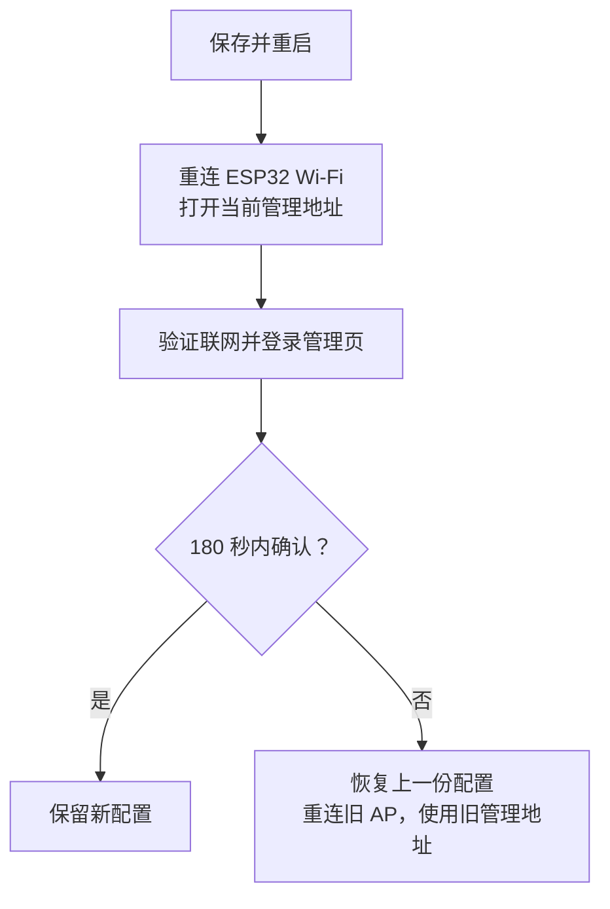

# esp32-socks5-gateway

[English](README.md) · [简体中文](README.zh-CN.md) · [日本語](README.ja.md)

把 **ESP32-S3** 变成一个小型 Wi-Fi 网关：手机或电脑连接它创建的 Wi-Fi 后，IPv4 的 TCP/UDP 通信会通过你提供的 **SOCKS5 代理服务器**转发，终端无需逐个应用设置代理。

例如，你已经在家里的电脑上运行了 SOCKS5 服务，希望两台手机都能使用它。ESP32 一边连接家里的 Wi-Fi，一边为手机提供另一个 Wi-Fi，并在两者之间转发通信。

这是一个实验项目，适合学习 ESP32 网络开发和小规模使用。默认配置针对 **ESP32-S3 N16R8**，最多接入两台终端；它仍需要已有的 Wi-Fi 网络和可用的 SOCKS5 服务。

## 阅读导航

- [先理解它怎么工作](#先理解它怎么工作)
- [准备硬件和软件](#准备硬件和软件)
- [准备上游 SOCKS5 服务](#准备上游-socks5-服务)
- [安装工具链并编译](#安装工具链并编译)
- [烧录并完成首次联网](#烧录并完成首次联网)
- [日常使用与状态灯](#日常使用与状态灯)
- [常见问题与排查](#常见问题与排查)
- [串口与恢复设置](#串口与恢复设置)
- [继续开发与运行测试](#继续开发与运行测试)
- [功能边界与安全说明](#功能边界与安全说明)

第一次使用，建议按上面的顺序阅读；已经能联网后，再查看测试和实现原理。

## 先理解它怎么工作


这里有两个 Wi-Fi 角色，它们由同一块 ESP32 同时承担：

| 名词 | 在本项目中的意思 |
| --- | --- |
| AP，接入点 | ESP32 创建的 Wi-Fi，手机或电脑连接它 |
| STA，客户端 | ESP32 作为 Wi-Fi 客户端，连接你已有的无线路由器 |
| 上游 | ESP32 连接的外部网络或服务，例如家里的 Wi-Fi 和 SOCKS5 服务器 |
| SOCKS5 | 一种代理协议；代理服务器代替客户端建立连接并转发数据 |
| 透明代理 | 终端连接网关 Wi-Fi 后，网关处理转发，终端应用无需单独填写代理地址 |

**本项目提供网关固件，SOCKS5 服务需要你另外准备。** SOCKS5 可以运行在局域网电脑或其他 ESP32 能访问的主机上；它不一定运行在无线路由器里。

管理页面运行在 ESP32 上。即使还没有填写上游 Wi-Fi，也可以先连接 ESP32 的 AP，打开管理页面完成配置。

## 准备硬件和软件

### 硬件

| 项目 | 推荐 / 已验证配置 | 注意事项 |
| --- | --- | --- |
| 开发板 | ESP32-S3 N16R8，双核 240 MHz | N16R8 表示 16 MB Flash 和 8 MB PSRAM；购买前确认板型 |
| Flash | 16 MB，DIO，80 MHz | 存放固件和持久配置 |
| PSRAM | 8 MB，Octal，80 MHz | 扩展运行内存，默认构建会在启动时测试它 |
| USB 线 | 能传输数据的 USB 线 | 只能充电的线无法烧录或读取串口 |
| 状态灯 | GPIO48 上的单颗 WS2812 / NeoPixel | 若板上灯的引脚不同，当前灯控配置不匹配；可在管理页关闭灯 |
| 无线路由器 | 可用的 2.4 GHz Wi-Fi | ESP32-S3 使用 2.4 GHz，不能连接只提供 5 GHz 的网络 |
| 测试终端 | 一台手机或电脑 | 第一次先验证一台，再接入第二台 |

其他 ESP32 芯片、Flash/PSRAM 规格或 LED 引脚不同的开发板，可能需要调整硬件配置。第一次使用建议选择上述配置，不要直接把默认固件用于任意 ESP32 板。

### 软件

- **ESP-IDF**：乐鑫提供的开发工具，用于编译和烧录固件。本项目要求下面列出的精确版本。
- **Git、Python 3.10 或更新版本**，以及 ESP-IDF 官方安装指南要求的系统依赖。
- 一个支持 IPv4、无认证和 UDP 转发的 **SOCKS5 服务**。
- 浏览器，用于访问 ESP32 的管理页面。当前管理页面为中文，串口命令为英文。
- 如果要运行宿主回归测试，还需要 Linux 的 GCC/binutils；前端测试另需 Node.js。普通固件构建不需要 Node.js。

ESP-IDF 安装脚本会获取对应的 GCC `15.2.0` 交叉编译器，用于生成 ESP32 固件；宿主测试使用的是电脑上的系统 GCC。固件组件 cJSON `1.7.19` 和 led_strip `3.0.3` 已记录在 `dependencies.lock`，首次构建会自动下载。

## 准备上游 SOCKS5 服务

先确认代理服务器能从 **ESP32 所在的网络**访问。电脑上“自己的代理能用”，不一定代表其他设备也能连上。

| 必须满足的条件 | 说明 |
| --- | --- |
| 提供 SOCKS5 端口 | HTTP 代理端口不能直接代替 SOCKS5 端口 |
| 支持 NO AUTH | 当前固件不支持 SOCKS5 用户名 / 密码认证 |
| 支持 UDP ASSOCIATE | 普通 DNS 查询等 UDP 通信依赖它；仅 TCP 可用不足以验证完整功能 |
| 监听局域网可访问的地址 | 只监听 `127.0.0.1` 时，其他设备不能访问；应按代理软件说明启用局域网访问 |
| 防火墙允许相应通信 | 除 TCP 控制连接外，还需允许服务返回的 UDP 中继地址 / 端口；它不一定与 SOCKS5 监听端口相同 |

一个配置示例：

| 用途 | 示例值 |
| --- | --- |
| 已有 Wi-Fi 名称 | `Home-WiFi` |
| 无线路由器地址 | `192.168.1.1` |
| 运行 SOCKS5 的电脑地址 | `192.168.1.2` |
| SOCKS5 端口 | `7897` |
| ESP32 AP / 管理页面地址 | `192.168.4.1` |
| DHCP 下发的 DNS 地址 | `1.1.1.1` |

这些地址仅用于说明。请换成你自己的网络参数；固件默认的 `192.168.1.2:7897` 并不表示该地址一定存在代理服务。也不要把电脑上的 `127.0.0.1` 填给 ESP32：对 ESP32 来说，它代表 ESP32 自己。

使用 Xray 时，可参考 [SOCKS 设置示例](examples/xray-socks-settings.json)及 `examples/` 中的 DNS 示例。这些文件是配置片段，需要放入你自己的完整 Xray 配置中。其他代理软件只要满足上述条件也可以使用。无认证的代理应仅对可信网络开放。

## 安装工具链并编译

以下命令使用 **Linux / macOS / WSL 的 Bash**。Windows 原生安装请参考 [ESP-IDF 官方入门指南](https://docs.espressif.com/projects/esp-idf/en/latest/esp32s3/get-started/index.html)，并使用安装器提供的开发终端或 EIM 激活脚本；按需将 `python3` 换成 `python`。

WSL 可以用于编译，但 USB 设备不一定自动出现在 WSL 中。烧录前需按你的系统方式连接 / 转发 USB，或改用 Windows 的 ESP-IDF 开发终端。

### 1. 安装本项目对应的 ESP-IDF

本项目为透明转发使用了一个小型 lwIP 补丁。lwIP 是 ESP-IDF 内部处理 TCP/IP 的网络库；补丁依赖其具体源码，所以仅显示“v6.1”还不够，必须匹配下面的提交：

| 依赖 | 精确提交 |
| --- | --- |
| ESP-IDF v6.1 | `fff9895c82d744c7237be8847347bdd1b07c6643` |
| esp-lwIP | `c6f2f878e7b0f86033214b85547d579be43351e3` |

先按官方指南安装系统依赖，再在一个**尚不存在的新目录**中执行下面的命令。示例使用单独的 `esp-idf-gateway` 目录，便于保留你已有的 ESP-IDF 安装。

```bash
mkdir -p ~/esp
cd ~/esp

git clone --no-checkout --depth 1 https://github.com/espressif/esp-idf.git esp-idf-gateway
cd esp-idf-gateway
git fetch --depth 1 origin fff9895c82d744c7237be8847347bdd1b07c6643
git checkout --detach fff9895c82d744c7237be8847347bdd1b07c6643
git submodule update --init --recursive --depth 1

./install.sh esp32s3
python3 tools/idf_tools.py install cmake ninja
source ./export.sh
```

`git submodule update` 会获取 ESP-IDF 所需的配套源码，包括对应版本的 lwIP。安装会下载编译器和 Python 依赖，请等待所有命令成功完成，再继续。

如果你已经安装了这两个精确提交，只需激活已有环境。**每次打开新终端，都需要重新激活**；使用上述目录时：

```bash
source ~/esp/esp-idf-gateway/export.sh
idf.py --version
git -C "$IDF_PATH" rev-parse HEAD
```

最后一条命令应输出表中的 ESP-IDF 提交。EIM 用户应使用自己安装时生成的激活脚本，并同样检查提交。

### 2. 获取项目并准备 lwIP

```bash
git clone https://github.com/noaic/esp32-socks5-gateway.git ~/esp32-socks5-gateway
cd ~/esp32-socks5-gateway
python3 tools/prepare_lwip.py apply
python3 tools/prepare_lwip.py check
```

已有项目目录时直接进入该目录，不必重复克隆。后续的项目命令都在**包含 `CMakeLists.txt` 的项目根目录**执行。

准备脚本会核对提交和源码哈希，将补丁应用到项目内生成的 `components/lwip`，不会修改全局 ESP-IDF。若提示版本或哈希不匹配，应先检查工具链，不要强行应用补丁。

### 3. 配置并编译

```bash
idf.py menuconfig
```

打开 `Transparent gateway Wi-Fi`：

- 第一次可以保持上游 `SSID` 为空，稍后通过管理页面填写；此时 AP 会启动，但 ESP32 不尝试连接上游。
- 将 `SoftAP WPA2 password` 改为你自己的 AP 密码，使用 8～63 个 ASCII 字符。
- AP 名称可以保留 `ESP32-Transparent-Proxy`。
- 其他硬件和网络参数先保留默认值；日常使用无需开启 `Temporary gateway diagnostics`。

保存并退出菜单后执行：

```bash
idf.py build
idf.py size
```

`build` 生成固件；`size` 查看固件占用，并不烧录。首次构建会下载组件，所需时间比后续构建长。

`sdkconfig.defaults` 提供 ESP32-S3、Flash 和 PSRAM 等初始配置；一旦已有 `sdkconfig`，defaults 不会自动覆盖它。因此，旧项目的配置也应检查是否匹配板型。

## 烧录并完成首次联网

### 1. 将固件写入开发板

用数据线连接开发板，找到实际串口。Linux 常见为 `/dev/ttyACM0` 或 `/dev/ttyUSB0`，macOS 常见为 `/dev/cu.*`，Windows 常见为 `COM5` 等；它们不是固定值。

在已激活 ESP-IDF 的项目终端中执行，例如：

```bash
idf.py -p /dev/ttyACM0 flash monitor
```

Windows 开发终端中的端口写法例如：

```text
idf.py -p COM5 flash monitor
```

`flash` 写入固件，`monitor` 打开串口日志，波特率为 **115200**。按 `Ctrl+]` 可退出 ESP-IDF monitor。烧录、monitor 和其他串口工具不要同时占用同一个设备。

### 2. 连接 ESP32 创建的 Wi-Fi

在手机或电脑上连接 `ESP32-Transparent-Proxy`，使用你在 `menuconfig` 设置的 AP 密码。未修改时，开发默认密码是 `esp32proxy`，应在正常使用前更换。

首次上游尚未配置，手机可能提示“此 Wi-Fi 无法访问互联网”。请选择保持连接；此时能访问本地管理页面就可以继续。为确认流量确实经过 ESP32，可在初次验证时暂时关闭手机的移动数据 / 自动切换网络功能。

### 3. 设置管理口令

在浏览器地址栏输入 **http://192.168.4.1/**。请明确使用 `http://`；管理页面不提供 HTTPS。

首次访问会要求设置管理口令。账号固定为 **`admin`**，口令为 **12～64 字节**，建议用 ASCII 字符组合，便于判断长度。设置后打开管理页，用 `admin` 和刚设置的口令登录。

下面三种密码用途不同：

| 密码 | 谁使用 | 在哪里设置 |
| --- | --- | --- |
| 上游 Wi-Fi 密码 | ESP32 连接已有路由器 | 管理页或 `menuconfig` |
| AP Wi-Fi 密码 | 手机 / 电脑连接 ESP32 | 管理页或 `menuconfig` |
| 管理口令 | 登录 ESP32 管理页面，账号为 `admin` | 首次设置页面，之后可在管理页修改 |

SOCKS5 上游使用 NO AUTH，因此这里没有 SOCKS5 用户名 / 密码输入项。

### 4. 填写网络和代理参数

在“网关配置”中填写：

| 页面字段 | 应填写的内容 |
| --- | --- |
| 上游 Wi-Fi SSID / 密码 | 已有的 2.4 GHz Wi-Fi 名称和密码 |
| SOCKS5 IPv4 | 代理服务器能被 ESP32 访问的 IPv4 地址，例如 `192.168.1.2` |
| SOCKS5 端口 | 代理实际监听的 SOCKS5 端口，例如 `7897` |
| AP 名称 / 密码 | ESP32 提供给终端的 Wi-Fi，可按需要修改 |
| 最大接入数 | 1 或 2 |
| DHCP 下发的 DNS IPv4 | 终端使用的 DNS，例如 `1.1.1.1` |
| AP 网段第三段 X | 默认 4，即管理地址为 `192.168.4.1` |

管理页的密码输入框**留空表示保留原密码**，不表示清空。连接无密码的上游 Wi-Fi 时，需勾选“上游 Wi-Fi 无密码”。SSID 和密码按 UTF-8 字节计数，中文字符通常占多个字节。

上游网络与 ESP32 AP 网络不能重叠。以常见的 `255.255.255.0` 网络为例：上游用 `192.168.1.x` 时，AP 默认 `192.168.4.x` 可以区分；如果上游也用 `192.168.4.x`，可将 X 改为 10，管理地址就变成 `192.168.10.1`。页面会根据实际网络掩码提示冲突。

### 5. 保存、重连并确认

点击“保存并重启”会中断当前连接，这是正常现象。新配置会先试运行；**重启后需在 180 秒内点击“确认保留配置”**，否则自动恢复上一份配置。



如果改了 AP 名称或密码，使用新的 Wi-Fi 参数；改了 X，打开新管理地址；改了管理口令，用新口令登录。重连后尚未取得新地址时，可断开 Wi-Fi 再连接，让终端重新获取地址。

在确认前，查看 STA 是否已取得 IPv4，运行“连接诊断”，尝试打开一个普通网页。确认后再用“立即检查互联网”补充验证；自动互联网检查会等待网络配置确认后运行。不要仅凭某一个状态灯或“请求已接受”就判断联网成功。

## 日常使用与状态灯

管理页面可查看运行状态、已连接设备、逐设备的代理流量、最近事件，也可重连上游 Wi-Fi、关闭现有代理连接或重启设备。这些操作可能中断正在进行的下载和视频播放，执行后应检查结果，避免反复点击。

| 颜色 | 含义 | 下一步 |
| --- | --- | --- |
| 蓝 | 尚未配置上游 Wi-Fi | 在管理页填写 SSID 和密码 |
| 红 | 已配置上游，但 STA 尚未就绪 | 检查 2.4 GHz Wi-Fi、密码和信号 |
| 紫 | AP+STA 已就绪，但互联网检查未通过、检查中或结果已过期 | 查看诊断结果并测试实际网页 |
| 绿 | 最近通过了经 SOCKS5 的 DNS / HTTP 检查 | 表示检测目标近期可达，不代表所有网站都可用 |
| 黄 | 上下游网段冲突，或检测目标连续检查失败 | 查看页面的冲突提示和具体失败步骤 |

绿色结果有效期为 10 分钟；正常自动检查间隔为 5 分钟，失败后会按退避间隔重试。检查失败不会自动重启设备。可以关闭自动检查或状态灯，这些偏好会保存。

**“连接诊断”**检查上游 TCP 端口、SOCKS5 NO AUTH 握手和 UDP DNS 往返；**“互联网检查”**还会经代理连接指定的 HTTP 检测目标。两者的结果都应结合实际应用使用情况判断。

## 常见问题与排查

建议从近到远检查：**终端 → ESP32 AP → 上游 Wi-Fi → SOCKS5 → DNS / 目标网站**。先把一台终端跑通，再增加第二台。

| 现象 | 优先检查 |
| --- | --- |
| `idf.py` 找不到 | 当前终端是否已执行 ESP-IDF 激活脚本；激活后再进入项目目录 |
| lwIP 提示 revision / hash 不匹配 | `$IDF_PATH` 是否指向指定提交，子模块是否完整；不要强行打补丁 |
| 编译无法下载组件 | 查看第一个下载错误，检查网络是否能访问 GitHub、乐鑫下载站和组件注册表；不要关闭 TLS / 哈希校验 |
| 找不到串口或无法烧录 | 数据线、板上 USB 接口、驱动、串口权限；WSL 中确认 USB 是否已转发；关闭其他占用串口的程序 |
| 启动报告 PSRAM 错误 | 板子是否确实是 N16R8 / Octal PSRAM 配置，供电是否稳定 |
| 手机提示 Wi-Fi 没有互联网 | 首次配置时可保持连接；之后检查 STA 和代理。排查时防止手机自动改走移动数据 |
| 管理页打不开 | 是否连接 ESP32 AP、是否使用 `http://`，地址是否因 X 改动；重新获取 DHCP 地址 |
| 管理登录失败 | 账号用 `admin`，口令不是 AP Wi-Fi 密码；若已修改口令，使用当前值 |
| STA 一直未就绪 | SSID、密码、2.4 GHz 网络、信号；留空 SSID 会禁止连接尝试 |
| 上游 TCP 端口检查失败 | SOCKS5 IP / 端口、局域网访问设置、防火墙；不要填 `127.0.0.1` |
| TCP 端口可达但 NO AUTH 失败 | 是否填了 HTTP 端口，代理是否要求用户名 / 密码 |
| 网页部分可用，DNS / UDP 失败 | UDP ASSOCIATE 支持、服务返回的中继地址和 UDP 端口是否可达、DNS 设置 |
| 保存后设置又变回去了 | 是否在 180 秒内确认；若回滚，使用上一份 AP 参数和管理地址 |
| 改了 `menuconfig`，板上网络却没变 | 板上已保存的 NVS 配置优先；通过管理页修改，或按下文恢复编译默认值 |
| 第三台设备无法接入 | 当前上限是两台，且可配置为一台；先断开其他设备 |

忘记管理口令、修改网络后无法再访问页面时，使用串口恢复。更多细节见 [维护与恢复](docs/maintenance.md)。

## 串口与恢复设置

串口命令为英文。在 ESP-IDF monitor 或其他支持发送文本的串口终端中输入，每条命令按 Enter 提交：

| 命令 | 用途 |
| --- | --- |
| `help` | 查看帮助 |
| `status` | 查看当前网络和资源状态 |
| `events` | 查看最近事件 |
| `log info` | 临时增加日志，便于排查 |
| `log warn` | 恢复日常 WARN 日志级别 |
| `log off` | 关闭日志输出 |
| `reset-admin` | 发起清除管理口令，保留当前网络设置 |
| `reset-network` | 发起恢复编译时的网络默认值，保留管理口令 |
| `confirm CODE` | 确认恢复操作；将 CODE 替换为设备刚显示的代码 |
| `cancel` | 取消待确认的恢复操作 |

两条 `reset-*` 命令不会立刻执行。设备会显示影响范围和一个**30 秒有效、只能使用一次的确认码**。读完提示后输入 `confirm` 加该次代码；不要照抄字面上的 `CODE`。成功后设备重启，两种恢复都会取消正在试运行的配置。

`reset-admin` 后重新打开管理页设置口令。`reset-network` 后使用编译时的 AP 名称 / 密码，管理地址恢复为 `192.168.4.1`。如果你曾在 `menuconfig` 填过 Wi-Fi 密码，“编译默认值”也会包含它，并不等于所有密码变空。

Web 页的“恢复默认配置”同样保留管理口令，但需要重启后进行 180 秒确认；串口 `reset-network` 使用上述 30 秒确认码执行恢复。**RST/EN 和断电只会重启，不清除已保存的密码或网络；BOOT 按钮未用作恢复菜单。** 日常恢复不需要擦除整块 Flash。

如需同时记录日志和发送命令，可在项目根目录运行：

```bash
python tools/uart_capture.py --port /dev/ttyACM0 --no-reset --interactive --timestamps --seconds 0
```

此时先退出其他串口工具。`--seconds 0` 表示持续读取到中断；`--no-reset` 避免工具主动复位，但 USB 适配器或系统驱动仍可能影响复位信号。

## 继续开发与运行测试

### 理解最基本的实现

可以把 ESP32 看作接收和转交数据的中间人：

- **TCP** 常用于网页等需要可靠传输的连接。网关记住终端原本想连接的目标，再通过 SOCKS5 的 `CONNECT` 请求让代理连接它，最后把响应送回终端。
- **UDP** 常用于普通 DNS 查询和部分实时通信。网关通过 `UDP ASSOCIATE` 获取中继信息，再携带目标地址转发数据。不同通信保留各自的转发状态。
- **DNS** 把域名转换成 IP 地址。默认 DHCP 告诉终端使用 `1.1.1.1`；ESP32 没有本地 DNS 服务，普通 DNS UDP 请求也经 SOCKS5 转发。
- **NVS** 是 Flash 中保存配置的区域。因此设置通常能跨重启保留，重新烧录应用也不会自动覆盖已有的网络参数。

当前总容量为 64 个活动 TCP 转发连接、32 个 UDP flow；另外有 512 条 TCP 映射记录，用于保存目标和结束阶段信息，**不表示可以同时转发 512 个 TCP 连接**。lwIP 负责 TCP 重传等底层工作，应用使用固定循环处理多条连接。

详细数据路径和模块职责见 [架构说明](docs/architecture.md)，第一次使用无需先理解所有内部实现。

### 运行现有回归测试

测试在开发电脑上编译并执行部分 C 逻辑，因此称为“宿主测试”，无需连接 ESP32 板。先成功构建一次固件，确保锁定的 cJSON 已下载到 `managed_components/`。

在 Linux、已激活 ESP-IDF 的项目终端中，准备系统 GCC/binutils 和 Node.js，再运行：

```bash
# 先记住当前 Python，避免调整 PATH 后切换到另一套解释器。
HOST_PYTHON="$(command -v python)"
PATH=/usr/bin:/bin:$PATH "$HOST_PYTHON" -m unittest discover -s tests -v
node tests/management_feedback_harness.js
node tests/management_transport_harness.js
```

ESP-IDF 的 Python 环境包含 pyserial/esptool，串口相关测试会用到它们。当前有 **75 项宿主回归**，另有两组前端反馈 / 兼容测试。请检查实际执行数量、失败和跳过情况；测试通过并不代替真实 Wi-Fi、掉电或长时间稳定性测试。

### 项目目录与进一步阅读

| 路径 | 内容 |
| --- | --- |
| `main/` | 固件源码和嵌入的管理页面 |
| `patches/` | lwIP 补丁及版本 / 哈希信息 |
| `tools/` | 补丁准备、串口采集、网络探测和测速工具 |
| `tests/` | C/Python 宿主测试和 JavaScript 前端测试 |
| `examples/` | Xray 配置片段 |
| `sdkconfig.defaults` | 初次配置的默认硬件和功能参数 |
| `dependencies.lock` | 固件组件版本记录 |
| `docs/` | 架构、维护、性能和开发记录 |

- [文档索引](docs/README.md)
- [维护与恢复](docs/maintenance.md)
- [性能与验证](docs/performance.md)：历史本地测试约为单路 16 Mbps、四路合计 24 Mbps 下载；Mbps 是兆比特每秒，不是 MB/s。这些数字受终端、上游和无线环境影响，不是速度保证。
- [开发历史](docs/history/README.md)：包含尝试过又撤回的实验，适合研究过程；日常使用优先参考本 README 和 `docs/` 顶层说明。

`sdkconfig`、`build/`、`managed_components/`、生成的 lwIP 副本和测试输出由工具生成。提交代码前检查 `git status`，不要把 Wi-Fi 密码、个人配置、日志或本地固件文件上传到仓库。

## 功能边界与安全说明

当前支持 IPv4、SOCKS5 NO AUTH、TCP 和 UDP 转发；不支持 IPv6、HTTP 上游代理、SOCKS5 账号认证、BLE、OTA、VLESS/REALITY、板上 GeoIP/GeoSite 分流或 NTP。SOCKS UDP 的分片包（`FRAG != 0`）会被丢弃；广播、组播和特殊 P2P 行为不在支持范围内，也未完成所有 QUIC 场景的兼容验证。

两台终端共享同一个 2.4 GHz 无线电和总体转发容量，接入数量限制不会保证带宽均分。它不适合代替需要大量用户、高吞吐或完整路由功能的设备。PSRAM 提供额外内存，但 Wi-Fi 和 lwIP 仍受内部 RAM 限制；长期稳定性、写 Flash 时断电和真实上游中断仍需进一步验证。

管理接口仅开放在 AP 上，但使用 HTTP；管理口令和网络配置未加密存储在 NVS。串口恢复依赖物理访问，没有登录认证；当前未启用安全启动和 Flash 加密。请在可信网络和终端上完成首次设置，使用自己的密码，不要将管理页面或无认证代理暴露到公网。
