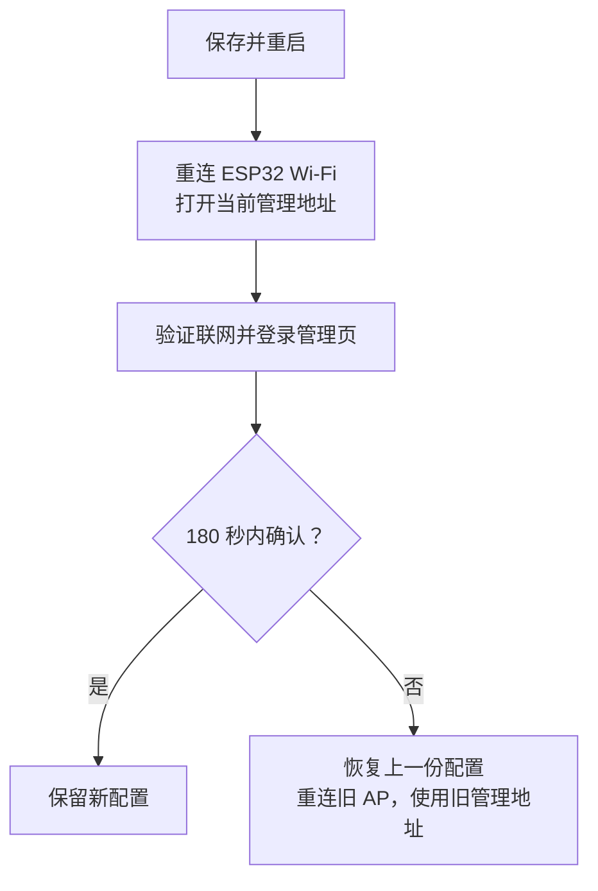

# esp32-socks5-gateway

[English](README.md) · [简体中文](README.zh-CN.md) · [日本語](README.ja.md)

把 **ESP32-S3** 变成一个小型 Wi-Fi 网关：手机或电脑连接它创建的 Wi-Fi 后，IPv4 的 TCP/UDP 通信会通过你提供的 **SOCKS5 代理服务器**转发，终端无需逐个应用设置代理。

例如，你已经在家里的电脑上运行了 SOCKS5 服务，希望两台手机都能使用它。ESP32 一边连接家里的 Wi-Fi，一边为手机提供另一个 Wi-Fi，并在两者之间转发通信。

这是一个实验项目，适合学习 ESP32 网络开发和小规模使用。默认配置针对 **ESP32-S3 N16R8**，最多接入两台终端；它仍需要已有的 Wi-Fi 网络和可用的 SOCKS5 服务。

## 阅读导航

- [先理解它怎么工作](#先理解它怎么工作)
- [性能与适用场景](#性能与适用场景)
- [准备硬件和软件](#准备硬件和软件)
- [准备上游 SOCKS5 服务](#准备上游-socks5-服务)
- [安装工具链并编译](#安装工具链并编译)
- [烧录并完成首次联网](#烧录并完成首次联网)
- [日常使用与状态灯](#日常使用与状态灯)
- [常见问题与排查](#常见问题与排查)
- [串口与恢复设置](#串口与恢复设置)
- [继续开发与运行测试](#继续开发与运行测试)
- [功能边界与安全说明](#功能边界与安全说明)

第一次使用，建议按上面的顺序阅读；已经能联网后，再查看测试和实现原理。

## 先理解它怎么工作


这里有两个 Wi-Fi 角色，它们由同一块 ESP32 同时承担：

| 名词 | 在本项目中的意思 |
| --- | --- |
| AP，接入点 | ESP32 创建的 Wi-Fi，手机或电脑连接它 |
| STA，客户端 | ESP32 作为 Wi-Fi 客户端，连接你已有的无线路由器 |
| 上游 | ESP32 连接的外部网络或服务，例如家里的 Wi-Fi 和 SOCKS5 服务器 |
| SOCKS5 | 一种代理协议；代理服务器代替客户端建立连接并转发数据 |
| 透明代理 | 终端连接网关 Wi-Fi 后，网关处理转发，终端应用无需单独填写代理地址 |

**本项目提供网关固件，SOCKS5 服务需要你另外准备。** SOCKS5 可以运行在局域网电脑或其他 ESP32 能访问的主机上；它不一定运行在无线路由器里。

管理页面运行在 ESP32 上。即使还没有填写上游 Wi-Fi，也可以先连接 ESP32 的 AP，打开管理页面完成配置。

## 性能与适用场景

下面是 ESP32-S3 N16R8 的**历史板上实测**，可以用来估计项目的吞吐量级。下载指数据送到连接 ESP32 的终端，上传指终端向测试服务发送数据；两个方向分别测量，并非同时满速。

| 场景 | 下载 Mbps | 上传 Mbps |
| --- | ---: | ---: |
| 一台终端，单路传输 | 16.43 | 16.25 |
| 一台终端，四路并行的合计吞吐 | 24.49 | 21.25 |
| 两台终端：A 空闲，B 单路测速 | 14.21 | 11.97 |
| 两台终端：A 播放 1080P 视频，B 单路测速 | 14.41 | 11.83 |

测试使用 Android 终端和局域网测试服务，每种场景完成三轮后取中位数，日常详细诊断关闭。最后两行是同一测试会话中的比较：A 播放视频时未报告卡顿，B 的测速结果与 A 空闲时接近。前两行来自另一组历史测试，不能直接据此推断后来版本变慢或变快。具体记录见 [性能与验证](docs/performance.md)。

**Mbps 是兆比特每秒，MB/s 是兆字节每秒，换算时约除以 8。** 单路约 16 Mbps 相当于约 2 MB/s；四路约 24 Mbps 是所有并行传输的合计，既不是每路 24 Mbps，也不是每台终端各有 24 Mbps。

| 容量项目 | 当前上限 | 含义 |
| --- | ---: | --- |
| Wi-Fi 终端 | 2 台 | 可配置为只允许 1 台 |
| 活动 TCP 转发连接 | 64 条 | 两台终端共享，不是每台各 64 条 |
| UDP flow | 32 条 | 不同通信的转发状态；两台终端共享 |
| TCP 映射记录 | 512 条 | 还保留结束阶段信息，不等于 512 条活动连接 |

它适合少量终端的网页访问、轻量传输和网络开发实验。历史视频测试支持“特定条件下可与另一台终端并用”，但视频可能提前缓存，实际码率也未知，不能保证所有 1080P 视频都流畅。如果你的目标是接近 100 Mbps 的传输、大量终端或多台同时进行高码率播放，应选用吞吐和容量更高的设备。

这些数值来自短期局域网测试，不是公网速度承诺。两台终端和 AP/STA 共用一个 2.4 GHz 无线电，更多终端不会让带宽翻倍；信号、干扰、上游代理、目标服务及连接数量都会影响结果。云端构建和宿主回归能验证实现与工具链，无法替代真实无线吞吐测试。

## 准备硬件和软件

### 硬件

| 项目 | 推荐 / 已验证配置 | 注意事项 |
| --- | --- | --- |
| 开发板 | ESP32-S3 N16R8，双核 240 MHz | N16R8 表示 16 MB Flash 和 8 MB PSRAM；购买前确认板型 |
| USB 线 | 能传输数据的 USB 线 | 只能充电的线无法烧录或读取串口 |
| 状态灯 | GPIO48 上的单颗 WS2812 / NeoPixel | 若板上灯的引脚不同，当前灯控配置不匹配；可在管理页关闭灯 |
| 无线路由器 | 可用的 2.4 GHz Wi-Fi | ESP32-S3 使用 2.4 GHz，不能连接只提供 5 GHz 的网络 |
| 测试终端 | 一台手机或电脑 | 第一次先验证一台，再接入第二台 |

其他 ESP32 芯片、Flash/PSRAM 规格或 LED 引脚不同的开发板，可能需要调整硬件配置。第一次使用建议选择上述配置，不要直接把默认固件用于任意 ESP32 板。

### 软件

| 类别 | 依赖与用途 | 如何准备 |
| --- | --- | --- |
| 必需：开发环境 | Git、Python ≥ 3.10（建议 3.12）、CMake ≥ 3.22、Ninja | Windows 用官方 EIM 检查并安装；Linux 按下文安装系统包。当前 IDF 工具清单推荐 CMake 4.0.3、Ninja 1.12.1 |
| 必需：SDK | 指定提交的 ESP-IDF v6.1 与 esp-lwIP | 见下方提交表；ESP-IDF 中已包含 FreeRTOS 和 lwIP，不必单独安装它们 |
| 自动管理：工具链 | Xtensa GCC 15.2.0，生成 ESP32-S3 固件；以及 esptool、Python 构建工具和 Component Manager | EIM 或 ESP-IDF 安装脚本依据此提交的工具清单安装 |
| 自动管理：组件 | cJSON 1.7.19、led_strip 3.0.3 | `main/idf_component.yml` 声明，`dependencies.lock` 固定版本和哈希，首次构建下载到 `managed_components/` |
| 必需：使用环境 | 浏览器、已有 2.4 GHz Wi-Fi、支持 IPv4 / NO AUTH / UDP ASSOCIATE 的 SOCKS5 服务 | 用户自行准备；仅编译和宿主测试无需实际代理服务 |
| 可选：开发测试 | Linux 系统 GCC/binutils、Node.js；ccache 可加速重复构建 | GCC 用于宿主 C 测试，Node.js 用于前端测试，均不是固件中的运行依赖 |

管理页和首次设置页默认英文；浏览器首选语言为中文（`zh` 或 `zh-*`）时显示简体中文，其他语言或无法识别时使用英文。首选英文、备用中文时仍显示英文。串口命令为英文。电脑上的系统 GCC 与 ESP32 的交叉编译器用途不同；不要用前者替换固件工具链，也不要为通过构建而更新锁文件。

## 准备上游 SOCKS5 服务

先确认代理服务器能从 **ESP32 所在的网络**访问。电脑上“自己的代理能用”，不一定代表其他设备也能连上。

| 必须满足的条件 | 说明 |
| --- | --- |
| 提供 SOCKS5 端口 | HTTP 代理端口不能直接代替 SOCKS5 端口 |
| 支持 NO AUTH | 当前固件不支持 SOCKS5 用户名 / 密码认证 |
| 支持 UDP ASSOCIATE | 普通 DNS 查询等 UDP 通信依赖它；仅 TCP 可用不足以验证完整功能 |
| 监听局域网可访问的地址 | 只监听 `127.0.0.1` 时，其他设备不能访问；应按代理软件说明启用局域网访问 |
| 防火墙允许相应通信 | 除 TCP 控制连接外，还需允许服务返回的 UDP 中继地址 / 端口；它不一定与 SOCKS5 监听端口相同 |

一个配置示例：

| 用途 | 示例值 |
| --- | --- |
| 已有 Wi-Fi 名称 | `Home-WiFi` |
| 无线路由器地址 | `192.168.1.1` |
| 运行 SOCKS5 的电脑地址 | `192.168.1.2` |
| SOCKS5 端口 | `7897` |
| ESP32 AP / 管理页面地址 | `192.168.4.1` |
| DHCP 下发的 DNS 地址 | `1.1.1.1` |

这些地址仅用于说明。请换成你自己的网络参数；固件默认的 `192.168.1.2:7897` 并不表示该地址一定存在代理服务。也不要把电脑上的 `127.0.0.1` 填给 ESP32：对 ESP32 来说，它代表 ESP32 自己。

上游 SOCKS5 服务使用 [Xray](https://github.com/XTLS/Xray-core) 时，可先阅读 [VLESS + TCP + REALITY 完整客户端示例](examples/xray-client-reality.json)及其 [字段位置与使用说明](examples/README.md)。它运行在局域网电脑上，使用前须替换 LAN 地址和远端节点参数。原有 [SOCKS 设置示例](examples/xray-socks-settings.json)及 DNS 示例仍是用于合并到已有配置的片段。其他代理软件只要满足上述条件也可以使用。无认证的代理应仅对可信网络开放。

## 安装工具链并编译

Windows 使用 **PowerShell**，Linux / WSL2 使用 **Bash**；请只执行对应系统的命令。SDK 和项目路径应避免空格及非 ASCII 字符，例如 Windows 的 `C:\esp`。以下步骤只在新目录中准备 SDK，不覆盖其他项目正在使用的 ESP-IDF。

### 1. 安装本项目对应的 ESP-IDF

本项目为透明转发使用了一个小型 lwIP 补丁。lwIP 是 ESP-IDF 内部处理 TCP/IP 的网络库；补丁依赖其具体源码，所以仅显示“v6.1”还不够，必须匹配下面的提交：

| 依赖 | 精确提交 |
| --- | --- |
| ESP-IDF v6.1 | `fff9895c82d744c7237be8847347bdd1b07c6643` |
| esp-lwIP | `c6f2f878e7b0f86033214b85547d579be43351e3` |

#### Windows 11：官方 EIM 与 PowerShell

1. 从 [乐鑫官方页面](https://dl.espressif.com/dl/eim/) 下载 EIM 图形安装器。按 [Windows 官方安装说明](https://docs.espressif.com/projects/esp-idf/en/latest/esp32s3/get-started/windows-setup.html)完成依赖检查；若 Git 尚未可用，先安装 [Git for Windows](https://git-scm.com/install/windows)，再打开新的 PowerShell。无需使用 `winget`。
2. 在普通 PowerShell 中将指定提交放入**尚不存在的** `C:\esp\esp-idf-gateway`。准备脚本兼容 LF 和 CRLF 检出，无需调整 Git 换行设置：

```powershell
git --version
New-Item -ItemType Directory -Force C:\esp | Out-Null
git clone --no-checkout --depth 1 https://github.com/espressif/esp-idf.git C:\esp\esp-idf-gateway
Set-Location C:\esp\esp-idf-gateway
git fetch --depth 1 origin fff9895c82d744c7237be8847347bdd1b07c6643
git checkout --detach fff9895c82d744c7237be8847347bdd1b07c6643
git submodule update --init --recursive --depth 1
```

3. 在 EIM 中选择 **Custom Installation**，将路径指向这个现有的 Git 目录。官方 [Expert Installation](https://docs.espressif.com/projects/idf-im-ui/en/latest/expert_installation.html)支持使用已有仓库而不改写其内容。安装该检出的工具链、CMake、Ninja 和 Python 环境；使用此目录，不要另外安装“最新版本”后直接用它构建。
4. 安装完成后，在 EIM 的 **Manage Installations → Open IDF Terminal** 中打开对应安装的 PowerShell，或使用它生成的 PowerShell 快捷方式。**后续 Windows 命令都在该已激活终端执行**，新开普通 PowerShell 不会自动带上环境：

```powershell
python --version
idf.py --version
git -C "$env:IDF_PATH" rev-parse HEAD
git -C "$env:IDF_PATH\components\lwip\lwip" rev-parse HEAD
git -C "$env:IDF_PATH\components\lwip\lwip" ls-files --eol src/core/ipv4/ip4.c
cmake --version
ninja --version
```

两个提交输出须与表中一致。换行命令仅用于诊断：`i/lf w/lf` 和 `i/lf w/crlf` 都受支持，后者表示 Git 检出了 Windows 换行，并不等于源码被修改，无需因此重装已有 SDK。EIM 使用其生成的激活入口；传统脚本安装在该 SDK 目录中，PowerShell 安装用 `.\install.ps1 esp32s3`，激活用 `.\export.ps1`，CMD 对应 `install.bat esp32s3` / `export.bat`。Windows 不使用 Bash 的 `source`。

#### Linux：Ubuntu/Debian 或 Fedora，Bash

Ubuntu/Debian 使用 [官方系统包列表](https://docs.espressif.com/projects/esp-idf/en/latest/esp32s3/get-started/linux-macos-setup-legacy.html)，建议选择提供 Python ≥ 3.10 的版本，例如 Ubuntu 22.04 或更新版本：

```bash
sudo apt-get update
sudo apt-get install git wget flex bison gperf python3 python3-pip python3-venv cmake ninja-build ccache libffi-dev libssl-dev dfu-util libusb-1.0-0
```

Fedora 对应包名不同，使用 `dnf`；其 Python 包提供 `venv` 模块：

```bash
sudo dnf install git wget flex bison gperf python3 python3-pip cmake ninja-build ccache libffi-devel openssl-devel dfu-util libusb1
```

接下来使用独立的 SDK 目录；`esp-idf-gateway` 应尚不存在：

```bash
mkdir -p ~/esp
cd ~/esp

git clone --no-checkout --depth 1 https://github.com/espressif/esp-idf.git esp-idf-gateway
cd esp-idf-gateway
git fetch --depth 1 origin fff9895c82d744c7237be8847347bdd1b07c6643
git checkout --detach fff9895c82d744c7237be8847347bdd1b07c6643
git submodule update --init --recursive --depth 1

./install.sh esp32s3
python3 tools/idf_tools.py install cmake ninja
source ./export.sh
```

安装脚本下载匹配的编译器和 Python 依赖；另行请求 CMake/Ninja 可避免系统工具过旧。**每次打开新 Bash 都要重新激活**，然后检查实际版本：

```bash
source ~/esp/esp-idf-gateway/export.sh
idf.py --version
git -C "$IDF_PATH" rev-parse HEAD
git -C "$IDF_PATH/components/lwip/lwip" rev-parse HEAD
cmake --version
ninja --version
```

#### 能否复用已有环境？

已安装的 SDK 只有在两个 Git 提交都匹配、子模块完整且全局 lwIP 源码未经修改时，才能直接复用。先通过它自己的激活入口运行上述检查；同样显示“v6.1”不代表同一提交。若不同，为本项目新建独立 SDK，不要在共享安装上直接 `git pull` 或切换版本。EIM 安装使用 EIM 的终端；脚本安装使用对应 `export` 脚本。

浅克隆时 `idf.py --version` 可能提示 `Git version unavailable`，随后读取源码版本；仍以两个精确提交和补丁脚本的校验为准。

WSL2 应在 Linux 发行版内执行 Linux 安装步骤，不能直接复用 Windows 编译器。USB 映射见下方刷写说明；macOS 用户可参考官方指南，Bash 的项目命令相同。

### 2. 获取项目并准备 lwIP

Windows 已激活的 PowerShell：

```powershell
git clone https://github.com/noaic/esp32-socks5-gateway.git C:\esp\esp32-socks5-gateway
Set-Location C:\esp\esp32-socks5-gateway
python tools/prepare_lwip.py apply
python tools/prepare_lwip.py check
```

Linux / WSL2 已激活的 Bash：

```bash
git clone https://github.com/noaic/esp32-socks5-gateway.git ~/esp32-socks5-gateway
cd ~/esp32-socks5-gateway
python3 tools/prepare_lwip.py apply
python3 tools/prepare_lwip.py check
```

已有项目目录时直接进入该目录，不必重复克隆。后续的项目命令都在**包含 `CMakeLists.txt` 的项目根目录**执行。

`patches/lwip-v6.1-transparent-tcp.patch` 保存 `ip4.c` 的改动，`patches/lwip-v6.1.json` 记录两个提交与修改前后的 SHA-256。脚本从 `$IDF_PATH/components/lwip` 复制整个组件及其 lwIP 子模块到项目 `components/lwip`，再只修改该副本。ESP-IDF 的 [同名组件优先规则](https://docs.espressif.com/projects/esp-idf/en/latest/esp32s3/api-guides/build-system.html#multiple-components-with-the-same-name)会选用项目副本，因此全局 SDK 和其他项目不受影响；生成目录已被 Git 忽略。

校验 `ip4.c` 时，脚本在内存中将 CRLF 视为 LF，仍使用原有固定哈希。`apply`、`restore` 只将已验证的项目副本写为 LF；补丁文件本身为 CRLF 时也可使用，不会改写补丁文件。`check` 完全只读。其他组件文件仍须与 SDK 逐字节一致；代码或空白修改、BOM（文件开头的编码标记）及单独的 CR 字符不会被当成正常换行差异放行。

以下命令两种终端都可执行（Linux 也可用 `python3`）：

| 命令 | 具体用途 |
| --- | --- |
| `python tools/prepare_lwip.py apply` | 检查版本和内容，创建或复用本地副本，将其中的 `ip4.c` 规范为 LF 并应用补丁；可重复执行 |
| `python tools/prepare_lwip.py check` | 只读检查提交、按 LF 计算的原始/补丁哈希及完整组件的文件列表和内容 |
| `python tools/prepare_lwip.py restore` | 将已验证的本地 `ip4.c` 反向还原为 LF，无需激活 SDK；保留本地组件目录，不自动关闭透明功能 |

默认配置启用了透明模式，`restore` 后必须重新 `apply`、`check` 才能继续正常构建；`check` 会拒绝未打补丁的副本。若已有构建曾引用全局 lwIP，准备副本后运行 `idf.py reconfigure` 再构建。版本错误会列出预期与实际提交；哈希错误表示存在 LF/CRLF 之外的差异。先备份并检查 SDK 或本地副本的意外修改，或准备独立的干净 SDK，不要强行覆盖。`apply`、`check` 也会拒绝其他组件文件的变化，写入时拒绝通过本地符号链接修改其他位置。未来升级 ESP-IDF/esp-lwIP 可能改变 `ip4.c` 路径、钩子位置或接口，需要另行审查和适配补丁，不能只改提交或哈希来绕过检查。

### 3. 配置并编译

以下配置与构建命令在两种已激活终端中相同：

```text
idf.py menuconfig
```

打开 `Transparent gateway Wi-Fi`：

- 第一次可以保持上游 `SSID` 为空，稍后通过管理页面填写；此时 AP 会启动，但 ESP32 不尝试连接上游。
- 将 `SoftAP WPA2 password` 改为你自己的 AP 密码，使用 8～63 个 ASCII 字符。
- AP 名称可以保留 `ESP32-Transparent-Proxy`。
- 其他硬件和网络参数先保留默认值；日常使用无需开启 `Temporary gateway diagnostics`。

保存并退出菜单后执行：

```text
idf.py build
idf.py size
```

`build` 生成固件；`size` 查看固件占用，并不烧录。首次构建会下载组件，所需时间比后续构建长。

`sdkconfig.defaults` 提供 ESP32-S3、Flash 和 PSRAM 等初始配置；一旦已有 `sdkconfig`，defaults 不会自动覆盖它。因此，旧项目的配置也应检查是否匹配板型。

Linux x86_64 的补丁准备、编译和容量检查已验证；Windows 11/EIM、发行版包安装和 WSL2 USB 操作依据官方说明核对，仍需对应系统与实体开发板验证。

## 烧录并完成首次联网

### 1. 将固件写入开发板

Windows 11 在“设备管理器 → 端口（COM 和 LPT）”中比较插拔前后的设备，找到新增的 COM 端口；按板上 USB 桥类型安装厂商驱动。Linux 可比较插拔前后的串口列表，并检查权限：

```bash
ls /dev/ttyACM* /dev/ttyUSB* 2>/dev/null
ls -l /dev/ttyACM0
```

`/dev/ttyACM0` 和 `COM5` 都只是示例，替换为实际端口；macOS 通常为 `/dev/cu.*`。若 Linux 串口所属组为 `dialout`，可执行 `sudo usermod -aG dialout "$USER"`，注销后重新登录；其他组按设备实际权限处理，不要靠长期使用 root 烧录。

Linux 已激活的项目终端：

```bash
idf.py -p /dev/ttyACM0 flash monitor
```

Windows 已激活的 PowerShell 项目终端：

```powershell
idf.py -p COM5 flash monitor
```

`flash` 写入固件，`monitor` 打开串口日志，波特率为 **115200**。按 `Ctrl+]` 可退出 ESP-IDF monitor。烧录、monitor 和其他串口工具不要同时占用同一个设备。

当前配置使用 **UART0 控制台**，优先连接板上标为 UART / USB-UART 的接口；原生 USB 能烧录不代表该接口能显示本固件的 UART 日志。无法自动进入下载模式时，按板卡说明使用 BOOT/EN。

**WSL2 USB：**先在 Windows 安装 [usbipd-win，按微软说明操作](https://learn.microsoft.com/en-us/windows/wsl/connect-usb)，并启动 WSL2 发行版。以下是 Windows PowerShell 命令；`4-4` 是示例 BUSID，必须替换为 `usbipd list` 中的设备。`bind` 需要管理员权限：

```powershell
usbipd list
usbipd bind --busid 4-4
usbipd attach --wsl --busid 4-4
```

然后在 WSL Bash 中重新查找 `/dev/ttyACM*` / `/dev/ttyUSB*`，按 Linux 命令烧录。设备复位后可能重新枚举，需重新确认映射；同一 USB 设备不能同时供 Windows 和 WSL 的串口工具使用。

#### 分区、镜像与重复刷写

`partitions.csv` 定义了以下布局；16 MB Flash 中剩余空间未分配，当前没有 OTA 或文件系统分区：

| 分区 | 起始地址 | 大小 | 用途 |
| --- | --- | --- | --- |
| `nvs` | `0x9000` | `0x6000`（24 KiB） | 持久配置等 NVS 数据 |
| `phy_init` | `0xf000` | `0x1000`（4 KiB） | PHY 初始化数据预留区；当前配置不生成单独的 PHY 镜像 |
| `factory` | `0x10000` | 4 MiB | 应用程序 |

正常构建生成 `build/bootloader/bootloader.bin`（启动应用）、`build/partition_table/partition-table.bin`（描述布局）和 `build/esp32-socks5-gateway.bin`（应用）。当前 `build/flash_args` 分别安排在 `0x0`、`0x8000`、`0x10000`；`idf.py flash` 会按构建参数处理，无需手工猜偏移。

普通刷写只擦写所需镜像范围，不等于 `erase-flash`；分区布局一致时，现有 NVS 设置通常保留。擦除整片会清除网络与管理口令，完整合并镜像的填充区也可能覆盖 NVS。不要将擦除作为例行升级步骤；更换分区布局或不兼容的配置格式前应先保存设置。原有 NVS 配置优先于新固件的编译默认值。

### 2. 连接 ESP32 创建的 Wi-Fi

在手机或电脑上连接 `ESP32-Transparent-Proxy`，使用你在 `menuconfig` 设置的 AP 密码。未修改时，开发默认密码是 `esp32proxy`，应在正常使用前更换。

首次上游尚未配置，手机可能提示“此 Wi-Fi 无法访问互联网”。请选择保持连接；此时能访问本地管理页面就可以继续。为确认流量确实经过 ESP32，可在初次验证时暂时关闭手机的移动数据 / 自动切换网络功能。

### 3. 设置管理口令

在浏览器地址栏输入 **http://192.168.4.1/**。请明确使用 `http://`；管理页面不提供 HTTPS。

首次访问会要求设置管理口令。账号固定为 **`admin`**，口令为 **12～64 字节**，建议用 ASCII 字符组合，便于判断长度。设置后打开管理页，用 `admin` 和刚设置的口令登录。

下面三种密码用途不同：

| 密码 | 谁使用 | 在哪里设置 |
| --- | --- | --- |
| 上游 Wi-Fi 密码 | ESP32 连接已有路由器 | 管理页或 `menuconfig` |
| AP Wi-Fi 密码 | 手机 / 电脑连接 ESP32 | 管理页或 `menuconfig` |
| 管理口令 | 登录 ESP32 管理页面，账号为 `admin` | 首次设置页面，之后可在管理页修改 |

SOCKS5 上游使用 NO AUTH，因此这里没有 SOCKS5 用户名 / 密码输入项。

### 4. 填写网络和代理参数

在“网关配置”中填写；以下采用中文界面名称，浏览器首选英文时对应 “Gateway configuration”：

| 页面字段 | 应填写的内容 |
| --- | --- |
| 上游 Wi-Fi SSID / 密码 | 已有的 2.4 GHz Wi-Fi 名称和密码 |
| SOCKS5 IPv4 | 代理服务器能被 ESP32 访问的 IPv4 地址，例如 `192.168.1.2` |
| SOCKS5 端口 | 代理实际监听的 SOCKS5 端口，例如 `7897` |
| AP 名称 / 密码 | ESP32 提供给终端的 Wi-Fi，可按需要修改 |
| 最大接入数 | 1 或 2 |
| DHCP 下发的 DNS IPv4 | 终端使用的 DNS，例如 `1.1.1.1` |
| AP 网段第三段 X | 默认 4，即管理地址为 `192.168.4.1` |

管理页的密码输入框**留空表示保留原密码**，不表示清空。连接无密码的上游 Wi-Fi 时，需勾选“上游 Wi-Fi 无密码”。SSID 和密码按 UTF-8 字节计数，中文字符通常占多个字节。

上游网络与 ESP32 AP 网络不能重叠。以常见的 `255.255.255.0` 网络为例：上游用 `192.168.1.x` 时，AP 默认 `192.168.4.x` 可以区分；如果上游也用 `192.168.4.x`，可将 X 改为 10，管理地址就变成 `192.168.10.1`。页面会根据实际网络掩码提示冲突。

### 5. 保存、重连并确认

点击“保存并重启”会中断当前连接，这是正常现象。新配置会先试运行；**重启后需在 180 秒内点击“确认保留配置”**，否则自动恢复上一份配置。



如果改了 AP 名称或密码，使用新的 Wi-Fi 参数；改了 X，打开新管理地址；改了管理口令，用新口令登录。重连后尚未取得新地址时，可断开 Wi-Fi 再连接，让终端重新获取地址。

在确认前，查看 STA 是否已取得 IPv4，运行“连接诊断”，尝试打开一个普通网页。确认后再用“立即检查互联网”补充验证；自动互联网检查会等待网络配置确认后运行。不要仅凭某一个状态灯或“请求已接受”就判断联网成功。

## 日常使用与状态灯

管理页面可查看运行状态、已连接设备、逐设备的代理流量、最近事件，也可重连上游 Wi-Fi、关闭现有代理连接或重启设备。这些操作可能中断正在进行的下载和视频播放，执行后应检查结果，避免反复点击。

| 颜色 | 含义 | 下一步 |
| --- | --- | --- |
| 蓝 | 尚未配置上游 Wi-Fi | 在管理页填写 SSID 和密码 |
| 红 | 已配置上游，但 STA 尚未就绪 | 检查 2.4 GHz Wi-Fi、密码和信号 |
| 紫 | AP+STA 已就绪，但互联网检查未通过、检查中或结果已过期 | 查看诊断结果并测试实际网页 |
| 绿 | 最近通过了经 SOCKS5 的 DNS / HTTP 检查 | 表示检测目标近期可达，不代表所有网站都可用 |
| 黄 | 上下游网段冲突，或检测目标连续检查失败 | 查看页面的冲突提示和具体失败步骤 |

绿色结果有效期为 10 分钟；正常自动检查间隔为 5 分钟，失败后会按退避间隔重试。检查失败不会自动重启设备。可以关闭自动检查或状态灯，这些偏好会保存。

**“连接诊断”**检查上游 TCP 端口、SOCKS5 NO AUTH 握手和 UDP DNS 往返；**“互联网检查”**还会经代理连接指定的 HTTP 检测目标。两者的结果都应结合实际应用使用情况判断。

## 常见问题与排查

建议从近到远检查：**终端 → ESP32 AP → 上游 Wi-Fi → SOCKS5 → DNS / 目标网站**。先把一台终端跑通，再增加第二台。

| 现象 | 优先检查 |
| --- | --- |
| `idf.py` 找不到 | 当前终端是否已执行 ESP-IDF 激活脚本；激活后再进入项目目录 |
| Python / CMake / Ninja 版本或路径错误 | 检查 Python ≥ 3.10、CMake ≥ 3.22，并使用对应 SDK 的终端；不要混用 Windows 与 WSL 工具链 |
| lwIP 提示 revision / hash 不匹配 | 检查两个固定提交及子模块是否完整。单纯 LF/CRLF 差异已兼容；在 SDK 的 lwIP 仓库中用 `git diff` 检查实际修改，或备份项目副本后再重新生成，不要强行打补丁 |
| 构建仍引用旧 SDK 或全局 lwIP | 确认正确环境并运行 `idf.py reconfigure`；缓存仍不一致时，在项目内 `idf.py fullclean` 后重新构建 |
| 编译无法下载组件 | 查看第一个下载错误，检查网络是否能访问 GitHub、乐鑫下载站和组件注册表；不要关闭 TLS / 哈希校验 |
| 找不到串口或无法烧录 | 数据线、板上 USB 接口、驱动、串口权限；WSL 中确认 USB 是否已转发；关闭其他占用串口的程序 |
| 启动报告 PSRAM 错误 | 板子是否确实是 N16R8 / Octal PSRAM 配置，供电是否稳定 |
| 手机提示 Wi-Fi 没有互联网 | 首次配置时可保持连接；之后检查 STA 和代理。排查时防止手机自动改走移动数据 |
| 管理页打不开 | 是否连接 ESP32 AP、是否使用 `http://`，地址是否因 X 改动；重新获取 DHCP 地址 |
| 管理登录失败 | 账号用 `admin`，口令不是 AP Wi-Fi 密码；若已修改口令，使用当前值 |
| STA 一直未就绪 | SSID、密码、2.4 GHz 网络、信号；留空 SSID 会禁止连接尝试 |
| 上游 TCP 端口检查失败 | SOCKS5 IP / 端口、局域网访问设置、防火墙；不要填 `127.0.0.1` |
| TCP 端口可达但 NO AUTH 失败 | 是否填了 HTTP 端口，代理是否要求用户名 / 密码 |
| 网页部分可用，DNS / UDP 失败 | UDP ASSOCIATE 支持、服务返回的中继地址和 UDP 端口是否可达、DNS 设置 |
| 保存后设置又变回去了 | 是否在 180 秒内确认；若回滚，使用上一份 AP 参数和管理地址 |
| 改了 `menuconfig`，板上网络却没变 | 板上已保存的 NVS 配置优先；通过管理页修改，或按下文恢复编译默认值 |
| 第三台设备无法接入 | 当前上限是两台，且可配置为一台；先断开其他设备 |

忘记管理口令、修改网络后无法再访问页面时，使用串口恢复。更多细节见 [维护与恢复](docs/maintenance.md)。

## 串口与恢复设置

串口命令为英文。在 ESP-IDF monitor 或其他支持发送文本的串口终端中输入，每条命令按 Enter 提交：

| 命令 | 用途 |
| --- | --- |
| `help` | 查看帮助 |
| `status` | 查看当前网络和资源状态 |
| `events` | 查看最近事件 |
| `log info` | 临时增加日志，便于排查 |
| `log warn` | 恢复日常 WARN 日志级别 |
| `log off` | 关闭日志输出 |
| `reset-admin` | 发起清除管理口令，保留当前网络设置 |
| `reset-network` | 发起恢复编译时的网络默认值，保留管理口令 |
| `confirm CODE` | 确认恢复操作；将 CODE 替换为设备刚显示的代码 |
| `cancel` | 取消待确认的恢复操作 |

两条 `reset-*` 命令不会立刻执行。设备会显示影响范围和一个**30 秒有效、只能使用一次的确认码**。读完提示后输入 `confirm` 加该次代码；不要照抄字面上的 `CODE`。成功后设备重启，两种恢复都会取消正在试运行的配置。

`reset-admin` 后重新打开管理页设置口令。`reset-network` 后使用编译时的 AP 名称 / 密码，管理地址恢复为 `192.168.4.1`。如果你曾在 `menuconfig` 填过 Wi-Fi 密码，“编译默认值”也会包含它，并不等于所有密码变空。

Web 页的“恢复默认配置”同样保留管理口令，但需要重启后进行 180 秒确认；串口 `reset-network` 使用上述 30 秒确认码执行恢复。**RST/EN 和断电只会重启，不清除已保存的密码或网络；BOOT 按钮未用作恢复菜单。** 日常恢复不需要擦除整块 Flash。

如需同时记录日志和发送命令，可在项目根目录运行：

```bash
python tools/uart_capture.py --port /dev/ttyACM0 --no-reset --interactive --timestamps --seconds 0
```

此时先退出其他串口工具。`--seconds 0` 表示持续读取到中断；`--no-reset` 避免工具主动复位，但 USB 适配器或系统驱动仍可能影响复位信号。

## 继续开发与运行测试

### 理解最基本的实现

`main/` 定义网关行为，使用 ESP-IDF 提供的 Wi-Fi、`esp_netif`、socket、HTTP 和 NVS API。**FreeRTOS 是 ESP-IDF 内置的调度系统**，负责 TCP/UDP、维护等任务及队列/锁；**lwIP 是其 TCP/IP 协议栈**，负责 IPv4、TCP 握手、重传等。应用决定如何转发，SDK 提供驱动与服务，FreeRTOS 调度执行，lwIP 处理网络协议；这些底层库不需要用户另装操作系统。

可以把 ESP32 看作接收和转交数据的中间人：

- **TCP** 常用于网页等需要可靠传输的连接。网关记住终端原本想连接的目标，再通过 SOCKS5 的 `CONNECT` 请求让代理连接它，最后把响应送回终端。
- **UDP** 常用于普通 DNS 查询和部分实时通信。网关通过 `UDP ASSOCIATE` 获取中继信息，再携带目标地址转发数据。不同通信保留各自的转发状态。
- **DNS** 把域名转换成 IP 地址。默认 DHCP 告诉终端使用 `1.1.1.1`；ESP32 没有本地 DNS 服务，普通 DNS UDP 请求也经 SOCKS5 转发。
- **NVS** 是 Flash 中保存配置的区域。因此设置通常能跨重启保留，重新烧录应用也不会自动覆盖已有的网络参数。

当前总容量为 64 个活动 TCP 转发连接、32 个 UDP flow；另外有 512 条 TCP 映射记录，用于保存目标和结束阶段信息，**不表示可以同时转发 512 个 TCP 连接**。lwIP 负责 TCP 重传等底层工作，应用使用固定循环处理多条连接。

### 从一条网页连接看 TCP 转发

**为什么修改 `ip4.c`？** 手机的外部网站请求原本并不是发给 ESP32 本地地址，普通应用 socket 不能直接接收这些 TCP 连接。当前补丁在 IPv4 校验后、本地地址判断前接入输入钩子，让应用记录目标并改写；在 IPv4 输出头准备好、交给网络接口前接入输出钩子，恢复远端地址。改写使用独立的数据包副本，避免损坏 lwIP 保留用于重传的数据。仅建立一个 SOCKS5 socket，无法完成本项目所需的透明截获与地址恢复；也无需让应用重写整套 TCP 协议。参考 [ESP-IDF 的 lwIP 说明](https://docs.espressif.com/projects/esp-idf/en/latest/esp32s3/api-guides/lwip.html)。

假设手机想连接网站的 `203.0.113.10:443`，这里的地址只是说明用的示例：

1. 手机将数据包发给它的默认网关，也就是 ESP32。
2. 项目内的 lwIP 补丁在 IPv4 处理路径调用网关代码。代码检查数据包，记录手机和原始目标，将 TCP 数据包改写为送给 ESP32 本地监听端口，并更新校验和，让接收方能正确验证数据包。
3. lwIP 处理这段本地 TCP 连接，网关应用通过 socket 读取数据。socket 可以理解为程序收发网络数据的接口；应用无需自行实现 TCP 握手或重传。
4. TCP 转发循环与上游协商 SOCKS5 NO AUTH，再发送 `CONNECT`，请求代理连接原始目标。之后在两段连接之间转交数据。
5. 回到手机的 TCP 数据包会按映射恢复为原始远端地址，并修正校验和。因此手机仍认为自己在与网站通信。


这里“透明”描述的是终端的使用方式，不代表把原始 TCP 数据包直接塞进 SOCKS5。网关先交给 lwIP 处理，再转发连接中的数据；HTTPS 加密仍由浏览器和网站处理，网关不解密网页内容。

### UDP、并发与配置保存怎么处理

UDP 没有 TCP 那样的连接过程，但 SOCKS5 的 UDP 转发仍需要一条 TCP 控制连接。每个 UDP flow 保存客户端和目标信息，协商 `UDP ASSOCIATE`，再将带有 SOCKS5 目标头的 UDP 数据交给中继。回复会核对流和客户端归属后送回对应终端。代码还为 DNS 保留部分容量和协商机会，减少其他 UDP 通信占满资源时无法解析域名的情况。

TCP 和 UDP 分别使用固定的转发循环，检查哪些连接现在能收发，处理一段数据后继续照顾其他连接，不为每条连接创建任务。队列容量和等待时间有上限；较大的 TCP 数据缓冲放在 PSRAM，频繁访问的 TCP 状态保留在内部 RAM。这样控制内存占用，但不会突破无线带宽和活动连接总上限。

配置管理保存当前值与上一份值。新网络配置先试运行，确认后保留；超时恢复旧值。管理和维护任务与转发循环分开，因此查看状态无需为每个网页请求重新启动代理。两台终端各有连接身份和流量计数，用于识别回复归属，并清理已离开终端的连接。

想阅读源码时，可按下面的顺序寻找对应实现：

| 要了解的部分 | 主要源码 |
| --- | --- |
| 启动、AP/STA 与网络事件 | [app_main.c](main/app_main.c) |
| TCP 入口、地址改写与目标记录 | [tcp_poc.c](main/tcp_poc.c)、[packet_rewrite.c](main/packet_rewrite.c)、[flow_table.c](main/flow_table.c) |
| TCP 的 SOCKS5 协商和双向转发 | [socks_relay.c](main/socks_relay.c) |
| UDP 接入、关联和数据格式 | [udp_gateway.c](main/udp_gateway.c)、[udp_relay.c](main/udp_relay.c)、[socks_udp.c](main/socks_udp.c) |
| 终端归属和计数 | [ap_clients.c](main/ap_clients.c) |
| 配置保存、确认与回滚 | [gateway_settings.c](main/gateway_settings.c)、[web_management.c](main/web_management.c) |
| 维护任务和连接检查 | [gateway_control.c](main/gateway_control.c)、[gateway_probe.c](main/gateway_probe.c) |

更完整的数据路径和模块职责见 [架构说明](docs/architecture.md)。初次使用只需先掌握配置步骤，再按兴趣阅读实现。

### 运行现有回归测试

测试在开发电脑上编译并执行部分 C 逻辑，因此称为“宿主测试”，无需连接 ESP32 板。先成功构建一次固件，确保锁定的 cJSON 已下载到 `managed_components/`。

在 Linux、已激活 ESP-IDF 的项目终端中，准备系统 GCC/binutils 和 Node.js，再运行：

```bash
# 先记住当前 Python，避免调整 PATH 后切换到另一套解释器。
HOST_PYTHON="$(command -v python)"
PATH=/usr/bin:/bin:$PATH "$HOST_PYTHON" -m unittest discover -s tests -v
node tests/management_feedback_harness.js
node tests/management_transport_harness.js
```

ESP-IDF 的 Python 环境包含 pyserial/esptool，串口相关测试会用到它们。当前有 **75 项固件宿主回归与 16 项 lwIP 准备脚本回归**，另有两组前端反馈 / 兼容测试。准备脚本测试使用独立的临时 Git 仓库，覆盖 LF/CRLF、重复操作、只读检查及拒绝意外修改。请检查实际执行数量、失败和跳过情况；测试通过并不代替真实 Wi-Fi、掉电或长时间稳定性测试。

### 项目目录与进一步阅读

| 路径 | 内容 |
| --- | --- |
| `main/` | 固件源码和嵌入的管理页面 |
| `patches/` | lwIP 补丁及版本 / 哈希信息 |
| `tools/` | 补丁准备、串口采集、网络探测和测速工具 |
| `tests/` | C/Python 宿主测试和 JavaScript 前端测试 |
| `examples/` | Xray 完整客户端示例、字段位置说明及配置片段 |
| `sdkconfig.defaults` | 初次配置的默认硬件和功能参数 |
| `dependencies.lock` | 固件组件版本记录 |
| `docs/` | 架构、维护、性能和开发记录 |

- [文档索引](docs/README.md)
- [维护与恢复](docs/maintenance.md)
- [性能与验证](docs/performance.md)：完整的测量记录、内存采样和验证边界。
- [开发历史](docs/history/README.md)：包含尝试过又撤回的实验，适合研究过程；日常使用优先参考本 README 和 `docs/` 顶层说明。

`sdkconfig`、`build/`、`managed_components/`、生成的 lwIP 副本和测试输出由工具生成。提交代码前检查 `git status`，不要把 Wi-Fi 密码、个人配置、日志或本地固件文件上传到仓库。

## 功能边界与安全说明

当前支持 IPv4、SOCKS5 NO AUTH、TCP 和 UDP 转发；不支持 IPv6、HTTP 上游代理、SOCKS5 账号认证、BLE、OTA、VLESS/REALITY、板上 GeoIP/GeoSite 分流或 NTP。SOCKS UDP 的分片包（`FRAG != 0`）会被丢弃；广播、组播和特殊 P2P 行为不在支持范围内，也未完成所有 QUIC 场景的兼容验证。

两台终端共享同一个 2.4 GHz 无线电和总体转发容量，接入数量限制不会保证带宽均分。它不适合代替需要大量用户、高吞吐或完整路由功能的设备。PSRAM 提供额外内存，但 Wi-Fi 和 lwIP 仍受内部 RAM 限制；长期稳定性、写 Flash 时断电和真实上游中断仍需进一步验证。

管理接口仅开放在 AP 上，但使用 HTTP；管理口令和网络配置未加密存储在 NVS。串口恢复依赖物理访问，没有登录认证；当前未启用安全启动和 Flash 加密。请在可信网络和终端上完成首次设置，使用自己的密码，不要将管理页面或无认证代理暴露到公网。
