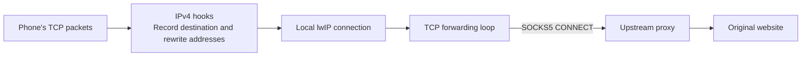

# Implementation and development

[English](development.md) · [简体中文](development.zh-CN.md) · [日本語](development.ja.md)

Start with the [user guide](../README.md) to configure the gateway, or the [source-build guide](build-and-flash.md) to compile it. This page explains the implementation, source layout, host regressions, and optional tools. Commands run from the project root unless noted.

## A simple view of the implementation

`main/` defines gateway behavior using ESP-IDF's Wi-Fi, `esp_netif`, socket, HTTP, and NVS APIs. **FreeRTOS is the scheduler included in ESP-IDF**, running TCP/UDP and maintenance tasks with queues/locks. **lwIP is its TCP/IP stack**, handling IPv4, TCP handshakes, retransmission, and related protocols. The application chooses forwarding behavior, the SDK provides drivers/services, FreeRTOS schedules execution, and lwIP handles networking. No separate operating-system installation is needed on the board.

Think of the ESP32 as an intermediary that receives and passes on data:

- **TCP**, used by many webpage connections, provides reliable transport. The gateway remembers the client's intended destination, asks the proxy to connect using SOCKS5 `CONNECT`, and returns the response to the client.
- **UDP**, used by ordinary DNS queries and some real-time traffic, uses `UDP ASSOCIATE` to obtain relay information. Forwarded packets carry their destination, and separate flows keep their own state.
- **DNS** converts names into IP addresses. Default DHCP tells clients to use `1.1.1.1`. The ESP32 does not run a local DNS service; ordinary DNS UDP traffic is forwarded through SOCKS5 too.
- **NVS** is the area of Flash used for persistent settings. That is why settings survive normal restarts and application flashing does not automatically replace existing network settings.

Total capacity is 64 active TCP relays and 32 UDP flows. The 512 destination/closing-state mappings have limits of 256 retained mappings and 16 initial mappings awaiting listener acceptance per client slot; **this does not mean 512 simultaneous forwarded TCP connections**. lwIP handles underlying TCP behavior, such as retransmission, while fixed application loops service multiple connections.

## Follow one webpage's TCP connection

**Why change `ip4.c`?** A client's website request is addressed to a remote host, so an ordinary local application socket does not receive that TCP connection. The patch adds an input hook after IPv4 validation and before local-address acceptance, allowing the gateway to record/rewrite the destination, plus an output hook after header preparation and before network-interface output to restore the remote address. Rewriting uses private packet copies so lwIP's retransmission buffers stay intact. Opening a SOCKS5 socket alone cannot provide the interception/address restoration used here, while the application need not reimplement TCP. See [ESP-IDF's lwIP documentation](https://docs.espressif.com/projects/esp-idf/en/latest/esp32s3/api-guides/lwip.html).

Suppose a phone connects to a website at `203.0.113.10:443`; this address is just an example:

1. The phone sends packets to its default gateway, the ESP32.
2. The project-local lwIP patch calls gateway code from the IPv4 processing path. It validates the packet, records the client and original destination, redirects the TCP packet to a local ESP32 listener, and updates checksums so the receiver can validate the packet.
3. lwIP handles this local TCP connection. The application reads data through a socket, a programming interface for sending/receiving network data, rather than implementing TCP handshakes and retransmission itself.
4. The TCP forwarding loop negotiates SOCKS5 NO AUTH and sends `CONNECT`, asking the proxy to connect to the original destination. It then passes data between the two connections.
5. TCP packets returning to the phone use the mapping to restore the original remote address and correct their checksums. The phone still sees a connection to the website.



“Transparent” describes the client's experience. Raw TCP packets are not simply inserted into SOCKS5; lwIP handles the connection, and the gateway forwards its data. HTTPS encryption remains between browser and website; the gateway does not decrypt webpage content.

## UDP, concurrency, and saved settings

UDP has no TCP-style connection setup, but SOCKS5 UDP forwarding still needs a TCP control connection. Each UDP flow records its client/destination, negotiates `UDP ASSOCIATE`, and sends UDP data with a SOCKS5 destination header to the relay. Replies are checked against the flow and client identity before delivery. The code reserves some capacity and negotiation opportunities for DNS, reducing cases where other UDP traffic prevents name resolution by exhausting resources.

TCP and UDP each use a fixed forwarding loop: check which connections can send/receive, handle a portion of data, then service others. There is no task per connection. Queues and wait times are bounded; larger TCP data buffers use PSRAM, while frequently accessed TCP state stays in internal RAM. This controls memory use without removing radio or total connection limits.

Configuration management stores current and previous settings. New network settings are tried first, kept after confirmation, or rolled back on timeout. Management/maintenance tasks are separate from forwarding loops, so viewing status does not restart the proxy for each page request. Each client has a connection identity and counters to identify reply ownership and clean up connections when it leaves.

Clients must obtain their IPv4 address through the ESP32's DHCP server: manually assigned static IPs are not registered for forwarding. Client identities protect against stale replies after reconnecting, but are not authentication against IP spoofing. Traffic counters measure relayed TCP/UDP **payload bytes**, excluding protocol headers; they are not radio byte counters or proof of delivery to an application.

The management server bounds network receive/send time to **5 seconds per request**, with a 1024-byte request-body limit. Rejected or partially read bodies close the connection instead of draining an arbitrary amount of data. This bounds network stalls in the HTTP task that also handles configuration rollback. Unsaved Internet-check preferences remain in the form during status polling; event names follow the page language.

To explore the source, start with the matching modules:

| Topic | Main source files |
| --- | --- |
| Startup, AP/STA, and network events | [app_main.c](../main/app_main.c) |
| TCP input, address rewriting, and destination records | [tcp_poc.c](../main/tcp_poc.c), [packet_rewrite.c](../main/packet_rewrite.c), [flow_table.c](../main/flow_table.c) |
| TCP SOCKS5 negotiation and bidirectional forwarding | [socks_relay.c](../main/socks_relay.c) |
| UDP interception, association, and packet format | [udp_gateway.c](../main/udp_gateway.c), [udp_relay.c](../main/udp_relay.c), [socks_udp.c](../main/socks_udp.c) |
| Client ownership and counters | [ap_clients.c](../main/ap_clients.c) |
| Settings, confirmation, and rollback | [gateway_settings.c](../main/gateway_settings.c), [web_management.c](../main/web_management.c) |
| HTTP transport deadlines and connection cleanup | [management_http.c](../main/management_http.c) |
| Maintenance jobs and connectivity checks | [gateway_control.c](../main/gateway_control.c), [gateway_probe.c](../main/gateway_probe.c) |

See [architecture](architecture.md) for the complete packet path and module responsibilities. For a first setup, learn the configuration steps first and explore the implementation when useful.

## Run the existing regression tests

“Host tests” compile and execute parts of the C implementation on your development computer; no ESP32 board is needed. Build the firmware successfully once first so the pinned cJSON source exists in `managed_components/`.

On Linux, in an activated ESP-IDF project terminal, make system GCC/binutils and Node.js available, then run:

```bash
# Remember the current interpreter before PATH changes select another Python.
HOST_PYTHON="$(command -v python)"
PATH=/usr/bin:/bin:$PATH "$HOST_PYTHON" -m unittest discover -s tests -v
node tests/management_feedback_harness.js
node tests/management_transport_harness.js
```

The ESP-IDF Python environment includes pyserial/esptool, which the UART tests need. Run the full suite and inspect its actual test count, failures, and skips; it covers firmware/tool host regressions, lwIP preparation, and frontend feedback/compatibility. The preparation tests use isolated temporary Git repositories to cover LF/CRLF, repeat operations, read-only checks, and rejection of unexpected edits. HTTP deadline tests use real host sockets; serial echo/prompt tests use a pseudo-terminal with a mocked UART driver. Check actual counts, failures, and skips. Passing these checks does not replace Wi-Fi, power-loss, or long-running hardware tests.

## Optional real-browser checks

The regular Node harnesses above do not require a browser or npm dependencies. To test the actual HTML in Chromium on Linux, install Playwright into a temporary host-only folder. This checks English/Chinese desktop and mobile layouts with mocked APIs; it does not access the board. Browser downloads and Chromium system libraries are optional development requirements.

```bash
BROWSER_TEST_TOOLS="$(mktemp -d)"
npm install --prefix "$BROWSER_TEST_TOOLS" --no-package-lock playwright@1.62.1
PLAYWRIGHT_BROWSERS_PATH="$BROWSER_TEST_TOOLS/browsers" "$BROWSER_TEST_TOOLS/node_modules/.bin/playwright" install chromium
NODE_PATH="$BROWSER_TEST_TOOLS/node_modules" PLAYWRIGHT_BROWSERS_PATH="$BROWSER_TEST_TOOLS/browsers" node tests/management_browser_harness.js
```

## Tools at a glance

Run these from the project root. Only lwIP preparation is required for a firmware build; the others are optional troubleshooting/development tools. See the [tool usage guide](../tools/README.md) for complete commands, platform limits, and test setup.

| Tool | Use |
| --- | --- |
| `package_firmware.py`, `flash_firmware.py` | Create factory/app images and script-free ZIPs; optional repository helper verifies and flashes split images |
| `prepare_lwip.py` | `apply` prepares the override, `check` verifies it, `restore` reverses the local patch |
| `uart_capture.py` | Save serial logs; Linux/WSL2 can also send commands with `--interactive` |
| `probe_upstream_udp.py`, `probe_upstream_quic.py` | Test SOCKS UDP/DNS or QUIC from the computer directly; these bypass the ESP32 |
| `test_stream_server.py`, `throughput_bench.html` | Host a LAN test service/page to measure throughput from an AP client |
| `test_transparent_echo.py`, `test-transparent-echo.ps1` | Check transparent TCP using a dedicated echo target; a normal HTTPS website is not an echo service |
| `collect_link_bench.py`, `snapshot_manifest.py` | Extract supported diagnostic UART reports; create/check a local file inventory |

## Repository layout and further reading

| Path | Contents |
| --- | --- |
| `main/` | Firmware source and embedded management pages |
| `patches/` | lwIP patch and revision/hash metadata |
| `tools/` | Patch preparation, UART capture, network probes, and benchmarks |
| `tests/` | C/Python host tests and JavaScript frontend tests |
| `examples/` | Complete Xray client example, field placement guide, and configuration fragments |
| `sdkconfig.defaults` | Initial hardware and feature defaults |
| `dependencies.lock` | Firmware component version record |
| `docs/` | Architecture, maintenance, performance, and development notes |

- [Documentation index](README.md)
- [Maintenance and recovery](maintenance.md)
- [Performance and validation](performance.md): full measurement records, memory samples, and validation limits.
- [Development history](history/README.md): includes experiments that were later reverted. For everyday behavior, prefer the [user guide](../README.md) and current guides in this directory.

`sdkconfig`, `build/`, `managed_components/`, the local lwIP copy, and test outputs are generated. Check `git status` before committing; keep Wi-Fi passwords, personal configuration, logs, and local firmware artifacts out of the repository.

## Serial capture

On Linux/WSL2, capture logs and send line-based commands through one connection from the project root:

```bash
python tools/uart_capture.py --port /dev/ttyACM0 --no-reset --interactive --timestamps --seconds 0
```

The tool's `--interactive` stdin handling is POSIX-only and sends a line after Enter. On Windows, use `idf.py -p COM5 monitor` or a serial terminal for commands; log-only capture works with `--port COM5` and without `--interactive`. Timestamped capture displays prompts/echo immediately, even before a newline. Exit other serial tools first. `--seconds 0` reads until interrupted. `--no-reset` avoids the tool's active reset, but adapter/driver behavior can still affect reset signals.
