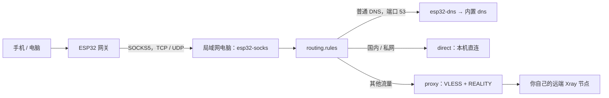

# Xray 配置示例

这里包含一份完整的 **Xray 客户端配置**，以及用于合并到已有配置的片段。配置文件里的出站字段叫 `outbounds`，不是 `output`。

从 [xray-client-reality.json](xray-client-reality.json) 开始阅读：它运行在局域网电脑上，为 ESP32 提供 SOCKS5 入口，再连接你自己的 VLESS + TCP + REALITY 远端节点。它不是远端服务端配置，也不需要放入 ESP32 固件；ESP32 仍只与电脑上的 SOCKS5 服务通信。



## 先替换示例参数

这是一份**结构完整的模板**，使用 `<...>` 明确标出待填写的参数，不包含可用节点地址或凭据。将它复制为独立的 `config.json`，先不要覆盖正在使用的配置；替换所有占位符后，再执行配置检查和启动。替换时保留 JSON 的双引号，删除值中的尖括号。

表中的 `[0]` 表示数组里的第一个对象；`outbounds[0]` 在本例就是 `tag: proxy` 的对象。

| 配置位置 | 占位符或示例值 | 应填写什么 |
| --- | --- | --- |
| `inbounds[0].port` | `7897` | 提供给 ESP32 的 SOCKS5 端口 |
| `inbounds[0].settings.ip` | `<LAN_IPV4>` | 运行 Xray 的电脑 LAN IPv4；供 SOCKS5 回复 UDP 中继地址 |
| `outbounds[0].settings.vnext[0].address` | `<REMOTE_ADDRESS>` | 远端节点实际地址；首次配置建议直接用 IPv4，减少解析依赖 |
| `outbounds[0].settings.vnext[0].port` | `443` | 远端 VLESS 监听端口，与本地 SOCKS5 端口不同 |
| `outbounds[0].settings.vnext[0].users[0].id` | `<VLESS_UUID>` | 远端节点分配给你的 UUID |
| `outbounds[0].streamSettings.realitySettings.serverName` | `<REALITY_SERVER_NAME>` | 节点指定的 SNI；须符合服务端允许的名称 |
| `outbounds[0].streamSettings.realitySettings.publicKey` | `<REALITY_PUBLIC_KEY>` | 服务端 REALITY 的 X25519 公钥，不是私钥；分享链接常写作 `pbk` |
| `outbounds[0].streamSettings.realitySettings.shortId` | `<REALITY_SHORT_ID>` | 服务端允许的一个短 ID；分享链接常写作 `sid` |

LAN 地址从本机网络设置获取；远端地址、端口、UUID、SNI、公钥和短 ID 从你自己的节点配置或服务提供方获取。同一套节点参数必须匹配，不要复制官方示例中的值，也不要把服务端私钥填入客户端。`7897`、`443` 是数值类型的示例端口，应按实际配置调整；`<...>` 不是 Xray 的变量语法，不会自动展开。

DNS 中的阿里和 Cloudflare 地址沿用本仓库的 [DNS 片段](xray-dns-settings.json)，是明确选择的公共解析服务，不是远端 VLESS 节点参数；可按自己的 DNS 策略调整。`0.0.0.0` 则是本机监听地址。

`settings.ip` 不是 ESP32 的 AP 地址 `192.168.4.1`，也不是 ESP32 的 STA 地址。电脑更换地址后要同步修改它。随后在 ESP32 管理页面填写这台电脑的 IPv4 和实际 SOCKS5 端口（本例为 `7897`）。

本例 `listen: 0.0.0.0` 监听本机所有 IPv4 接口，便于 LAN 接入；也可以改为实际 LAN 地址以限制监听接口。它使用固件要求的 `auth: noauth`、`udp: true`，应通过防火墙仅允许可信 LAN / ESP32 接入，并允许 Xray 返回的 UDP 中继端口，不向公网转发这个入口。

客户端使用 `xtls-rprx-vision-udp443`，对应服务端用户的 `flow` 应为 `xtls-rprx-vision`。客户端的 `-udp443` 选项允许 UDP 443；普通 Vision 会拦截该端口以促使浏览器改用 TCP。是否能实际使用 QUIC，还取决于远端节点、网络和应用，不能仅凭此字段保证。

## 五个顶层块分别负责什么

`{}` 表示一个对象，`[]` 表示数组。`inbounds`／`outbounds` 中的每个对象有自己的 `protocol` 和 `settings`；这些 `settings` 互相独立，字段由各自的协议决定。

| 顶层块 | 作用 | 与其他块的关系 |
| --- | --- | --- |
| `log` | 控制日志详细程度 | 本例用 `warning`；排查时可临时用 `info` |
| `dns` | Xray 内置的域名解析器 | 由 DNS 出站导入 A/AAAA 查询；`dns.tag` 标记它发出的非 local 查询 |
| `inbounds` | 入口数组：接收 ESP32 的 SOCKS5 流量 | 每个入口可用 `tag` 命名，供路由匹配 |
| `outbounds` | 出口数组：定义实际怎么发出流量 | 本例为 `proxy`、`direct`、`esp32-dns`；路由通过名称选择 |
| `routing` | 决定一条连接交给哪个出口 | `rules` 从上到下匹配，命中后选择 `outboundTag` |

几个容易放错的位置：

- SOCKS 的 `auth`、`udp`、`ip` 放在**那个 SOCKS 入站的 `settings`** 中，不放在顶层，也不放在 `dns` 中。
- VLESS 的节点地址和用户参数放在**那个 VLESS 出站的 `settings.vnext`** 中；用户的 `id`、`encryption`、`flow` 在其 `users` 数组内。
- `streamSettings` 与这个出站的 `settings` **同级**，描述 TCP 和 REALITY 传输；`realitySettings` 在 `streamSettings` 内。
- `sniffing` 与入站的 `settings` **同级**，不是 SOCKS 的协议设置。
- `routing.rules` 每条规则的 `outboundTag` 必须与某个出站的 `tag` 一致。`dns.tag` 可由规则的 `inboundTag` 匹配，它不代表一个实际的监听端口。

本例将 `proxy` 放在出站数组第一项。未命中任何规则时 Xray 使用第一项作为默认出站；同时保留最后一条 SOCKS → `proxy` 的显式规则，便于读者看清默认策略。不要把 `esp32-dns` 放到第一项，否则普通连接也可能进入 DNS 出站。

## DNS 与路由如何配合

本例复用了现有 DNS 服务器设置，路由顺序为：

1. `esp32-socks` 收到的 TCP/UDP 53 端口请求交给 `esp32-dns`。这里用专用入站名称限定范围，不要求固定 ESP32 的 STA 地址。
2. DNS 出站将 A/AAAA 查询交给顶层 `dns`；其他类型按 `nonIPQuery: skip` 放行给原目标 DNS，不保证享受内置域名分流。
3. 内置 DNS 优先为 `geosite:cn` 使用阿里的 `https+local://`，为 `geosite:geolocation-!cn` 使用 Cloudflare 的 `https://1.1.1.1/dns-query`。Cloudflare 请求带有 `esp32-dns-upstream` 标记，由第二条路由交给 `proxy`。
4. 普通流量再依次匹配私网 IP、国内域名、国内 IP，交给 `direct`；其余 SOCKS 流量交给 `proxy`。

DNS 两条路由放在私网／国内 IP 规则前面，确保明文 DNS 先被接管。`https+local://` 和 `localhost` 使用电脑本机网络／系统 DNS，不经过上述 `proxy` 规则；`disableFallback: false` 允许失败后尝试其他解析器，因此本例不是严格的 DNS 隔离策略。Cloudflare 用 IP 形式的 DoH 地址，是为了避免先解析 DoH 域名的依赖。

顶层 `dns` **不会自动在电脑的 UDP 53 端口开一个 DNS 服务**，也不会改变 ESP32 的 DHCP 配置。终端仍可使用固件默认的 `1.1.1.1`，这些明文 DNS 报文经 SOCKS5 到达 Xray 后才被接管。应用自带的 DoH、DoT 等加密 DNS 不匹配普通端口 53 规则。

ESP32 送来的普通连接目标通常是 IP。`sniffing` 可从部分 HTTP、TLS、QUIC 流量中获取域名供路由，`routeOnly: true` 只改变路由判断，不改原始目标 IP。取不到域名时，仍可按目标 IP 匹配；`IPIfNonMatch` 是在需要时将已有域名解析成 IP，不是把任意 IP 反查成原域名。

## 原有片段应该放在哪里

这些片段用于已有配置的合并，**不要再逐个追加到完整示例中**，否则会重复 DNS 出站或路由。合并数组是添加对象，合并对象是更新字段，不是用一个片段覆盖整份配置。

| 原有文件 | 配置位置 | 说明 |
| --- | --- | --- |
| [xray-socks-settings.json](xray-socks-settings.json) | SOCKS 入站的 `settings` | 仅协议设置，外层还需要 `protocol`、监听地址和端口 |
| [xray-dns-settings.json](xray-dns-settings.json) | 顶层 `dns` 对象 | 不是入站／出站的 `settings` |
| [xray-esp32-dns-outbound-compat.json](xray-esp32-dns-outbound-compat.json) | `outbounds` 数组中的一个对象 | 本完整示例使用的兼容写法 |
| [xray-esp32-dns-outbound-current.json](xray-esp32-dns-outbound-current.json) | 同一个 DNS 出站对象的替代写法 | 只用于确认支持 `settings.rules` 的新版内核，与 compat 二选一 |
| [xray-esp32-dns-route.json](xray-esp32-dns-route.json) | `routing.rules` 数组前部的一条规则 | 原片段按 ESP32 STA 源 IP 限定；完整示例改按 `esp32-socks` 入站名称限定 |
| [xray-doh-route.json](xray-doh-route.json) | `routing.rules` 数组前部的一条规则 | 将内置 DNS 的非 local 查询交给 `proxy` |

本例采用 `settings.vnext[].users[]` 和 `nonIPQuery: skip` 的兼容结构。较新的官方示例／文档可能使用简化的 VLESS 设置或 DNS `settings.rules`，不要将不同写法混在同一个对象里。旧内核可能忽略不认识的字段；仅通过 JSON 语法检查或 `run -test`，不能证明新版字段已经生效。若使用新版 DNS 出站，替换整个 DNS 出站对象，并核对实际内核版本和行为。

## 检查与启动

从 [Xray-core 官方 Releases](https://github.com/XTLS/Xray-core/releases) 获取对应系统的程序。将修改后的 `config.json` 和官方包中的 `geoip.dat`、`geosite.dat` 放在程序目录：本例的 `geoip:`／`geosite:` 规则需要这些分类数据。若 GUI 客户端自动生成配置，应使用其导入／自定义配置入口，避免手动编辑的文件被覆盖。

确认 `config.json` 中已没有 `<...>` 占位符后，在**程序目录**先检查，再运行。Windows PowerShell：

```powershell
.\xray.exe version
.\xray.exe run -test -config .\config.json
.\xray.exe run -config .\config.json
```

Linux Bash：

```bash
./xray version
./xray run -test -config ./config.json
./xray run -config ./config.json
```

未替换的模板是合法 JSON，但不是有效的 Xray 运行配置：`run -test` 报地址、UUID、公钥或短 ID 格式错误是预期结果，先核对上表。替换后显示 `Configuration OK` 只表示内核接受配置，不保证节点可联网。启动后，先从 ESP32 的管理页运行连接诊断，核对 SOCKS5 NO AUTH、UDP DNS，再测试普通网页。若需排查，可临时将 `loglevel` 改为 `info`，检查流量实际选择的出口。

验证记录：在不提交的临时副本中，用本机回环地址、文档保留地址和临时生成的测试值替换占位符，在 Linux x86_64 的 **Xray 26.1.18、26.3.27** 上通过 `run -test`；未替换的模板在两版内核上均被拒绝。功能测试另用临时配置，将监听地址、`proxy` 后端及 `dns.servers` 换为本地端点，验证了 NO AUTH、TCP 网页请求、UDP 回显、DNS A 查询接管和三个出站的路由选择。测试没有使用真实远端凭据，因此未验证公网 REALITY 握手、实际 DoH 服务、Windows 实机或 ESP32 的实际联网。

## 官方参考

- [官方 VLESS + TCP + XTLS Vision + REALITY 客户端示例](https://github.com/XTLS/Xray-examples/tree/main/VLESS-TCP-XTLS-Vision-REALITY)：本例参考其客户端传输结构，再加入本项目的 LAN SOCKS5、DNS 与路由。
- [SOCKS 入站](https://xtls.github.io/en/config/inbounds/socks.html)、[内置 DNS](https://xtls.github.io/en/config/dns.html)、[DNS 出站](https://xtls.github.io/en/config/outbounds/dns.html)。
- [路由规则](https://xtls.github.io/en/config/routing.html)、[入站及 sniffing](https://xtls.github.io/en/config/inbound.html)、[VLESS 出站与 UDP 443](https://xtls.github.io/en/config/outbounds/vless.html)。
- [Xray 26.3.27 DNS 配置解析](https://github.com/XTLS/Xray-core/blob/v26.3.27/infra/conf/dns_proxy.go)：确认该版本使用 `nonIPQuery`，不使用新版 `settings.rules`。
